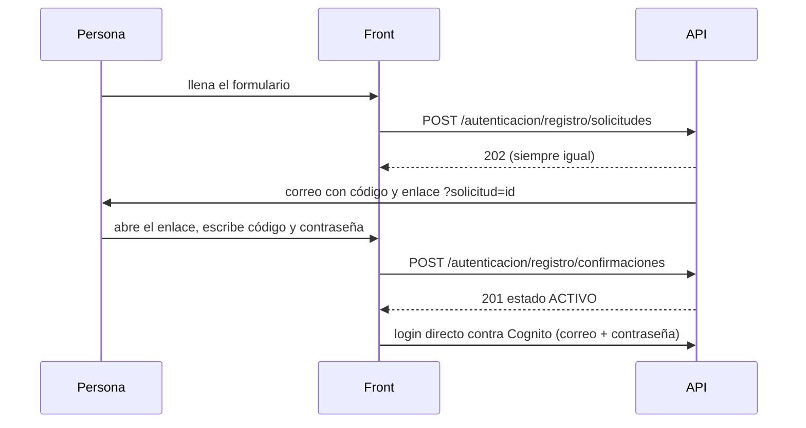

# Autenticación

Contrato de las rutas de cuentas de LogiGho. Dominio dueño: `autenticacion` (código en `Lambdas_NET_LogiGho/LambdasLogiGho.Aplicacion/AWS/Autenticacion/`). Estado (2026-11-02): **desplegado y probado en PreProd** lo de `createUser`, `users` y el registro; el **cambio de contraseña con código** y la **asignación de acceso** quedan activos al completar los PR 576 y 577 del repo de lambdas. Producción se sube junto con el front, después del aval de Iker.

## Entorno de PreProd (para construir y probar el front)

| Dato | Valor |
|---|---|
| Base del API | `https://8u5isw5u30.execute-api.us-east-1.amazonaws.com/PreProd` |
| User pool de Cognito | `us-east-1_NtFz4uKGk` |
| App client (sin secreto) | `37n1vom76u3godto2losctoh2v` |
| Correos de prueba | SES está en *sandbox*: solo llegan correos a direcciones verificadas. Verificadas: `ikeracevedowrk+registro1@gmail.com`, `ikeracevedowrk+registro2@gmail.com` y `ikeracevedowrk+prueba1tienda@gmail.com` (los tres llegan al mismo buzón). Otra dirección no recibe el código |
| Remitente de los correos | `Equipo Seguridad LogiGho <no-reply@logigho.com>` (no tiene buzón: las respuestas no las lee nadie) |
| CORS | `*` (decisión de Iker; la identidad va en el header `Token`, no en cookies) |

Estos identificadores no son secretos; ya van en el bundle del front.

## Cómo se autentica una persona

1. El front inicia sesión directo contra **Cognito** (SRP) con el user pool de LogiGho. No hay una ruta de login en el API.
2. Cognito devuelve un `id_token` (JWT RS256). El front lo guarda en `sessionStorage` (`id_token`).
3. Cada llamada del usuario al API manda ese token en el header **`Token`** (no en `Authorization`).
4. La lambda verifica el token (firma con las llaves públicas del pool, emisor, `token_use`, vigencia y que el `client_id` sea uno de los autorizados). Un token falso o vencido responde `401`.
5. El **rol** del usuario nunca sale del token ni del cuerpo: la lambda lo lee de la colección `Users`, buscando por `cognitoId` (el `sub` del token).

!!! warning "`headersecurity` no es autenticación"
    El header `headersecurity` viaja dentro del bundle de Angular, así que cualquiera lo conoce. Las rutas de este dominio **lo ignoran**. Sigue viajando en otras rutas mientras se migran una a una (backlog M-193).

## Formato de respuesta de error

Las lambdas del dominio responden JSON con esta forma:

```json
{ "Error": true, "Codigo": "PROHIBIDO", "Mensaje": "No tienes permiso para crear usuarios.", "Motivos": null }
```

- `Codigo` es estable y sirve para decidir qué mostrar. `Mensaje` es texto para la persona.
- `Motivos` solo trae datos útiles y seguros (motivos de la política de contraseña, roles rechazados, campos rechazados). Nunca trae la contraseña ni datos internos.
- Un error inesperado responde `500 ERROR_INTERNO` sin detalle. El detalle queda en los logs del servidor, también sin datos personales.

## Política de contraseña

La misma que exige el user pool: **8 a 256 caracteres**, al menos una minúscula, una mayúscula, un número y un símbolo, sin espacios al inicio ni al final y sin caracteres de control. Símbolos válidos: `^ $ * . [ ] { } ( ) ? " ! @ # % & / \ , > < ' : ; | _ ~ ` = + -`.

Cuando falla, la respuesta es `400 POLITICA_CONTRASENA` y `Motivos` lista una o varias de estas claves:

| Clave | Significado |
|---|---|
| `Vacia` | No se envió contraseña |
| `Corta` / `Larga` | Menos de 8 o más de 256 caracteres |
| `SinMinuscula` / `SinMayuscula` / `SinNumero` / `SinSimbolo` | Falta ese tipo de carácter |
| `EspaciosExtremos` | Empieza o termina con espacio |
| `CaracteresInvalidos` | Lleva caracteres de control |

## Quién puede qué

| Acción | Roles |
|---|---|
| Crear usuarios y editar sus datos | `Administrador`, `Comercial`, `CEO`, `Desarrollador` |
| Dar o cambiar roles y tiendas de usuarios **existentes** | `Administrador`, `Desarrollador` |
| Al **crear**, asignar roles que no son de administración | Todos los de la primera fila |
| Al crear, asignar `Administrador`, `Comercial`, `CEO` o `Desarrollador` | Solo `Administrador` y `Desarrollador` |
| Dar acceso (roles y tiendas) a **cualquier** cliente desde la vista de clientes de Comercial | `Administrador`, `Desarrollador` (todos los roles) y `Comercial`/`CEO` (solo los de la lista configurable `ROLES_ASIGNABLES_COMERCIAL`: hoy `Tienda`, `Inversionista`, `Proveedor`, `Dropshipping`) |
| Cambiar la propia contraseña | Cualquier usuario autenticado, con su contraseña actual **y un código enviado a su correo** |
| Editar los propios datos de contacto | Cualquier usuario autenticado |

Las listas salen de las variables `ROLES_ADMINISTRACION` y `ROLES_GESTION_PRIVILEGIOS` de cada lambda; si faltan, nadie puede nada. Los nombres de rol se comparan exactos (sin ignorar mayúsculas).

---

## `POST /createUser` — crear un usuario

Requiere header `Token` de una persona con rol de administración.

**Body** (la misma forma que ya envía la vista de usuarios):

```json
{
  "Usuario": {
    "email": "nuevo@tienda.com",
    "numTelefono": "3001234567",
    "tipoDocumento": "CC",
    "documento": "123456789",
    "autorizaDatos": true,
    "roles": ["Tienda"],
    "tiendas": ["TIENDA1"]
  },
  "Contrasena": "Segura#2026x",
  "TipoUsuario": "Tienda"
}
```

- `numTelefono` y `documento` pueden ir como texto o número.
- `TipoUsuario` es una etiqueta opcional de texto libre (`custom:TipoUsuario` en Cognito); **no decide ningún permiso**. Si no hay un valor real, no lo envíes o envía `N/A`. Los valores de los ejemplos (`Interno`, etc.) no significan nada.
- El `username` que mande el front **se ignora**: se calcula como el prefijo del correo, en minúsculas.
- Al menos un rol. Ningún texto pasa de 100 caracteres y el correo no pasa de 254.

| Código HTTP | `Codigo` | Cuándo |
|---|---|---|
| 200 | `OK` | Usuario creado en Cognito (contraseña permanente) y en `Users` |
| 400 | `DATOS_INVALIDOS` | Faltan datos o el cuerpo no es válido |
| 400 | `POLITICA_CONTRASENA` | La contraseña no cumple (ver `Motivos`) |
| 401 | `NO_AUTORIZADO` | Sin `Token`, falso o vencido |
| 403 | `PROHIBIDO` | Sin registro en `Users` o sin rol de administración |
| 403 | `ROL_NO_PERMITIDO` | Pidió un rol que su rol no puede asignar (`Motivos` lista los rechazados) |
| 409 | `USUARIO_DUPLICADO` | Ya existe una cuenta con ese correo |
| 500 | `ERROR_INTERNO` | Fallo inesperado. Si el guardado en `Users` falla, la cuenta de Cognito se elimina para no dejar usuarios huérfanos |

No se envía correo a la persona creada: `createUser` no manda mensajes. Cognito no le pide cambiar la contraseña en el primer ingreso.

## Cambio de contraseña con código al correo

Dos pasos, los dos con header `Token`. Solo cambia **la contraseña de quien tiene la sesión**; el código viaja **únicamente por correo** al correo registrado de la cuenta (se lee de `Users`, nunca del cuerpo).

### Paso 1. `POST /cambio-pass/codigo` — pedir el código

Sin cuerpo. Envía un código de 6 dígitos (vigencia **15 minutos**) y devuelve el identificador de la solicitud.

```json
{ "Error": false, "Codigo": "OK", "Mensaje": "Te enviamos un código al correo de tu cuenta.", "Motivos": null, "solicitudId": "kT3...(43 caracteres)" }
```

| Código HTTP | `Codigo` | Cuándo |
|---|---|---|
| 200 | `OK` | Código enviado; guarda `solicitudId` en memoria para el paso 2 |
| 401 | `NO_AUTORIZADO` | Token ausente, falso o vencido |
| 409 | `CUENTA_SIN_CORREO` | La cuenta no tiene correo registrado: pedir ayuda a soporte |
| 429 | `DEMASIADAS_SOLICITUDES` | Menos de 60 segundos desde el último código, o 3 en la última hora |
| 503 | `CORREO_NO_ENVIADO` | SES no pudo enviarlo; reintentar en unos minutos |

### Paso 2. `POST /cambio-pass` — cambiar la contraseña

```json
{ "ContrasenaActual": "La que tiene hoy", "Contrasena": "Nueva#2026x", "Codigo": "123456", "SolicitudId": "kT3..." }
```

| Código HTTP | `Codigo` | Cuándo |
|---|---|---|
| 200 | `OK` | Contraseña cambiada y sesiones anteriores cerradas |
| 400 | `DATOS_INVALIDOS` | Falta algún dato (incluidos `Codigo` y `SolicitudId`) |
| 400 | `POLITICA_CONTRASENA` | La nueva no cumple (`Motivos`). **No gasta intento del código** |
| 400 | `NUEVA_IGUAL_ACTUAL` | La nueva es igual a la actual. No gasta intento |
| 400 | `CODIGO_INVALIDO` | Código incorrecto (máximo **5 intentos** por código) |
| 401 | `NO_AUTORIZADO` | Token ausente, falso o vencido |
| 403 | `CLAVE_ACTUAL_INVALIDA` | La contraseña actual no es correcta (el código **no** se consume: puede reintentar) |
| 410 | `CODIGO_VENCIDO` | Venció, ya se usó, o lo pidió otra cuenta: pedir uno nuevo |
| 429 | `DEMASIADOS_INTENTOS` | 5 intentos fallidos con el código (pedir uno nuevo) o demasiados intentos con la contraseña actual |
| 500 | `ERROR_INTERNO` | Fallo inesperado |

Después de un cambio exitoso Cognito revoca los *refresh tokens*: **el front debe cerrar la sesión local y pedir ingreso con la contraseña nueva**. El `id_token` ya emitido sigue siendo aceptado hasta que venza (máximo 60 minutos en PreProd; observación M-215 pendiente de confirmar).

!!! danger "No registrar estos cuerpos"
    El cuerpo del paso 2 lleva dos contraseñas y un código. El front **no debe** mandarlo a la auditoría genérica (`insertarGenerico` copia el cuerpo a la colección de auditoría). La ruta `cambio-pass` ya está excluida en `RUTAS_SIN_AUDITORIA`; agrega también `cambio-pass/codigo`.

!!! warning "Cambio de contrato"
    Antes `POST /cambio-pass` bastaba con la contraseña actual. Ahora **sin `Codigo` y `SolicitudId` responde 400**. Es lo acordado (M-214).

## `/users` — usuarios (GET, POST, PUT)

Todos los métodos requieren header `Token` y que la persona tenga registro en `Users`.

**`GET /users?page=1&email=...`**: sin cambios en la respuesta (`Resultado` comprimido en gzip y `NumeroPaginas`). Cualquier usuario autenticado puede consultar. Restringirlo por rol queda en el backlog (M-199) porque el front lo usa al iniciar sesión y en listados.

**`PUT /users?_id=<id>`** con un cuerpo parcial de campos a cambiar:

| Campo | Quién lo puede cambiar |
|---|---|
| `_id`, `cognitoId`, `email`, `username`, `createdAt` | Nadie por esta ruta (`400 CAMPOS_PROTEGIDOS`) |
| `roles`, `tiendas`, `idtiendas`, `idMensajero` | Roles de gestión de privilegios, y nunca sobre sí mismos (`403 PRIVILEGIOS_NO_PERMITIDOS`) |
| Cualquier otro | Roles de administración sobre cualquiera; cualquier usuario sobre su propio registro |

Nombres de campo que empiezan con `$` o llevan punto se rechazan (`400 DATOS_INVALIDOS`). Si el `_id` no existe responde `404 NO_ENCONTRADO`.

**`POST /users`**: queda para quien tenga rol de administración y solo con roles que pueda asignar. Un documento nuevo no puede reutilizar el `cognitoId` de una cuenta ya registrada (`409 USUARIO_DUPLICADO`). Para crear personas usa `/createUser`, que además crea la cuenta de Cognito.

## `POST /registerContact` — formulario de contacto (público)

Es el formulario de la landing y no exige sesión. Solo acepta `POST` (los demás métodos responden `405`).

- Cuerpo: un arreglo con 1 a 3 contactos, o un contacto suelto.
- Campos aceptados: `userName`, `email`, `phoneNumber`, `source`, `comienzo`, `city`, `NombreComercio`, `ventasPorMes`, `businessType` (texto de hasta 200 caracteres) e `isColombian` (booleano). Cualquier otro campo se descarta.
- Obligatorios: `userName`, `email` válido y `phoneNumber`.
- `fechaRegistro` y `estado` (`No Contactado`) los pone el servidor; lo que mande el front se ignora.
- Responde `200 OK`, `400 DATOS_INVALIDOS` o `500 ERROR_INTERNO`.

## `POST /obtenerTokenAuth` — token de servicio

La usan **servicios** (Hoko Wallet, Guías, Liquidaciones, intereses de apalancamiento), no el front. Contrato de éxito sin cambios: el cuerpo trae usuario y clave (la clave en Base64) y el token vuelve en el header `Token`. Cambios de seguridad sin romper el contrato: un cuerpo inválido responde `400`, los errores ya no devuelven el mensaje interno de Cognito y se retiró `Access-Control-Allow-Credentials`. La sustitución por credenciales de máquina (OAuth2 `client_credentials`) está en el backlog (M-194).

## Registro por autoservicio con código (spec 008)

Rutas **públicas** (sin `Token`). La persona se registra, recibe un código de 6 dígitos por correo, define su contraseña y **queda activa de inmediato con el rol `Red social`** (sin tiendas). Después Comercial le da el acceso real desde su vista de clientes (siguiente sección). No hay aprobación previa.



### `POST /autenticacion/registro/solicitudes`

Usa **los mismos nombres de campo del formulario público de contacto** (`/registerContact`), más `autorizaDatos`:

```json
{
  "userName": "Ana Pérez",
  "email": "ana@tienda.com",
  "phoneNumber": "3001234567",
  "source": "Instagram",
  "comienzo": "Ya vendo",
  "city": "Bogotá",
  "NombreComercio": "Tienda Ana",
  "ventasPorMes": "10-50",
  "businessType": "Moda",
  "isColombian": true,
  "autorizaDatos": true
}
```

- Obligatorios: `userName`, `email` válido, `phoneNumber` y `autorizaDatos: true`. Los demás son opcionales. Textos de hasta 200 caracteres; cuerpo de hasta 16 KB; un campo con tipo equivocado es `DATOS_INVALIDOS`.
- El correo se pasa a minúsculas.
- **Responde 202 con el mismo cuerpo exista o no el correo** (para que nadie descubra qué correos están registrados). Si el correo ya tiene cuenta no se manda código: se manda un aviso de "este correo ya tiene una cuenta".
- Máximo 3 solicitudes por correo por hora; pasado el límite sigue respondiendo 202 pero no envía nada.

| Código HTTP | `Codigo` | Cuándo |
|---|---|---|
| 202 | `OK` | "Si el correo puede registrarse, recibirás un código." |
| 400 | `DATOS_INVALIDOS` | Falta un obligatorio, `autorizaDatos` no es `true`, tipo equivocado o cuerpo demasiado grande |

**El correo** trae el código, su vigencia (15 minutos), el enlace `{URL_REGISTRO}?solicitud=<solicitudId>` y el aviso "si no fuiste tú, ignora este correo". El enlace **no lleva el código ni el correo**. `URL_REGISTRO` hoy es `https://www.logigho.com/registro` en PreProd; el equipo de front define la ruta final y se cambia con una variable, sin redesplegar código.

### `POST /autenticacion/registro/solicitudes/reenvio`

```json
{ "solicitudId": "kT3..." }
```

Envía un código nuevo; **el anterior deja de servir** y los intentos vuelven a cero. Espera 60 segundos entre envíos y máximo 3 por hora.

| Código HTTP | `Codigo` | Cuándo |
|---|---|---|
| 202 | `OK` | Código nuevo enviado |
| 429 | `DEMASIADAS_SOLICITUDES` | Antes de 60 s o más de 3 por hora |
| 410 | `SOLICITUD_NO_DISPONIBLE` | No existe, venció o ya se usó: empezar de nuevo |

### `POST /autenticacion/registro/confirmaciones`

```json
{ "solicitudId": "kT3...", "codigo": "123456", "contrasena": "Segura#2026x" }
```

Crea la cuenta (Cognito y `Users` con rol `Red social`) y actualiza o crea la fila de `RegisterContact` (`estado: "Registrado en plataforma"`, `userId`), **sin duplicar** el contacto que el formulario de la landing ya haya guardado. Si algo falla al crear, la cuenta de Cognito se borra para no dejar huérfanos.

| Código HTTP | `Codigo` | Cuándo |
|---|---|---|
| 201 | `OK` + `"estado": "ACTIVO"` | Ya puede iniciar sesión con su correo y su contraseña |
| 400 | `POLITICA_CONTRASENA` | La contraseña no cumple (`Motivos`). **No gasta intento** |
| 400 | `CODIGO_INVALIDO` | Código incorrecto; máximo **5 intentos**, después la solicitud se bloquea |
| 400 | `DATOS_INVALIDOS` | Falta `solicitudId`, `codigo` o `contrasena` |
| 409 | `SOLICITUD_YA_USADA` | Esa solicitud ya se usó |
| 409 | `CORREO_YA_REGISTRADO` | Se creó una cuenta con ese correo mientras tanto |
| 410 | `SOLICITUD_VENCIDA` | Venció (15 minutos), no existe o la clave del código fue retirada |
| 429 | `DEMASIADOS_INTENTOS` | Solicitud bloqueada por 5 códigos incorrectos: empezar de nuevo |
| 500 | `ERROR_INTERNO` | Fallo inesperado |

## Asignación de acceso por Comercial (vista de clientes)

Para que Comercial convierta a una persona registrada (`Red social`) en un cliente con acceso real **sin tener la pantalla de usuarios**. Ambas rutas requieren `Token` y rol de administración (`Administrador`, `Comercial`, `CEO`, `Desarrollador`).

### `GET /autenticacion/roles-asignables`

Devuelve los roles que **quien consulta** puede dar. Úsalo para llenar el selector.

```json
{ "Error": false, "Codigo": "OK", "Mensaje": "", "Motivos": null, "Roles": ["Tienda", "Inversionista", "Proveedor", "Dropshipping"] }
```

Para `Administrador` y `Desarrollador` son todos los roles activos; para `Comercial` y `CEO`, solo los de la lista configurable `ROLES_ASIGNABLES_COMERCIAL` (nunca roles de administración). Errores: `401 NO_AUTORIZADO`, `403 PROHIBIDO`.

### `POST /autenticacion/usuarios/{usuarioId}/acceso`

```json
{ "roles": ["Tienda"], "tiendas": ["TIENDA1"] }
```

- `usuarioId`: el `userId` de la fila de `RegisterContact` (se guarda al registrarse) **o** el `_id` del usuario en `Users`. Cualquiera de los dos sirve.
- `roles`: lista no vacía. `tiendas` es opcional: si no se envía, se conservan las que tiene; si se envía, **reemplaza** la lista.
- **Quien asigna solo controla los roles que puede asignar**: los demás roles del usuario se conservan. Y **se quita siempre el rol inicial `Red social`**, salvo que se pida a propósito. Ejemplo: un cliente con `Red social`, a quien Comercial asigna `Tienda`, queda solo con `Tienda`.
- Comercial puede cambiar a **cualquier cliente**, pero no a un usuario con rol de administración, ni a sí mismo.
- Queda un registro en la colección de auditoría (quién, a quién, roles antes y después), sin datos personales.

| Código HTTP | `Codigo` | Cuándo |
|---|---|---|
| 200 | `OK` | Acceso actualizado |
| 400 | `DATOS_INVALIDOS` | Cuerpo roto, `roles` vacío, o nombres en blanco |
| 401 | `NO_AUTORIZADO` | Sin `Token`, falso o vencido (se evalúa **antes** que el cuerpo) |
| 403 | `PROHIBIDO` | Sin registro en `Users` o sin rol de administración |
| 403 | `ROL_NO_PERMITIDO` | Pidió un rol que no puede dar (`Motivos` lista los rechazados) |
| 403 | `AUTO_ASIGNACION_NO_PERMITIDA` | Intentó cambiar su propio acceso |
| 403 | `USUARIO_PROTEGIDO` | Comercial intentó cambiar a alguien con rol de administración |
| 404 | `NO_ENCONTRADO` | No existe ese usuario |
| 500 | `ERROR_INTERNO` | Fallo inesperado |

Para cambiar roles de usuarios que ya tienen acceso, o los de otro administrador, sigue sirviendo la vista de usuarios (`PUT /users`, solo `Administrador` y `Desarrollador`).
