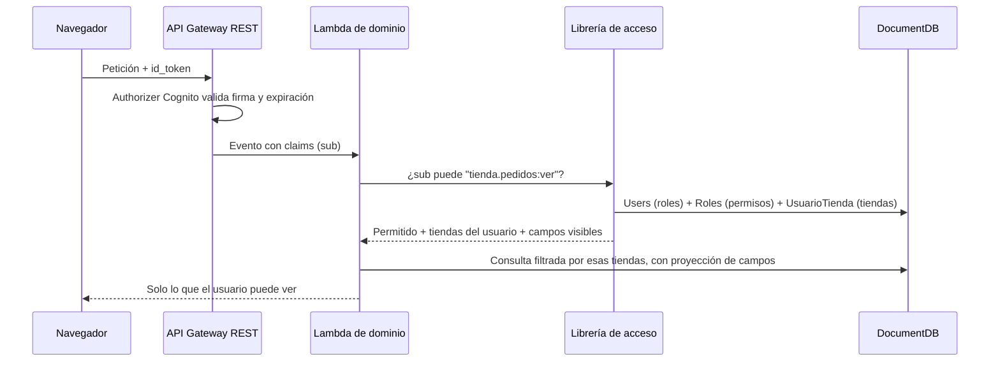

---

## Autor: Iker Acevedo

Fecha creacion: 2026-10-17
Estado: propuesta (pendiente de aprobación)
Tipo: arquitectura transversal

# Seguridad y accesos: modelo objetivo

Este documento define **cómo debe funcionar** la autorización en LogiGho. El inventario detallado de brechas
actuales se mantiene fuera del repositorio mientras se corrigen.

## Principios

1. **El frontend nunca es la barrera.** Ocultar un botón o un menú es experiencia de usuario, no seguridad.
   Todo lo que el navegador recibe, el usuario lo puede ver; toda petición, el usuario la puede modificar.
2. **La identidad sale del token, no de parámetros.** El backend obtiene el `sub` del token validado por
   API Gateway (Cognito). Nunca confía en un `email`, `Tienda` o `roles` enviados por el cliente.
3. **El backend decide qué datos devuelve.** Filtra por las tiendas del usuario y quita los campos que no puede ver
   antes de responder.
4. **Permisos por acción, no por nombre de rol.** El código pregunta `tienda.pedidos:anular-guias`, no
   `roles.includes('CEO')`. Los roles agrupan permisos y se editan sin desplegar.
5. **Mínimo privilegio en infraestructura.** Cada Lambda tiene su propio rol IAM con solo lo que necesita
   (como ya hace `ApiLambdaPublicarReporteAnalytics`) y toda ruta tiene authorizer.
6. **Sin operaciones destructivas genéricas expuestas.** Ninguna ruta pública permite borrar o reemplazar datos de
   cualquier colección.

## Flujo objetivo

## Piezas

| Pieza | Qué es | Estado |
|---|---|---|
| Authorizer Cognito en API Gateway REST | Valida el token en todas las rutas | Existe (`tvqga4` en prod, `slrxdp` en PreProd); falta aplicarlo a todas las rutas |
| `UsuarioTienda` | Qué tiendas ve cada usuario | Existe; ya lo usa `APILambdaConsultarPedidos` |
| `ConfiguracionCamposApi` | Qué campos se devuelven | Existe; ya lo usa `APILambdaConsultarPedidos` |
| Librería de acceso (.NET) | `ObtenerContextoAsync(sub)` devuelve roles, permisos y tiendas | Nueva; extraer de `ApiLambdaConsultarPedidos` y `ApiLambdaPublicarReporteAnalytics` |
| `GET /acceso/mi-menu` | Módulos permitidos del usuario | Nueva |
| `Roles.permisos` | Permisos por rol | Nueva (fase posterior a `mi-menu`) |

## Hacia RBAC sin romper nada

1. **Hoy:** `Modulo.roles` dice qué roles ven cada módulo. `mi-menu` se construye con esa misma información, pero
   en el servidor.
2. **Después:** se agrega `Roles.permisos` generado por script desde `Modulo.roles`. Durante la transición la
   librería lee el formato nuevo y, si falta, el viejo.
3. **Al final:** se elimina `Modulo.roles` y el rol especial `"Todos"` pasa a `Modulo.accesoGeneral: true`.

## Historial de cambios

| Fecha | Autor | Cambio |
|---|---|---|
| 2026-10-17 | Iker Acevedo | Creación de la propuesta |
