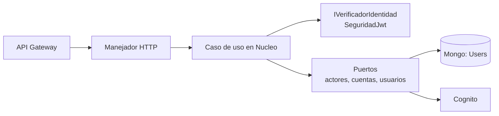

# Dominio autenticación (backend)

Cuentas de usuario de LogiGho: verificación de identidad, permisos, alta de usuarios, cambio de contraseña y, más adelante, registro por OTP. Contrato HTTP: [API de autenticación](../api/autenticacion.md).

## Dónde vive

Todo en `Lambdas_NET_LogiGho/LambdasLogiGho.Aplicacion/AWS/Autenticacion/`, en **.NET 10** salvo lo indicado:

| Carpeta | Qué es | Runtime |
|---|---|---|
| `Autenticacion.Nucleo` | Reglas puras y casos de uso: política de contraseña, de permisos y de edición; verificación de identidad; alta de usuario; cambio de contraseña. Sin AWS ni Mongo | net10.0 |
| `Autenticacion.Nucleo.Tests` | 142 pruebas | net10.0 |
| `ApiLambdaCreateUserCognitoAOT` | `POST /createUser`. Nombre histórico; hoy corre como lambda administrada, no AOT | net10.0, `dotnet10` |
| `ApiLambdaCambioPasswordCognito` | `POST /cambio-pass` | net10.0, `dotnet10` |
| `ApiLambdaUser` | `/users` (GET, POST, PUT) | net10.0, `dotnet10` |
| `ApiLambdaCrudRegistroClienteAOT` | `POST /registerContact` público | net8 AOT (ver abajo) |
| `ApiLambdaTokenCognitoAOT` | `POST /obtenerTokenAuth` para servicios | net8 AOT (ver abajo) |

La librería de verificación de JWT está en `LambdasLogiGho.Infraestructura/SeguridadJwt` (net10.0).

!!! note "Por qué dos lambdas siguen en net8 AOT"
    Pasar una lambda AOT a net10 exige validar la publicación nativa en el pipeline y la reflexión de sus dependencias (Newtonsoft, BSON). Se hará lambda por lambda, con prueba en PreProd, no junto con el cambio de seguridad.

## Arquitectura

Cada lambda es delgada: traduce HTTP al caso de uso y el resultado a HTTP. La regla vive en el núcleo y se prueba sin infraestructura.

Reglas de diseño que se mantienen en cada lambda nueva o modificada:

- La identidad sale del header `Token` verificado (firma, emisor, `token_use`, vigencia, `client_id`).
- El rol sale de `Users` por `cognitoId`; nunca del token ni del body.
- Los permisos vienen de variables de entorno y **fallan cerrados**.
- Errores sin mensaje interno; logs con `[INFO]/[WARN]/[ERROR]`, resultado y tipo de excepción, **sin correos, teléfonos, contraseñas, tokens ni cuerpos**.
- Sin secretos en el repositorio ni en `aws-lambda-tools-defaults.json`.

## Logs que se esperan

| Lambda | Líneas |
|---|---|
| createUser | `[INFO] crear-usuario resultado=Creado`, `[ERROR] crear-usuario excepcion=<Tipo>` |
| cambio-pass | `[INFO] cambio-pass resultado=<ResultadoCambio>` |
| users | `[INFO] users metodo=PUT estado=200`, `[WARN] users metodo=GET resultado=NO_AUTORIZADO` |
| registerContact | `[INFO] registro-contacto resultado=CREADO cantidad=1` |
| obtenerTokenAuth | `[INFO] obtener-token resultado=OK`, `[ERROR] obtener-token excepcion=<Tipo>` |

Buscar problemas en CloudWatch: filtrar por `[ERROR]` y `[WARN]` en el log group de cada lambda.

## Variables de entorno

Las define el pipeline (Library) y se aplican al desplegar. **Ninguna lleva secretos en el repo.**

| Variable | Lambdas | Para qué |
|---|---|---|
| `COGNITO_REGION`, `COGNITO_USER_POOL_ID` | createUser, cambio-pass, users | Pool contra el que se valida |
| `COGNITO_CLIENT_IDS` | createUser, cambio-pass, users | App clients cuyo token se acepta |
| `COGNITO_CLIENT_ID_SIN_SECRETO` | cambio-pass | Client para verificar la contraseña actual |
| `ROLES_ADMINISTRACION`, `ROLES_GESTION_PRIVILEGIOS` | createUser, users | Quién crea/edita y quién cambia privilegios |
| `MONGO_URI`, `MONGO_DATABASE` | createUser | Conexión a `Users` (valor de la Library) |
| `CADENA_CONEXION`, `DATABASE_NAME` | users, registerContact | Conexión que ya usa `DocumentRepository` |
| `ORIGENES_CORS` | todas las nuevas | `*` por decisión de producto (2026-10-31); lista separada por comas cuando haya dominios fijos |

## Despliegue y reversión

1. Ejecutar las pruebas del dominio (`dotnet test` de cada proyecto).
2. Publicar la lambda con runtime `dotnet10` y el handler del `aws-lambda-tools-defaults.json` de su carpeta.
3. Aplicar las variables de la Library.
4. Probar en PreProd con la [guía E2E](../guias/pruebas-autenticacion-e2e.md).
5. Observar una semana en producción. **Reversión:** volver a la versión anterior de la lambda (alias o versión previa); los datos creados permanecen y son compatibles.

Una ruta se cierra a la vez (política M-195). El orden de las demás rutas está en [Rutas y autorización](../arquitectura/rutas-y-autorizacion.md).
