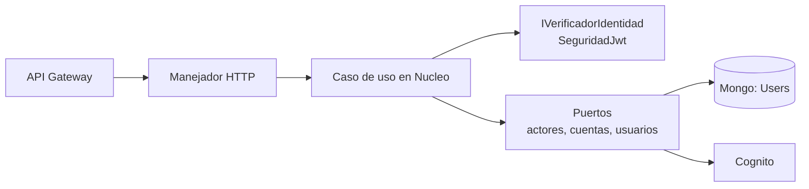

# Dominio autenticación (backend)

Cuentas de usuario de LogiGho: verificación de identidad, permisos, alta de usuarios, registro por autoservicio, recuperación y cambio de contraseña con código al correo, y asignación de acceso por Comercial. Contrato HTTP: [API de autenticación](../api/autenticacion.md).

## Dónde vive

Todo en `Lambdas_NET_LogiGho/LambdasLogiGho.Aplicacion/AWS/Autenticacion/`, en **.NET 10** salvo lo indicado:

| Carpeta | Qué es | Runtime |
|---|---|---|
| `Autenticacion.Nucleo` | Reglas puras y casos de uso: política de contraseña, de permisos y de edición; verificación de identidad; alta de usuario; cambio de contraseña. Sin AWS ni Mongo | net10.0 |
| `Autenticacion.Infraestructura` | Biblioteca (no es lambda) con los adaptadores compartidos: Mongo atómico, SES, Secrets Manager y Cognito | net10.0 |
| `Autenticacion.Nucleo.Tests` | 293 pruebas | net10.0 |
| `ApiLambdaRegistro` | **Única lambda nueva.** Rutas públicas: `POST /autenticacion/registro/solicitudes`, `.../solicitudes/reenvio` y `.../confirmaciones`, y `POST /autenticacion/recuperacion/solicitudes` y `.../confirmaciones` | net10.0, `dotnet10` |
| `ApiLambdaCreateUserCognitoAOT` | `POST /createUser`. Nombre histórico; hoy corre como lambda administrada, no AOT | net10.0, `dotnet10` |
| `ApiLambdaCambioPasswordCognito` | `POST /cambio-pass/codigo` y `POST /cambio-pass` (contraseña actual + código al correo). **Obsoleta desde 2026-11-03**: la reemplaza la recuperación de contraseña; se retira cuando el front confirme que no la usa | net10.0, `dotnet10` |
| `ApiLambdaUser` | `/users` (GET, POST, PUT) y la asignación de acceso (`GET /autenticacion/roles-asignables`, `POST /autenticacion/usuarios/{usuarioId}/acceso`) | net10.0, `dotnet10` |
| `ApiLambdaCrudRegistroClienteAOT` | `POST /registerContact` público | net8 AOT (ver abajo) |
| `ApiLambdaTokenCognitoAOT` | `POST /obtenerTokenAuth` para servicios | net8 AOT (ver abajo) |

La librería de verificación de JWT está en `LambdasLogiGho.Infraestructura/SeguridadJwt` (net10.0).

!!! note "Por qué dos lambdas siguen en net8 AOT"
    Pasar una lambda AOT a net10 exige validar la publicación nativa en el pipeline y la reflexión de sus dependencias (Newtonsoft, BSON). Se hará lambda por lambda, con prueba en PreProd, no junto con el cambio de seguridad.

## Arquitectura

Cada lambda es delgada: traduce HTTP al caso de uso y el resultado a HTTP. La regla vive en el núcleo y se prueba sin infraestructura.

Reglas de diseño que se mantienen en cada lambda nueva o modificada:

- La identidad sale del header `Token` verificado (firma, emisor, `token_use`, vigencia, `client_id`).
- El rol sale de `Users` por `cognitoId`; nunca del token ni del body.
- Los permisos vienen de variables de entorno y **fallan cerrados**.
- Errores sin mensaje interno; logs con `[INFO]/[WARN]/[ERROR]`, resultado y tipo de excepción, **sin correos, teléfonos, contraseñas, tokens ni cuerpos**.
- Sin secretos en el repositorio ni en `aws-lambda-tools-defaults.json`.

## Por qué hay una sola lambda nueva

Regla de Iker (2026-11-02): no llenar el repositorio de lambdas que luego hay que monitorear. Antes de crear una se revisan todas las existentes y se consulta. Aquí:

- **Asignación de acceso** vive dentro de `ApiLambdaUser`: mismo actor (token y rol leído de `Users`), solo Mongo.
- **Cambio de contraseña con código y contraseña actual** (obsoleto) vive en `ApiLambdaCambioPasswordCognito`.
- **`ApiLambdaRegistro` es aparte** porque es **pública** (sin token) y es la única que crea cuentas o cambia contraseñas a partir de un código: mezclarla con una lambda de usuarios con sesión le daría esos permisos a rutas con otra superficie. Por eso la **recuperación de contraseña** (también pública) se agregó aquí en vez de crear otra lambda (decisión 2026-11-03).
- No hay lambda de aprobación ni de rotación: el usuario nace activo con `Red social` y la clave del código se rota a mano.

## Código de un solo uso (OTP)

Un solo motor en `Autenticacion.Nucleo`, usado por el registro, la recuperación y el cambio de contraseña:

- Código de 6 dígitos con `RandomNumberGenerator`; identificador de solicitud de 256 bits (solo se guarda su SHA-256).
- En base queda la **firma HMAC-SHA256** del código (con el identificador como contexto), nunca el código. La clave sale de **Secrets Manager** con dos claves (`actual` y `anterior`) para rotar sin invalidar códigos vivos; la lambda la guarda 5 minutos en memoria.
- Comparación en tiempo constante. 5 intentos por código; vigencia máxima 15 minutos (el código ignora un valor mayor de `OTP_VIGENCIA_MINUTOS`); 60 s entre envíos y 3 por hora por correo.
- Cada cambio de estado es una operación atómica de Mongo con su condición en el filtro (dos confirmaciones simultáneas crean un solo usuario).
- Un código de **registro** no sirve para recuperar una contraseña ni al revés (campo `tipo`: `REGISTRO`, `CAMBIO_PASSWORD` o `RECUPERACION`), y el de recuperación queda atado a la cuenta (`cuentaSub`) que lo pidió. El conteo de solicitudes de registro ignora los otros tipos.

## Datos

| Colección | Uso |
|---|---|
| `RegistroSolicitudes` (**nueva**) | Una fila por código emitido (`tipo` `REGISTRO`, `CAMBIO_PASSWORD` o `RECUPERACION`): hash del identificador, correo, firma, estado, intentos, envíos. **Se borra sola 24 h después** (índice TTL en `borrarEn`). Índices: `solicitudHash` único, `email`+`creadoEn` y el TTL (script en la spec 008) |
| `Users` | Se inserta con rol `Red social` y sin tiendas al confirmar el registro; la asignación de acceso actualiza `roles` y `tiendas` |
| `RegisterContact` | Se actualiza por correo a `Registrado en plataforma` con el `userId` (cognitoId), o se crea si no existía. **Nunca se borra**: es la lista de trabajo de Comercial |
| `Roles` | Solo lectura: los roles activos que se pueden asignar |
| `LogAuditoria` | La asignación de acceso deja quién, a quién y roles antes y después (sin datos personales) |

## Infraestructura (Terraform, `environments/preprod/autenticacion`)

- Rol de ejecución propio por función, con permisos mínimos. `ApiLambdaRegistro` y `cambio-pass` pueden enviar con SES **solo** desde `no-reply@logigho.com` y leer **solo** el secreto de claves. Mientras SES esté en *sandbox* también necesitan permiso sobre la identidad del destinatario (en producción, fuera del sandbox, no hace falta). El rol de `ApiLambdaRegistro` también puede `AdminCreateUser`, `AdminSetUserPassword`, `AdminDeleteUser`, `ListUsers` (busca la cuenta por `sub`) y `AdminUserGlobalSignOut` (cierra sesiones tras recuperar la contraseña), **solo** sobre el user pool del entorno.
- Secreto `logigho/<entorno>/autenticacion/otp-claves`: Terraform crea el contenedor; **el valor no está en el estado** y se escribe con la CLI.
- *Configuration set* de SES `logigho-autenticacion-<entorno>` con métricas de rebote, queja y rechazo.
- Una métrica de CloudWatch por evento de negocio (espacio de nombres `LogiGho/Autenticacion`): `registro.solicitud.recibida`, `registro.solicitud.limitada`, `registro.otp.enviado`, `registro.otp.reenviado`, `registro.otp.invalido`, `registro.solicitud.bloqueada`, `registro.confirmacion.exitosa`, `registro.compensacion.ejecutada`, `registro.ses.fallo`, `registro.contacto.sin_actualizar`, y los de la recuperación: `recuperacion.solicitud.recibida`, `.solicitud.limitada`, `.otp.enviado`, `.otp.invalido`, `.solicitud.bloqueada`, `.exitosa`, `.ses.fallo`, `.aviso.fallo`, `.cuenta.no_encontrada`. En producción llevan alarma a Slack; en PreProd solo se miran.
- Rutas bajo `/autenticacion` en el REST del entorno. Un stage EDGE (CloudFront) **rechaza con 403 un GET que trae cuerpo** antes de llegar a la lambda: las pruebas de humo no deben mandar cuerpo en un GET.

## Operación: rotar la clave del código

1. Leer el secreto (`actual`), copiarlo a `anterior` y escribir una `actual` nueva (32 bytes aleatorios en base64, con un `id` nuevo).
2. Los códigos ya emitidos siguen validando con `anterior`; los nuevos usan `actual`. Pasados 15 minutos se puede quitar `anterior`.
3. La lambda recarga el secreto sola en 5 minutos; no hace falta redesplegar. Rotar cuando se sospeche una filtración y, como rutina, cada 90 días (M-168).

## Correos

Cuatro correos, todos con el diseño "guía de envío" del equipo de front (HTML y texto plano, sin respuesta posible):

| Correo | Cuándo | Asunto |
|---|---|---|
| Código de registro | `POST /autenticacion/registro/solicitudes` y su reenvío | Tu guía de activación de LogiGho |
| Cuenta existente | Solicitud de registro con un correo que ya tiene cuenta | Tu correo ya tiene su lugar en LogiGho |
| Código de recuperación | `POST /autenticacion/recuperacion/solicitudes` (solo si la cuenta existe) | Tu guía de seguridad de LogiGho |
| Contraseña cambiada | Después de `POST /autenticacion/recuperacion/confirmaciones` exitoso | Tu cuenta de LogiGho quedó protegida |

- Las plantillas viven en `Autenticacion.Nucleo/Plantillas/` (`01`–`04`, `.html` y `.txt`) y se rellenan con `{{variable}}`. Para cambiar el diseño se reemplazan esos archivos; no hay que tocar código. Si una plantilla pide una variable que el código no entrega, la lambda falla en vez de enviar el correo a medias.
- En el HTML todo valor (nombre, enlace) se codifica; en el texto va tal cual.
- El nombre sale del `username` de la cuenta (en la recuperación se lee de Users al pedir el código y se guarda en la solicitud para el aviso). Sin nombre se usa "Cliente LogiGho".
- La fecha del aviso va en hora de Colombia (UTC-5), formato `5 nov 2026 · 1:06 p. m.`.
- Las tres imágenes (`logo-tinta.png`, `codigo-barras.png`, `icono-copiar.png`) se leen de `CORREO_URL_IMAGENES`. Si no cargan, el correo se entiende igual (se ve el texto "LogiGho").
- El correo de cambio con sesión (`/cambio-pass`, obsoleto) conserva su texto antiguo hasta que se retire.
- **Por qué así:** dónde viven las plantillas, de dónde sale el nombre, por qué la fecha va en UTC-5, dónde van las imágenes y por qué el botón de copiar no copia solo están razonados, con las alternativas descartadas, en [Decisiones de Autenticación (ADR)](../arquitectura/adr/autenticacion/index.md).

## Logs que se esperan

| Lambda | Líneas |
|---|---|
| createUser | `[INFO] crear-usuario resultado=Creado`, `[ERROR] crear-usuario excepcion=<Tipo>` |
| recuperación | `[INFO] recuperacion.solicitud.recibida`, `[INFO] recuperacion.otp.enviado`, `[INFO] recuperacion.exitosa`, `[WARN] recuperacion.otp.invalido`, `[ERROR] recuperacion.ses.fallo excepcion=<Tipo> detalle=<motivo sin correos>` |
| cambio-pass (obsoleto) | `[INFO] cambio-pass/codigo resultado=<ResultadoCodigoCambio>`, `[INFO] cambio-pass resultado=<ResultadoCambio>`, `[INFO] cambio-pass.otp.enviado`, `[WARN] cambio-pass.otp.invalido` |
| registro | `[INFO] registro estado=<HTTP>` y los eventos de negocio de arriba; `[ERROR] registro.ses.fallo excepcion=<Tipo> detalle=<motivo sin correos>` |
| asignar acceso | `[INFO] acceso metodo=POST estado=200` |
| users | `[INFO] users metodo=PUT estado=200`, `[WARN] users metodo=GET resultado=NO_AUTORIZADO` |
| registerContact | `[INFO] registro-contacto resultado=CREADO cantidad=1` |
| obtenerTokenAuth | `[INFO] obtener-token resultado=OK`, `[ERROR] obtener-token excepcion=<Tipo>` |

Buscar problemas en CloudWatch: filtrar por `[ERROR]` y `[WARN]` en el log group de cada lambda.

## Variables de entorno

Las define el pipeline (Library) y se aplican al desplegar. **Ninguna lleva secretos en el repo.**

| Variable | Lambdas | Para qué |
|---|---|---|
| `COGNITO_REGION`, `COGNITO_USER_POOL_ID` | createUser, cambio-pass, users | Pool contra el que se valida |
| `COGNITO_CLIENT_IDS` | createUser, cambio-pass, users | App clients cuyo token se acepta |
| `COGNITO_CLIENT_ID_SIN_SECRETO` | cambio-pass | Client para verificar la contraseña actual |
| `ROLES_ADMINISTRACION`, `ROLES_GESTION_PRIVILEGIOS` | createUser, users | Quién crea/edita y quién cambia privilegios |
| `MONGO_URI`, `MONGO_DATABASE` | createUser | Conexión a `Users` (valor de la Library) |
| `CADENA_CONEXION`, `DATABASE_NAME` | users, registerContact | Conexión que ya usa `DocumentRepository` |
| `ORIGENES_CORS` | todas las nuevas | `*` por decisión de producto (2026-10-31); lista separada por comas cuando haya dominios fijos |
| `ROLES_ASIGNABLES_COMERCIAL` | users | Roles que Comercial/CEO pueden dar desde la vista de clientes. Sin valor, no pueden asignar ninguno (cierra por defecto) |
| `REGISTRO_ROL_INICIAL` | registro, users | Rol con que nace la cuenta registrada (`Red social`) y que se quita al asignar acceso. En `users` además limita `GET /users` a ese rol (y a quien no tiene roles) a su propio registro |
| `REGISTRO_TIPO_USUARIO` | registro | `custom:TipoUsuario` de Cognito (por defecto `N/A`; sin relevancia funcional) |
| `SES_REMITENTE`, `SES_CONFIGURATION_SET` | registro, cambio-pass | Remitente `Equipo Seguridad LogiGho <no-reply@logigho.com>` y su configuration set |
| `URL_REGISTRO` | registro | Página del front a la que apunta el enlace del correo (`?solicitud=<id>`) |
| `CORREO_URL_IMAGENES` | registro, cambio-pass | Carpeta pública HTTPS con `logo-tinta.png`, `codigo-barras.png` e `icono-copiar.png` de los correos. Opcional: por defecto `https://www.logigho.com/assets/images/correos`. Las direcciones `/app/login` y `/app/recuperar` de los botones van fijas en el código |
| `URL_RECUPERACION` | registro | Página del front del enlace del correo de recuperación (por defecto `https://www.logigho.com/app/recuperar`) |
| `OTP_SECRETO_ID`, `OTP_VIGENCIA_MINUTOS` | registro, cambio-pass | Nombre del secreto de claves y vigencia del código (tope 15) |

## Despliegue y reversión

1. Ejecutar las pruebas del dominio (`dotnet test` de cada proyecto).
2. Publicar la lambda con runtime `dotnet10` y el handler del `aws-lambda-tools-defaults.json` de su carpeta.
3. Aplicar las variables de la Library.
4. Probar en PreProd con la [guía E2E](../guias/pruebas-autenticacion-e2e.md).
5. Observar una semana en producción. **Reversión:** volver a la versión anterior de la lambda (alias o versión previa); los datos creados permanecen y son compatibles.

Una ruta se cierra a la vez (política M-195). El orden de las demás rutas está en [Rutas y autorización](../arquitectura/rutas-y-autorizacion.md).
