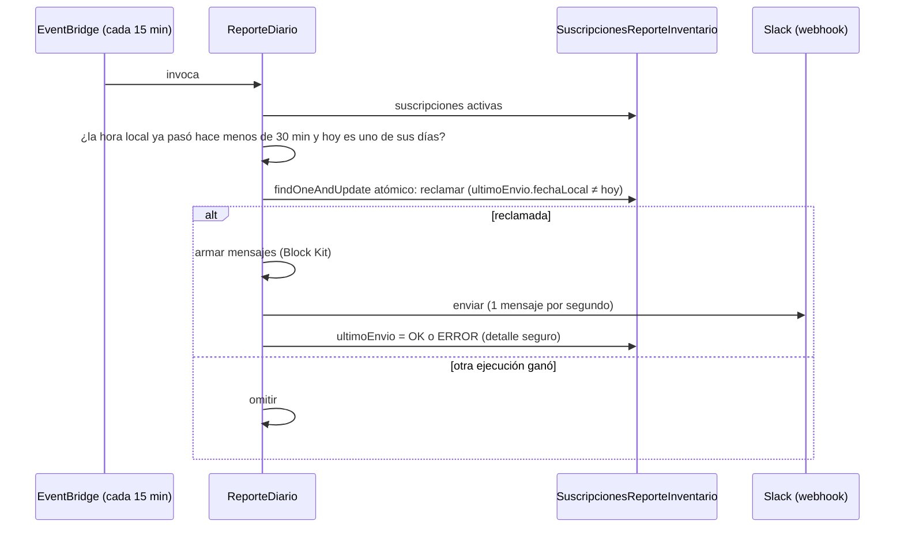

# Inventario — alertas diarias por Slack

**Autor:** Iker Acevedo · **Fecha de creación:** 2026-10-21 · **Estado:** backend listo y desplegado en PreProd; **producción después del go-live del inventario**

Producto nuevo: cada persona recibe en Slack, a la hora que elija, **solo los productos que le importan**, sin entrar a la plataforma. Está diseñado desde el día uno para muchos usuarios (producto vendible) y para más canales después (correo, WhatsApp).

!!! info "Estado"
    - **Confirmado:** código y Terraform probados en local (~142 pruebas nuevas de alertas); 3 funciones desplegadas en PreProd; pantalla «Suscripción inventario» en el menú *Más* del Resumen.
    - **Pendiente:** prueba con el webhook real de Iker y encender la regla en PreProd para ver un envío programado; el front debe conectarse al API real (sin mock); producción (ver [Producción](#produccion)).

## Los dos mensajes

1. **Guías generadas** (antes llamado «despachos del día»). Ejemplo: `Guías generadas — miércoles 21 de octubre: 500 guías · 1.000 unidades`, con tabla `PRODUCTO / GUÍAS / UNIDADES` y total. Sin movimientos: «sin guías».
2. **Resumen de inventario**, una línea por producto y una de total si son varios: `CAMISETA — Bodega 200 · Tránsito 1.203 · Inv. físico $200.000 · Inv. rodante $1.203.000 · Total $1.403.000 (COP)`.
    - Físico = `Actual × PrecioProveedor`; rodante = `max(0, EnTransito × PrecioProveedor)`; total = físico + rodante. Son las mismas cuentas de la pantalla Resumen.
    - «Bodega» = stock actual. Moneda `COP` fija por la variable `ALERTAS_MONEDA` (hoy ni `Productos` ni `Tienda` guardan moneda). Sin decimales para COP/CLP/PYG/UYI/JPY; 2 decimales para el resto.

Los mensajes de prueba llevan `[PRUEBA]` en el título.

## Qué es «despachado»

Por decisión de Iker del 2026-10-21: **la salida registrada en `SalidaInventario.fecha` en el día local de la suscripción, menos las anulaciones registradas ese mismo día.** Unidades = salidas − anulaciones (nunca negativas); guías = guías con salida ese día que no tienen anulación ese día.

!!! warning "Pendiente de definir con el Jefe de Logística (D5)"
    «Despachado» aquí significa *guía generada con salida registrada*, no la `Fecha Despacho` del pedido ni el momento en que la transportadora recoge. Por eso el mensaje se rotuló «Guías generadas». Cambiar la definición toca una sola regla (`AgregadorDespachos`) y la fuente de datos. Límite conocido: `fecha` es texto ISO UTC con `Z`; un documento viejo con otro formato no entra. Ver también [Tareas futuras](tareas-futuras.md#despachado-real).

## Modelo de datos

Colección **`SuscripcionesReporteInventario`** (la crea el primer insert). Cada suscripción guarda el usuario (correo), nombre, activa o pausada, el canal (`slack` + webhook **cifrado** + últimos 4 caracteres), el horario (hora local, zona IANA, días ISO 1–7), los filtros (productos, proveedores, ecosistemas), qué mensajes recibe y el `ultimoEnvio` (`fechaLocal`, `estado`, `detalle`, `enviadoUtc`). Contrato JSON completo: [API de inventario](../../api/inventario.md#inventariosuscripciones-alertas-diarias).

Filtros: `productos ∪ productos de los proveedores ∪ productos de los ecosistemas`, solo productos **activos** (y con `ManejaInventario=true` mientras el filtro de activación esté `on`). **Proveedor = id numérico de la tienda dueña** (`Productos.IdTienda = Tienda.Id`), no el nombre; ecosistema = `Tienda.Ecosistema`. Un id inexistente desaparece sin error. Los filtros vacíos no envían nada (la validación exige al menos uno).

## Cómo funciona el envío

1. EventBridge invoca `ReporteDiarioHandler` **cada 15 minutos**. La regla (`Inventario-<entorno>-ReporteDiario-cada-15-min`) se crea **deshabilitada**; encenderla es decisión de Iker.
2. Una suscripción «toca» si la hora programada (en **su zona**) ya pasó hace menos de `VENTANA_ENVIO_MINUTOS` (30 por defecto, mínimo 15) y hoy es uno de sus días. Mira el día local de hoy **y el de ayer** (un envío de las 23:50 no se pierde si el cron corre a las 00:05).
3. La **reclama** con un `findOneAndUpdate` atómico: si dos ejecuciones se cruzan, solo una gana (probado con 8 ejecuciones simultáneas = 1 envío; misma idea que la clave única). Un reclamo `ENVIANDO` de más de 10 min que nadie cerró se puede volver a reclamar.
4. Arma y envía los mensajes por `SlackCanal` (Block Kit; se parten si no caben en 3.000 caracteres o 50 bloques; reintento de 429/5xx hasta 3 intentos respetando `Retry-After` acotado; 4xx sin reintento).
5. Guarda `ultimoEnvio.estado = OK | ERROR` con un detalle seguro (nunca el webhook). Una suscripción que falla no frena a las demás. El log `reporte-envio-fallido` (WARN) alimenta una alarma.

!!! note "Sin reintento automático tras un ERROR"
    Tras un `ERROR` no hay reintento el mismo día. La persona ve el estado en su suscripción y puede usar *Enviar prueba* o corregir el webhook. Quien crea una suscripción a las 18:40 con hora 18:30 la recibe en la siguiente ejecución del cron (está dentro de la ventana).

## Seguridad del webhook

- Un webhook de Slack es un **secreto**: quien lo tenga puede publicar en ese canal.
- Se guarda **cifrado** con el esquema de la plataforma y solo se descifra al enviar. **Nunca vuelve al front** (solo los últimos 4 caracteres), nunca va a logs ni a mensajes de error (las validaciones no lo repiten).
- `SlackCanal` solo llama a `https://hooks.slack.com/…`: no es un cliente HTTP abierto, y el API solo acepta webhooks `https://hooks.slack.com/(services|workflows|triggers)/…`.
- El campo del front es de tipo contraseña. **No pegar webhooks en chats, tickets ni archivos del repositorio.**
- Límite aceptado: el cifrado de la plataforma es AES-256 **ECB** (determinista, sin autenticación). Protege en reposo, pero no es lo ideal; migrar a GCM o KMS está aislado en `ICifrador`/`CifradorPlataforma` (ver [Tareas futuras](tareas-futuras.md)).

## Autorización

Cada usuario administra **sus** suscripciones (por correo, máximo 20). `Jefe Logistica`, `Administrador`, `Desarrollador` y `CEO` administran las de todos. Una suscripción ajena responde `404`. Los endpoints exigen que el usuario exista en `Users`.

## Infraestructura

Terraform `modules/inventario` (variable `alertas_habilitadas`, **false por defecto** — producción no cambia) y `modules/inventario-rutas` (`crear_rutas_alertas`, false por defecto):

- Funciones `Suscripciones` (512 MB/30 s), `Despachos` (512 MB/30 s) y `ReporteDiario` (1024 MB/300 s), con roles mínimos, logs y alarmas de errores, throttles, duración y error en log.
- Regla EventBridge `rate(15 minutes)` **deshabilitada**.
- Alarma `reporte-envio-fallido` y widget en el dashboard.
- Rutas en el REST del entorno: `/inventario/suscripciones`, `/{id}`, `/{id}/prueba`, `/prueba` y `/inventario/despachos`, con un `OPTIONS` por recurso.

Variables: `DATABASE_NAME`, `CADENA_CONEXION` (cifrada; la agrega el CD), `ZONA_HORARIA_PEDIDOS`, `FILTRO_ACTIVACION`, `ALERTAS_MONEDA`, `VENTANA_ENVIO_MINUTOS`, `ROLES_ADMIN_SUSCRIPCIONES`, `ROLES_DESPACHOS`, `CORS_ORIGENES`, `COGNITO_*`.

**Orden obligatorio del despliegue:** las funciones deben existir en AWS (Terraform) **antes** de que corra el CD; el paso de respaldo falla si una función de la lista no existe y detendría el despliegue de todas.

## Producción

!!! warning "Pendiente: llega después del go-live del inventario"
    Los números solo son confiables tras la limpieza de datos. Para el go-live de alertas:

    - `alertas_habilitadas = true` en `environments/prod/inventario` y `crear_rutas_alertas = true` para las rutas en `7elgyten88`.
    - Las funciones viven en la VPC de DocumentDB y necesitan **NAT** para llegar a `hooks.slack.com` (en producción la VPC ya tiene NAT).
    - Los `aws-lambda-*.json` de producción traen valores `COMPLETAR_*` en CORS y Cognito.
    - **Cuidado con el CD:** `cd-prod.yml` ya lista las 3 funciones nuevas. Si se integra a `main` antes de crearlas en producción, el respaldo del CD de producción falla. Mantener la rama fuera de `main` hasta ese go-live, o quitar esas 3 líneas en esa ventana.
    - Índices recomendados (cambios de BD, los ejecuta una persona, primero PreProd): `SuscripcionesReporteInventario` `{usuarioEmail:1,_id:1}` y `{activo:1,_id:1}`; para despachos, `{ "fecha": 1 }` o `{ "id producto": 1, "fecha": 1 }` en `SalidaInventario` y `AnulacionesInventario`.
    - Confirmar en PreProd (paso de prueba con el webhook real) los tipos y nombres de campo asumidos: `Tienda.Ecosistema`, `Tienda.Id` ↔ `Productos.IdTienda`, `ResumenInventario.PrecioProveedor`, `SalidaInventario.fecha`. Si algo no calza, los mensajes salen vacíos, no rotos.

## Probar en PreProd (resumen)

1. Crear las funciones (Terraform `environments/preprod/inventario`, con OK de Iker) **antes** de publicar el código (CD).
2. Crear las rutas en el puente temporal de PreProd (script `puente_g3iz6qk3f0.ps1`, idempotente, `-Quitar` las retira).
3. Con un token real: `POST /inventario/suscripciones/prueba` con un borrador debe dejar un `[PRUEBA]` de cada mensaje en el canal (mirar `datos.ok`); crear (201), listar, editar sin webhook (se conserva) y probar la guardada.
4. Negativos esperados: sin `Token` → 401; webhook `https://evil.com/x` → 400 sin repetirlo; usuario que no es dueño → 404.
5. Envío automático sin encender la regla: invocar `ReporteDiario` con `{"AhoraUtc": "<hora dentro de la ventana>"}`. Respuesta esperada `Reclamadas: 1, Enviadas: 1`; repetir el mismo comando da `Reclamadas: 0` (ya se envió hoy: la garantía de no duplicar).
6. Encender la regla (`reporte_diario_habilitado = true`) solo cuando se decida, y limpiar con `DELETE`.

## Decisiones pendientes

| # | Tema |
|---|---|
| D1 | Roles de `GET /inventario/despachos`: hoy exige los de la trazabilidad; la pantalla «Despachos por día» la ve quien ve el Resumen |
| D2 / D5 | Definición de «despachado» (salida registrada vs `Fecha Despacho`) |
| D3 | Ventana de 30 min y falta de reintento automático tras un `ERROR` |
