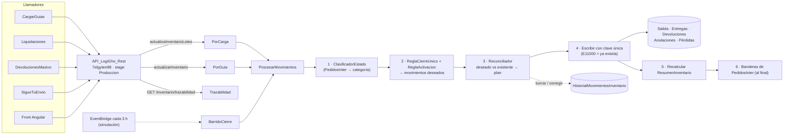

# Inventario — arquitectura

**Autor:** Iker Acevedo · **Fecha de creación:** 2026-10-21 · **Estado:** validado en PreProd; producción pendiente

Código: `LambdasLogiGho.Aplicacion/Logigho/Inventario/ApiLambdaInventario/` (.NET 10, ReadyToRun; Native AOT no es obligatorio, [INV-023](../../arquitectura/adr/inventario/index.md#decisiones-de-origen)).

## Un proyecto, ocho funciones

Un solo `.csproj`, un solo zip y **ocho funciones Lambda**: cada handler se despliega con su propia memoria, timeout, permisos y alarmas (patrón de `ApiLambdaDevolucionesMasivo`). Un cambio en el Dominio redespliega las ocho (son del mismo dominio y cambian juntas).

| # | Función (sufijo `PreProd` en ese entorno) | Handler | Disparo | Escribe | Memoria / timeout |
|---|---|---|---|---|---|
| 1 | `ApiLambdaInventarioTrazabilidad` | `TrazabilidadHandler` | `GET /inventario/trazabilidad` | No | 512 MB / 30 s |
| 2 | `ApiLambdaInventarioPorCarga` | `MovimientosPorCargaHandler` | ruta `actualizaInventarioLotes` | Sí | 2048 MB / 900 s |
| 3 | `ApiLambdaInventarioPorGuia` | `MovimientosPorGuiaHandler` | ruta `actualizarInventario` | Sí | 1024 MB / 60 s |
| 4 | `ApiLambdaInventarioBarridoCierre` | `BarridoCierreHandler` | EventBridge cada 3 h (regla deshabilitada) o invocación directa | Solo con `ModoSimulacion=false` | 2048 MB / 900 s |
| 5 | `ApiLambdaInventarioRecalcularResumen` | `RecalcularResumenHandler` | Invocación directa | Solo `ResumenInventario` | 1024 MB / 900 s |
| 6 | `ApiLambdaInventarioSuscripciones` | `SuscripcionesHandler` | `/inventario/suscripciones…` | `SuscripcionesReporteInventario` | 512 MB / 30 s |
| 7 | `ApiLambdaInventarioDespachos` | `DespachosHandler` | `GET /inventario/despachos` | No | 512 MB / 30 s |
| 8 | `ApiLambdaInventarioReporteDiario` | `ReporteDiarioHandler` | EventBridge `rate(15 minutes)` | Solo `ultimoEnvio` | 1024 MB / 300 s |

!!! note "Qué funciones llegan a producción en el go-live"
    El go-live de inventario crea en producción las **5 primeras** (Terraform `environments/prod/inventario`). Las tres de [alertas diarias](alertas-slack.md) (6–8) existen en PreProd; en producción se agregan en su propia salida (`alertas_habilitadas=false` hasta entonces).

### Capas (Clean Architecture)

```
Handlers/          Borde delgado. Identifica al llamador, valida el cuerpo, responde.
Aplicacion/        Casos de uso: ProcesarMovimientos, RegistrarMovimientos, BarridoCierre,
                   RecalcularResumen, ConsultarTrazabilidad, alertas…   |  Puertos (interfaces)  |  DTO
Dominio/           Lógica pura, sin Mongo/AWS/HTTP, 100 % testeable:
                   ClasificadorEstado · ReglaCierreUnico · CalculadoraMovimientosDeseados · Reconciliador
                   ReglaActivacion · CalculadoraResumen · DetectorDescuadre · ClaveMovimiento · InterpretadorFecha
Infraestructura/   Repositorios Mongo, VerificadorJwtCognito, SlackCanal, cifrado, logs.
```

Regla de dependencias: `Handlers → Aplicacion → Dominio`; `Infraestructura` implementa los puertos. Las reglas de negocio se prueban sin base de datos (más de 1.370 pruebas unitarias; las de integración contra PreProd se omiten sin cadena de conexión).

## Flujo por guía

Es el corazón del sistema y lo ejecutan igual `PorCarga`, `PorGuia` y el `Barrido`:

1. **Clasificar.** Se lee el pedido de `PedidosInter` y [`ClasificadorEstado`](estados-y-formula.md#homologacion-de-estados) lo lleva a una categoría (entregada, retorno, anulada, pérdida, revisar…). El texto crudo de la transportadora tiene 277 variantes; se normaliza tilde, mayúsculas y espacios.
2. **Deseados.** Se calcula qué debería existir: **una salida por casilla** del pedido más **un solo cierre** según la categoría ([`ReglaCierreUnico`](estados-y-formula.md#un-cierre-por-guia)). Si el producto no pasa el [filtro de activación](#filtro-de-activacion-por-proveedor), no entra.
3. **Reconciliar.** Se leen los movimientos que existen y se compara. El resultado es un plan `{insertar, corregir, borrar}`; si está vacío, la guía ya estaba bien.
4. **Escribir.** Se aplica solo la diferencia:
    - **Insertar** lleva `clave` + `slot`. Si el índice único responde `E11000` (duplicate key), significa «ya existía» y se cuenta como éxito, no como error.
    - **Borrar** o **corregir** primero guarda el documento original completo en `HistorialMovimientosInventario`. **Si el historial falla, no se borra ni se corrige nada** y el lote queda intacto para reintentarse.
5. **Cerrar el ciclo.** Se recalcula `ResumenInventario` de los productos que cambiaron (o que recibieron ingresos/ajustes) y **al final** se marcan las banderas de `PedidosInter`.

Correr el flujo dos veces seguidas da un plan vacío la segunda vez (idempotencia). Los pedidos se leen **de 500 en 500 ordenados por `_id`**; sin `Idcarga` ni guías **no se lee ningún pedido** (lección de un OutOfMemory de julio).

Los **ingresos y ajustes manuales** no pasan por el reconciliador: se guardan tal cual, sin filtro de activación.

### Diagrama



## Strangler Fig y repunte de rutas

El sistema nuevo crece alrededor del viejo y lo reemplaza **ruta por ruta**, sin «big bang» ([INV-021](../../arquitectura/adr/inventario/index.md#decisiones-de-origen)):

1. Se construyó `ApiLambdaInventario` en paralelo. Las gemelas siguen en producción sin cambios.
2. Primero lo que no reemplaza nada: trazabilidad (solo lectura) y recalcular resumen.
3. Luego el barrido en simulación.
4. El día del go-live, las **mismas rutas** que ya conocen los llamadores se repuntan a las funciones nuevas. **No cambia ningún contrato ni ningún llamador.**

| Ruta (REST de producción `7elgyten88`) | Antes | Después del repunte | Authorizer |
|---|---|---|---|
| `POST /actualizarInventario` | `ApiLambdaActualizacionInventario` | `ApiLambdaInventarioPorGuia` | Cognito (se conserva) |
| `POST /actualizaInventarioLotes` | `ApiLambdaInventarioCarga` | `ApiLambdaInventarioPorCarga` | Ninguno (se conserva) |
| `GET /inventario/trazabilidad` | no existía | `ApiLambdaInventarioTrazabilidad` | verifica el JWT dentro de la lambda |

- El repunte **no se hace con Terraform**: Terraform no administra el REST `7elgyten88` y el cambio debe poder revertirse en segundos. Se hace con `aws apigateway put-integration` + `create-deployment` ([detalle en el runbook](../../guias/inventario-operacion.md#p8-repuntar-las-dos-rutas)).
- **Rollback:** volver el stage al deployment anterior y restaurar la integración hacia la gemela. Los datos ya limpiados y sellados son compatibles con las gemelas (insertan sin `clave`, que el índice sparse ignora).
- Después de una semana de observación se apagan las gemelas. Mientras tanto quedan con concurrencia reservada 0 y sin ruta.

!!! warning "Regla de API: todo en `API_LogiGho_Rest`"
    Todas las rutas de inventario viven en el REST único del entorno: **`7elgyten88`** (producción, stage `Produccion`) y **`8u5isw5u30`** (PreProd, stage `PreProd`). El HTTP API **`g3iz6qk3f0`** es un **puente temporal solo de PreProd**: existe porque las rutas de inventario aún no están en el REST de PreProd. Se retira cuando la rama de infraestructura incorpore `main` (ver [Tareas futuras](tareas-futuras.md#retirar-el-puente-g3iz6qk3f0)). No debe usarse como destino de nada nuevo.

## Filtro de activación por PROVEEDOR

Con `FILTRO_ACTIVACION=on` (valor del go-live, [INV-034](../../arquitectura/adr/inventario/ADR-INV-004-filtro-de-activacion.md)) un producto cuenta **solo si** cumple las tres condiciones:

| Condición | Dónde vive |
|---|---|
| `ManejaInventario = true` | `Productos` |
| `ServicioInventario = true` en la **tienda dueña** del producto (`Productos.IdTienda = Tienda.Id`) | `Tienda` |
| Fecha del pedido ≥ `FechaInicioInventario` (por defecto, la fecha del primer ingreso) | `Productos` |

- **La activación vive en el proveedor** (dueño del producto), no en la tienda que vende. Un dropshipper no necesita activar nada; verificado en el E2E (la tienda vendedora no tenía el servicio y los movimientos se registraron por la tienda proveedora).
- Un producto que no cuenta **no se toca**: no se crean, borran ni corrigen movimientos suyos, no se recalcula su resumen y el barrido no lo lista. Los ingresos y ajustes **sí** se escriben siempre.
- Efecto práctico: hoy son los 65 productos BTK. Los demás productos activos, y los productos nuevos, **no descuentan inventario** hasta activarse (pantalla *Administrar inventario* o script). Un producto sin ingresos no se activa (sin fecha de inicio contaría desde siempre).

## Fórmula, estados y cierres

La [fórmula v2 con ejemplo numérico](estados-y-formula.md#formula-v2), la homologación de estados y las reglas de cierre (INV-008, 035, 038, 039) están en la página [Estados, cierres y fórmula](estados-y-formula.md).

## Datos

| Colección | Uso | Índices |
|---|---|---|
| `SalidaInventario` (`Guia`), `EntregasInventario`, `DevolucionesInventario`, `AnulacionesInventario`, `PerdidasInventario` (nueva) (`Guia Inicial`) | Movimientos | `ix_idproducto_guia` `{id producto, <guía>}`, `ix_guia`, **`ux_clave` único + sparse** |
| `IngresoInventario`, `AjustesInventario` | Ingresos y ajustes manuales | — |
| `HistorialMovimientosInventario` (nueva) | Original de todo lo borrado o corregido | `{coleccion, idDocumento}` |
| `ResumenInventario` | Vista materializada por producto | — |
| `SuscripcionesReporteInventario` (nueva) | [Alertas por Slack](alertas-slack.md) | `{usuarioEmail,_id}`, `{activo,_id}` (recomendados) |
| `PedidosInter` | Fuente de verdad: estado, fechas, casillas, banderas | `Numeropreenvio`, `Idcarga` (existentes) |
| `Productos`, `Tienda`, `ParametrosGenerales`, `Users` | Maestros, parámetros y roles (lectura) | — |

Tipos reales a tener presentes: `id producto` en movimientos es **texto**; `Productos.idproducto` y `IdStockN` son **números**; la guía se maneja como texto y **no puede contener `|`**. Las fechas de `PedidosInter` son texto en 4 formatos y se convierten a **UTC real** leyendo las que no traen zona como `America/Bogota` ([INV-026](../../arquitectura/adr/inventario/index.md#decisiones-de-origen)); todo lo que se escribe es ISO UTC con `Z` verdadera.

## Seguridad en el borde

- La identidad llega por los claims del authorizer o por la cabecera `Token` (JWT de Cognito). La lambda **verifica la firma**: RS256 (nunca `none` ni HS256) contra el JWKS del user pool, emisor, vigencia con 60 s de tolerancia, `token_use` y app client. Sin configuración, rechaza todo (falla cerrado). Un token armado a mano da 401 (probado con 7 ataques).
- Luego se busca el correo en `Users` y se exige un rol permitido. Detalle en la [API](../../api/inventario.md#seguridad).
- Sin secretos en el repo: `CADENA_CONEXION` va cifrada con el esquema de la plataforma y la agrega el pipeline de despliegue.
