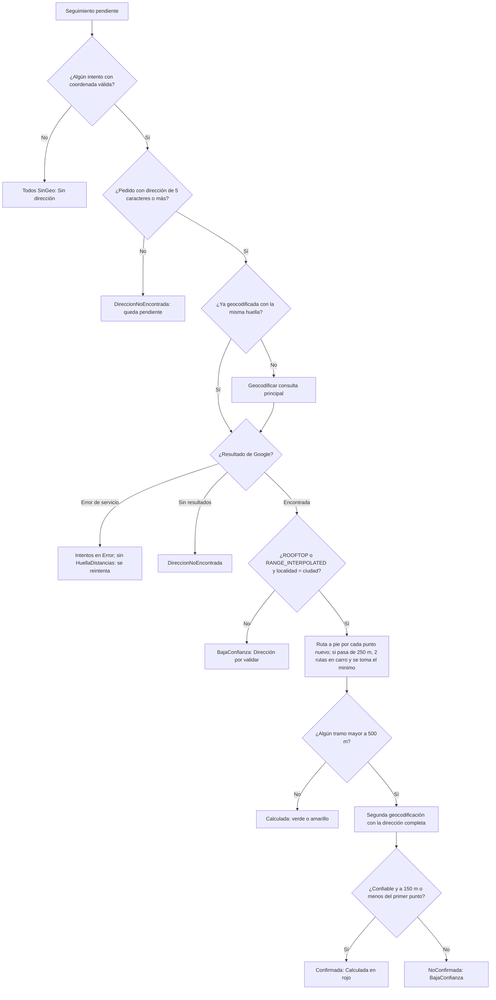

## Autor: Iker Acevedo

Fecha creacion: 2026-11-06  
Estado: produccion (v8 desplegada 2026-11-08; Scheduler de reportes apagado)  
Actualizado: 2026-11-09 (v4 a v8; antes la página describía solo DRIVE y la regla v3)

---

# Reglas de negocio de la distancia

Cómo se decide cuántos metros **por calle** hay entre la dirección del pedido y el punto donde el mensajero de Inter marcó la novedad, y
cuándo ese número es confiable. Resumen de las versiones: **v2/v3** (2026-11-06) regla de confianza y confirmación del rojo; **v4** (2026-11-06) motivos de validación visibles;
**v5** (2026-11-06) ruta a pie y tope de 50 km; **v6** (2026-11-07) mínimo entre a pie y carro; **v8** (2026-11-07) dirección en texto del mensajero (la v7 solo cambió los reportes: ver
[Reglas de los reportes](reglas-reportes.md)). Las reglas viven en `Dominio/Reglas/ReglasDistancia.cs` y `ReglasDireccion.cs`; las aplica
[`ApiLambdaNovedadesInterDistancias`](../ApiLambdaNovedadesInterDistancias.md). Decisiones: Iker 2026-11-05 y 2026-11-06
([ADR-004](../adr/ADR-004-regla-de-geocodificacion-v2-v3-y-confirmacion-del-rojo.md)).

## 1. Origen de los dos puntos

| Punto | De dónde sale |
| ----- | ------------- |
| **Origen** (la dirección) | `PedidosInter.Direccion`, `Ciudad` y `Departamento`, geocodificadas con Google Geocoding (`components=country:CO`, `region=co`) |
| **Destino** (el mensajero) | `UltimoMotivo.Geo` y el `Geo` de cada entrada de `Historial` en `SeguimientoNovedadesInter`: la coordenada del evento del flujo de Inter que trae el motivo |

- Se calcula un resultado por **intento** (cada entrada del historial más el último motivo), con tope de 50 entradas, igual que `Historial`.
- El enlace de la ruta tiene `origin` = dirección del pedido y `destination` = punto del mensajero (`travelmode=driving`).
- Una coordenada que no pasa la validación no es del mensajero: estado `SinGeo` y un log `[WARN]` sin datos personales.
  Se exige latitud en [-90, 90], longitud en [-180, 180], que no sean las dos 0 y que caigan en la caja de Colombia
  (latitud −5 a 14, longitud −82 a −66).

## 2. Limpieza de la dirección

Observado en `SanitizadorDireccion`:

1. Se quitan caracteres de control, se colapsan espacios y se limita a **200 caracteres**.
2. Dirección vacía o de **menos de 5 caracteres**: no se llama a Google (`DireccionNoEncontrada`).
3. **Consulta principal** (regla v2/v3): `"{dirección limpia}, {ciudad}, Colombia"`, **sin departamento**. La dirección se corta en
   la primera palabra completa de unidad u observación (apto, torre, casa, barrio, bloque, conjunto, piso, local, oficina,
   manzana, lote, urbanización, sector, vereda, frente, cerca, detrás, referencia, edificio, etc.; sin distinguir mayúsculas ni
   tildes). Si lo que queda mide menos de 5 caracteres se usa la dirección sin cortar. También se elimina el carácter dañado `U+FFFD`.
4. **Consulta de confirmación**: `"{dirección completa}, {ciudad}, {departamento}, Colombia"` (ver §5).
5. La URL se arma con `Uri.EscapeDataString`; nunca se interpola sin escapar.
6. La dirección es dato personal: **nunca se loguea** ni sale en los Excel.

## 3. Regla de confianza (v2, vigente en v3)

Una geocodificación es **confiable** si se cumplen las dos condiciones:

- `location_type` es `ROOFTOP` (portal exacto) o `RANGE_INTERPOLATED` (interpolada en el rango de la calle), **aunque `partial_match` sea verdadero**
  (las direcciones de Inter traen texto extra), y
- la **localidad** del resultado (`locality` o `administrative_area_level_2`) coincide con la **ciudad del pedido**: sin tildes ni mayúsculas,
  contenida en un sentido u otro. Ciudad vacía o resultado sin localidades: no es confiable.

`GEOMETRIC_CENTER` y `APPROXIMATE` se **rechazan**: darían la distancia al centro del barrio o de la ciudad, que no significa nada.

La regla inicial (solo sin coincidencia parcial) dejaba calculada apenas el **5 %** de 277 guías reales de PreProd; la nueva, el **45 %**
(Iker 2026-11-06; medido en PreProd).

## 4. Ruta, color y estados

- **Ruta (v5, Iker 2026-11-06):** Google Routes `computeRoutes`. Primero **a pie** (`travelMode = WALK`, sin `routingPreference`: con WALK Google responde error): «la distancia en calle sin importar la vía (contravía)».
  Con DRIVE los sentidos únicos inflaban la distancia (caso medido en prod: recta 318 m, DRIVE ida 53 666 m, DRIVE vuelta 384 m, WALK 395 m; midiendo a pie 263 de 1 301 guías rojas, 20 %, dejaron de serlo).
  Nunca línea recta. La línea recta (Haversine) se guarda en `MetrosLineaRecta` solo como referencia.
- **Mínimo entre modos (v6, Iker 2026-11-07):** a pie falla en vías sin acceso peatonal y en carro falla por calles de un solo sentido. Caso medido (guía de Pailitas): recta 593 m, a pie 38 561 m,
  en carro 791 m (ida) y 973 m (vuelta). Por eso `Metros` = **el mínimo entre a pie, carro ida y carro vuelta** (conservador para reclamar a Inter), y `Modo` (`WALK` o `DRIVE`) dice de cuál salió
  (empate: `WALK`).
  - Por punto: **primero a pie**. Si es **≤ 250 m (verde)** no se piden más rutas (el mínimo no puede cambiar el color; ahorra Google). Si pasa de 250 m o no existe, se piden las **dos rutas en carro**
    (`DRIVE`, `TRAFFIC_UNAWARE`; ida dirección → mensajero y vuelta mensajero → dirección). Una ruta «sin ruta» se ignora; si ninguna existe, `Error`.
  - `DistanciaIntento` guarda `MetrosCaminando`, `MetrosCarro` (el menor de ida y vuelta) y el marcador `ModoMinimoEvaluado`, que evita que una guía cuyas rutas en carro dieron «sin ruta» quede pendiente para siempre.
  - Si una llamada falla por servicio: la guía no se da por terminada (se reintenta), el punto conserva lo que ya se sabía, no se pide la confirmación del rojo para un punto sin el mínimo evaluado y no se pide la vuelta si la ida falló.
  - El color, el tope de 50 km y la confirmación del rojo se evalúan **sobre el mínimo**. El enlace usa `travelmode=walking` o `driving` según el modo del mínimo.
  - Medido en prod con las 1 060 guías rojas del 2026-11-07: con el mínimo solo 4 dejan de ser rojas; 1 056 siguen > 500 m y 21 siguen > 50 km.
- **Distancia inverosímil (v5):** una ruta de **más de 50 000 m** (`UmbralDistanciaInverosimilMetros`; 50 000 exactos es válida) queda `BajaConfianza` **conservando** `Metros` y `MetrosLineaRecta`, sin color;
  si es el último intento y la dirección se había aceptado, `DireccionPedido.MotivoValidacion = DistanciaInverosimil`. No entra al reporte 1: va a la hoja «Por revisar (más de 50 km)». Causa típica: un municipio
  homónimo (p. ej. Argelia; mejora **M-267**: comparar también el departamento).
- **Ruta de 0 m:** Google **omite** `distanceMeters` cuando mide 0 m (origen y destino en el mismo punto de la vía). Se interpreta como
  **0 m** (verde), no como «sin ruta». Era un bug de la v2 que guardaba esas guías como `Error` definitivo; la v3 las recalcula.
- **Colores** (Iker 2026-11-05; observado en `ReglaColorDistancia`, `LimiteVerde = 250`, `LimiteAmarillo = 500`): `Metros <= 250` **verde** · `251` a `500` **amarillo** · `> 500` **rojo**.
  Sin cambios en las versiones v4 a v8.

### Estados de un intento

| Estado | Cuándo | Cómo lo ve el usuario |
| ------ | ------ | --------------------- |
| `Calculada` | Dirección confiable y ruta encontrada (y, si es roja, confirmada) | Metros con chip de color |
| `SinGeo` | El intento no trae coordenada (o es inválida / fuera de Colombia) | «Sin dirección» |
| `DireccionNoEncontrada` | Pedido sin dirección útil, o Google sin resultados | «Dirección por validar» |
| `BajaConfianza` | `GEOMETRIC_CENTER` / `APPROXIMATE`, ciudad que no coincide, rojo **no confirmado** o ruta de **más de 50 km** (conserva los metros) | «Dirección por validar»; no entra al reporte 1 (las de > 50 km van a «Por revisar») |
| `Error` | Falla de servicio de Google; o Google no devolvió ruta entre los dos puntos | «Error al calcular» |
| (sin dirección en el pedido) | No existe el pedido o su dirección mide menos de 5 caracteres | La guía queda pendiente: no se fija `HuellaDistancias` hasta que cambie |

En `BajaConfianza` por confianza de la dirección no se pide ruta, pero sí se deja el enlace para revisar a mano.

### Motivo de validación (v4, Iker 2026-11-06)

`DireccionPedido.MotivoValidacion` explica en el front por qué una guía quedó en «Dirección por validar». Se evalúa en este orden (observado: `Constantes.cs`, `ReglaConfianzaGeocodificacion`):

| Orden | Valor | Cuándo |
| ----- | ----- | ------ |
| 1 | `NoEncontrada` | Google sin resultado (`ZERO_RESULTS`) |
| 2 | `SinCiudad` | El pedido no trae ciudad o Google no devolvió localidades |
| 3 | `Aproximada` | `location_type` distinto de `ROOFTOP`/`RANGE_INTERPOLATED` |
| 4 | `CiudadDistinta` | Localidad del resultado distinta de la ciudad del pedido |
| 5 | `NoConfirmada` | Aceptada, pero el rojo no se confirmó a ≤ 150 m |
| 6 | `DistanciaInverosimil` | La ruta del último intento mide más de 50 km |

Aceptada = campo ausente. `DireccionGoogle`, `DireccionGoogleConfirmacion` y `DistanciaConfirmacionMetros` también se guardan (todos opcionales). Son direcciones: **no van en logs**; en los Excel solo sale
`DireccionGoogle` («Dirección que entendió Google») desde la v6, en un canal privado de Slack.

## 5. Confirmación del rojo

Solo cuando el **mínimo** da **más de 500 m** (candidata al reporte 1) se hace **una** segunda geocodificación con la dirección completa.
Se **confirma** si esa segunda es confiable (§3) y cae a **≤ 150 m** (Haversine) del punto de la consulta principal.

| Resultado | Qué pasa |
| --------- | -------- |
| `Confirmada` | El cálculo queda como `Calculada` (rojo válido) |
| `NoConfirmada` | Las distancias rojas pasan a `BajaConfianza`, sin `Metros` |
| Google falla (429/5xx) | No se fija nada; se reintenta en la siguiente corrida (la guía queda pendiente) |

El resultado se guarda en `DireccionPedido.ConfirmacionDireccion` y no se repite mientras la dirección no cambie. Sirve para no reclamarle
a Inter por un error de Google. En PreProd quedaron **38 rojas confirmadas** (2026-11-06).

## 6. Diagrama del flujo de decisión

## 7. Tabla de decisión

| Tipo de ubicación | Localidad = ciudad del pedido | Metros | Confirmación | Estado final | Color |
| ----------------- | ----------------------------- | ------ | ------------ | ------------ | ----- |
| `ROOFTOP` / `RANGE_INTERPOLATED` | Sí | 0–250 | no hace falta | `Calculada` | verde |
| `ROOFTOP` / `RANGE_INTERPOLATED` | Sí | 251–500 | no hace falta | `Calculada` | amarillo |
| `ROOFTOP` / `RANGE_INTERPOLATED` | Sí | > 500 | `Confirmada` | `Calculada` | rojo |
| `ROOFTOP` / `RANGE_INTERPOLATED` | Sí | > 500 | `NoConfirmada` | `BajaConfianza` | — |
| `ROOFTOP` / `RANGE_INTERPOLATED` | No | — | — | `BajaConfianza` | — |
| `GEOMETRIC_CENTER` / `APPROXIMATE` | cualquiera | — | — | `BajaConfianza` | — |
| `ROOFTOP` / `RANGE_INTERPOLATED` | Sí | > 50 000 | no se pide | `BajaConfianza` (con metros; hoja «Por revisar») | — |
| (sin resultado) | — | — | — | `DireccionNoEncontrada` | — |
| (intento sin coordenada) | — | — | — | `SinGeo` | — |

## Versión de la regla y huella

- `VersionReglaGeocodificacion.Actual = "v4"` y `VersionReglaRuta.Actual = "walk1"` (observado: `ReglasDireccion.cs`). v2 introdujo la consulta limpia, la aceptación de
  coincidencia parcial con ciudad igual y la confirmación del rojo; v3 corrigió la ruta de 0 m; v4 guardó los motivos de validación; `walk1` (v5) pasó de DRIVE a WALK.
  La v6 (mínimo entre modos) y la v8 (dirección del mensajero) **no subieron ninguna versión**. **Corregido 2026-11-09:** esta página decía v3 y la spec 012 §1 sigue hablando de «ruta a pie» sin el mínimo.
- **Huella de dirección** (`DireccionPedido.HuellaDireccion`): sha256 de la versión de la regla, la dirección, la ciudad y el departamento normalizados.
  Cambia si cambia la dirección real **o** la regla de geocodificación (no la de ruta).
- **`HuellaDistancias`** = `"{HuellaMotivos}|v4|walk1"`. Una guía es pendiente si su `HuellaDistancias` es distinta de esa expresión; subir la versión
  recalcula todo una vez y luego no se vuelve a tocar. La versión de **ruta** (`walk1`) va solo aquí y no en la huella de dirección: cambiar de modo recalcula rutas **sin geocodificar de nuevo**,
  y la caché por punto solo reutiliza rutas con el mínimo evaluado o a pie.
- **Otros pendientes sin subir versión (v6 y v8):** (a) última distancia `Calculada` con más de 250 m, o inverosímil, sin `MetrosCarro` y sin `ModoMinimoEvaluado`: se evalúa con lo guardado, sin geocodificar
  ni repetir la ruta a pie (`ReglaDistanciaMinima.NecesitaEvaluarMinimo`); (b) falta la dirección del mensajero (`ReglaDireccionMensajero.Necesita`, ver §9).
- **Huella de punto** (`Distancias[].HuellaGeo`): `"lat,lng"` a 6 decimales con punto decimal.

## 8. Caché y costos

- **Una geocodificación por guía** mientras no cambie la huella de la dirección; **una ruta por punto** (la caché por `HuellaGeo` solo vale si la dirección no cambió).
- La confirmación cuesta una llamada extra **solo en rojos**. Las rutas en carro (2 por punto) solo se piden si a pie pasa de 250 m.
- Costo de la recarga de la v6 (estimado, Iker 2026-11-07): ~1 800 guías no verdes × 2 rutas ≈ 3 600 llamadas a Routes. Una ráfaga superó la cuota de Routes en prod y cortó una corrida (mejora **M-268**).
- Una segunda corrida sin cambios hace **0 llamadas** a Google (CA5; se ve en `LlamadasGoogle`).
- Llamadas de una corrida: `Geocodificaciones + Rutas + RutasCarro + Confirmaciones + GeocodificacionesInversas`.
- Control de costo previsto en la spec: tope diario de cuotas en GCP y presupuesto de USD 50 con alertas (**pendiente de verificar que estén configurados**; no hay evidencia en el código).

## 9. Dirección del mensajero (v8)

ws-inter solo entrega al mensajero como coordenadas (`UltimoMotivo.Geo`); la dirección en texto se obtiene por **geocodificación inversa** de Google y se guarda
([ADR-006](../adr/ADR-006-direccion-del-mensajero-guardada-por-geocodificacion-inversa.md)). Observado: `ReglaDireccionMensajero.cs`, `ClienteGoogleMaps.cs`, `CalcularDistanciasUseCase.cs`.

| Aspecto | Regla |
| ------- | ----- |
| Qué punto | El del **último intento** (el de `DistanciaUltima`) |
| Llamada | `geocode/json?latlng=lat,lng&language=es`, sin `result_type`; se toma el primer `formatted_address` que **no** sea un plus code; máximo 300 caracteres, sin controles |
| Dónde se guarda | `SeguimientoNovedadesInter.DireccionMensajero { Texto, HuellaGeo, FechaCalculo, Estado }` (modelo en [Modelos](modelos.md)) |
| Cuándo se calcula | Una vez por guía y por punto: hay punto válido y **no** hay dirección guardada, es de **otra** `HuellaGeo`, o quedó en `Error` |
| `Estado = Calculada` | Hay texto |
| `Estado = SinResultado` | Google respondió sin dirección útil: **no** se reintenta mientras la `HuellaGeo` no cambie |
| `Estado = Error` | Falla de servicio (429, 5xx, llave): se reintenta en la siguiente corrida y cuenta para cortar la corrida |
| Reintentos y corte | Los mismos que el resto de las llamadas a Google (2 reintentos con espera; `FALLAS_SEGUIDAS_PARA_CORTAR`) |
| Versión de regla | **Ninguna**: es una marca independiente. Una guía ya al día en lo demás se completa con un `$set` de **un solo campo**, sin rutas ni geocodificar el pedido (ni siquiera las `BajaConfianza`) |
| Privacidad | Es dato personal: nunca se loguea. Sale en la columna «Dirección del mensajero (texto)» de los Excel (canal privado) y en la vista |

Medido en prod 2026-11-08 (observado): 8 112 guías `Calculada`, 0 `SinResultado`, 0 `Error`; ~8 100 llamadas, ~USD 40 una sola vez (M-272). Prod 2026-11-07: 8 114 de 18 051 seguimientos traen coordenada.
