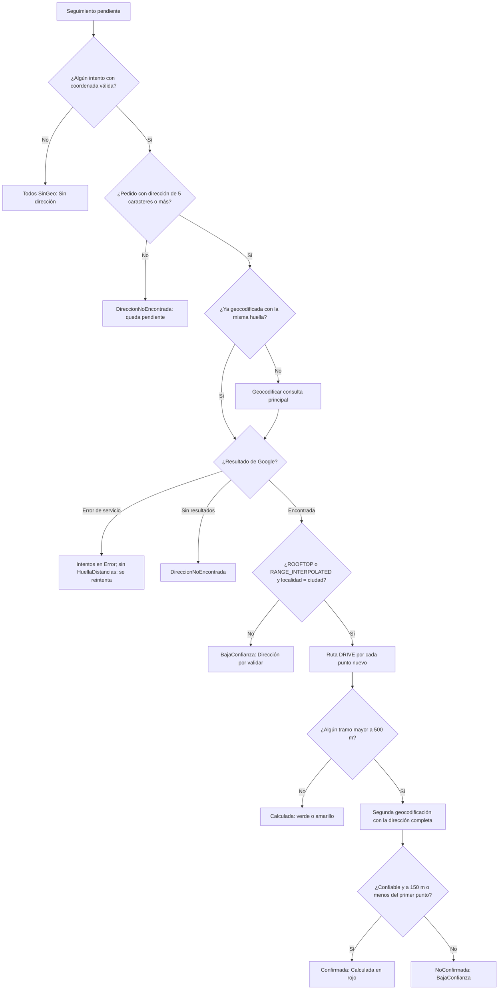

## Autor: Iker Acevedo

Fecha creacion: 2026-11-06  
Estado: desarrollo (PreProd validada; producción pendiente)

---

# Reglas de negocio de la distancia

Cómo se decide cuántos metros hay entre la dirección del pedido y el punto donde el mensajero de Inter marcó la novedad, y
cuándo ese número es confiable. Las reglas viven en `Dominio/Reglas/ReglasDistancia.cs` y `ReglasDireccion.cs`; las aplica
[`ApiLambdaNovedadesInterDistancias`](../ApiLambdaNovedadesInterDistancias.md). Decisiones: Iker 2026-11-05 y 2026-11-06
([ADR-004](../adr/ADR-004-regla-de-geocodificacion-v2-v3-y-confirmacion-del-rojo.md)).

## 1. Origen de los dos puntos

| Punto | De dónde sale |
| ----- | ------------- |
| **Origen** (la dirección) | `PedidosInter.Direccion`, `Ciudad` y `Departamento`, geocodificadas con Google Geocoding (`components=country:CO`, `region=co`) |
| **Destino** (el mensajero) | `UltimoMotivo.Geo` y el `Geo` de cada entrada de `Historial` en `SeguimientoNovedadesInter`: la coordenada del evento del flujo de Inter que trae el motivo |

- Se calcula un resultado por **intento** (cada entrada del historial más el último motivo), con tope de 50 entradas, igual que `Historial`.
- El enlace de la ruta tiene `origin` = dirección del pedido y `destination` = punto del mensajero (`travelmode=driving`).
- Una coordenada que no pasa la validación no es del mensajero: estado `SinGeo` y un log `[WARN]` sin datos personales.
  Se exige latitud en [-90, 90], longitud en [-180, 180], que no sean las dos 0 y que caigan en la caja de Colombia
  (latitud −5 a 14, longitud −82 a −66).

## 2. Limpieza de la dirección

Observado en `SanitizadorDireccion`:

1. Se quitan caracteres de control, se colapsan espacios y se limita a **200 caracteres**.
2. Dirección vacía o de **menos de 5 caracteres**: no se llama a Google (`DireccionNoEncontrada`).
3. **Consulta principal** (regla v2/v3): `"{dirección limpia}, {ciudad}, Colombia"`, **sin departamento**. La dirección se corta en
   la primera palabra completa de unidad u observación (apto, torre, casa, barrio, bloque, conjunto, piso, local, oficina,
   manzana, lote, urbanización, sector, vereda, frente, cerca, detrás, referencia, edificio, etc.; sin distinguir mayúsculas ni
   tildes). Si lo que queda mide menos de 5 caracteres se usa la dirección sin cortar. También se elimina el carácter dañado `U+FFFD`.
4. **Consulta de confirmación**: `"{dirección completa}, {ciudad}, {departamento}, Colombia"` (ver §5).
5. La URL se arma con `Uri.EscapeDataString`; nunca se interpola sin escapar.
6. La dirección es dato personal: **nunca se loguea** ni sale en los Excel.

## 3. Regla de confianza (v2, vigente en v3)

Una geocodificación es **confiable** si se cumplen las dos condiciones:

- `location_type` es `ROOFTOP` (portal exacto) o `RANGE_INTERPOLATED` (interpolada en el rango de la calle), **aunque `partial_match` sea verdadero**
  (las direcciones de Inter traen texto extra), y
- la **localidad** del resultado (`locality` o `administrative_area_level_2`) coincide con la **ciudad del pedido**: sin tildes ni mayúsculas,
  contenida en un sentido u otro. Ciudad vacía o resultado sin localidades: no es confiable.

`GEOMETRIC_CENTER` y `APPROXIMATE` se **rechazan**: darían la distancia al centro del barrio o de la ciudad, que no significa nada.

La regla inicial (solo sin coincidencia parcial) dejaba calculada apenas el **5 %** de 277 guías reales de PreProd; la nueva, el **45 %**
(Iker 2026-11-06; medido en PreProd).

## 4. Ruta, color y estados

- **Ruta:** Google Routes `computeRoutes`, `travelMode = DRIVE`, `routingPreference = TRAFFIC_UNAWARE` (distancia, no tránsito en vivo; SKU más barato).
  Nunca línea recta. La línea recta (Haversine) se guarda en `MetrosLineaRecta` solo como referencia.
- **Ruta de 0 m:** Google **omite** `distanceMeters` cuando mide 0 m (origen y destino en el mismo punto de la vía). Se interpreta como
  **0 m** (verde), no como «sin ruta». Era un bug de la v2 que guardaba esas guías como `Error` definitivo; la v3 las recalcula.
- **Colores** (Iker 2026-11-05): `Metros <= 250` verde · `251` a `500` amarillo · `> 500` rojo.

### Estados de un intento

| Estado | Cuándo | Cómo lo ve el usuario |
| ------ | ------ | --------------------- |
| `Calculada` | Dirección confiable y ruta encontrada (y, si es roja, confirmada) | Metros con chip de color |
| `SinGeo` | El intento no trae coordenada (o es inválida / fuera de Colombia) | «Sin dirección» |
| `DireccionNoEncontrada` | Pedido sin dirección útil, o Google sin resultados | «Dirección por validar» |
| `BajaConfianza` | `GEOMETRIC_CENTER` / `APPROXIMATE`, ciudad que no coincide, o rojo **no confirmado** | «Dirección por validar»; no entra al reporte 1 |
| `Error` | Falla de servicio de Google; o Google no devolvió ruta entre los dos puntos | «Error al calcular» |
| (sin dirección en el pedido) | No existe el pedido o su dirección mide menos de 5 caracteres | La guía queda pendiente: no se fija `HuellaDistancias` hasta que cambie |

En `BajaConfianza` no se pide ruta, pero sí se deja el enlace para revisar a mano.

## 5. Confirmación del rojo

Solo cuando alguna ruta da **más de 500 m** (candidata al reporte 1) se hace **una** segunda geocodificación con la dirección completa.
Se **confirma** si esa segunda es confiable (§3) y cae a **≤ 150 m** (Haversine) del punto de la consulta principal.

| Resultado | Qué pasa |
| --------- | -------- |
| `Confirmada` | El cálculo queda como `Calculada` (rojo válido) |
| `NoConfirmada` | Las distancias rojas pasan a `BajaConfianza`, sin `Metros` |
| Google falla (429/5xx) | No se fija nada; se reintenta en la siguiente corrida (la guía queda pendiente) |

El resultado se guarda en `DireccionPedido.ConfirmacionDireccion` y no se repite mientras la dirección no cambie. Sirve para no reclamarle
a Inter por un error de Google. En PreProd quedaron **38 rojas confirmadas** (2026-11-06).

## 6. Diagrama del flujo de decisión

## 7. Tabla de decisión

| Tipo de ubicación | Localidad = ciudad del pedido | Metros | Confirmación | Estado final | Color |
| ----------------- | ----------------------------- | ------ | ------------ | ------------ | ----- |
| `ROOFTOP` / `RANGE_INTERPOLATED` | Sí | 0–250 | no hace falta | `Calculada` | verde |
| `ROOFTOP` / `RANGE_INTERPOLATED` | Sí | 251–500 | no hace falta | `Calculada` | amarillo |
| `ROOFTOP` / `RANGE_INTERPOLATED` | Sí | > 500 | `Confirmada` | `Calculada` | rojo |
| `ROOFTOP` / `RANGE_INTERPOLATED` | Sí | > 500 | `NoConfirmada` | `BajaConfianza` | — |
| `ROOFTOP` / `RANGE_INTERPOLATED` | No | — | — | `BajaConfianza` | — |
| `GEOMETRIC_CENTER` / `APPROXIMATE` | cualquiera | — | — | `BajaConfianza` | — |
| (sin resultado) | — | — | — | `DireccionNoEncontrada` | — |
| (intento sin coordenada) | — | — | — | `SinGeo` | — |

## Versión de la regla y huella

- `VersionReglaGeocodificacion.Actual = "v3"` (observado: `ReglasDireccion.cs`). v2 introdujo la consulta limpia, la aceptación de
  coincidencia parcial con ciudad igual y la confirmación del rojo; v3 corrigió la ruta de 0 m. **Discrepancia:** la spec 012 y su
  ficha mencionan «v2» en varios puntos; el código vigente es v3.
- **Huella de dirección** (`DireccionPedido.HuellaDireccion`): sha256 de la versión de la regla, la dirección, la ciudad y el departamento normalizados.
  Cambia si cambia la dirección real **o** la regla.
- **`HuellaDistancias`** = `"{HuellaMotivos}|v3"`. Una guía es pendiente si su `HuellaDistancias` es distinta de esa expresión; subir la versión
  recalcula todo una vez y luego no se vuelve a tocar.
- **Huella de punto** (`Distancias[].HuellaGeo`): `"lat,lng"` a 6 decimales con punto decimal.

## 8. Caché y costos

- **Una geocodificación por guía** mientras no cambie la huella de la dirección; **una ruta por punto** (la caché por `HuellaGeo` solo vale si la dirección no cambió).
- La confirmación cuesta una llamada extra **solo en rojos**.
- Una segunda corrida sin cambios hace **0 llamadas** a Google (CA5; se ve en `LlamadasGoogle`).
- Llamadas de una corrida: `Geocodificaciones + Rutas + Confirmaciones`.
- Control de costo previsto en la spec: tope diario de cuotas en GCP y presupuesto de USD 50 con alertas (**pendiente de verificar que estén configurados**; no hay evidencia en el código).
