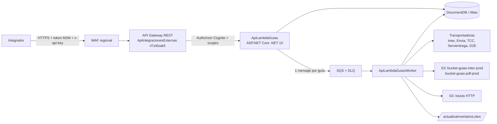

# API pública de creación de guías

> **Estado:** diseño aprobado el 2026-10-22. No hay código desplegado todavía.
> HU en ClickUp: [HU: API pública de creación de guías](https://app.clickup.com/t/86e30792h).

---

## ¿Qué es?

Servicio para que **integradores externos** (tiendas o plataformas) creen guías por API REST, de a una o en lotes, consulten su etiqueta, las anulen y vean su cupo. Hasta hoy la API pública (`ApiIntegracionesExternas`) solo permite consultar pedidos (`GET /pedidos`).

El servicio **replica exactamente** el flujo que hoy hacen `ApiLambdaCrearGuia`, `ApiLambdaCargarGuias` y `ApiLambdaCrearEtiquetaManual`, con los mismos destinos de datos, para que liquidaciones, sincronizadores, inventario y Angular sigan funcionando sin cambios.

Más adelante (fase F5), las lambdas actuales y el front pueden migrar a este servicio.

---

## Alcance

| Incluido en v1 | Fuera de v1 |
| --- | --- |
| Creación unitaria de guías | Contraentrega (COD) |
| Creación por lotes (varias guías en una llamada) | Recogidas (`FECHA RECOGIDA`) |
| Etiqueta (mismos buckets de hoy) | Cotización (llegará después) |
| Anulación de guías | Operación en otros países (el código no quema país ni moneda) |
| Cupo financiero y de conteo | Consulta de guías (ya existe `GET /pedidos`) |
| Administración de clientes API (tiendas, productos, transportadoras, bloqueo, auditoría) | |

**Transportadoras:** Interrapidísimo primero (F1). Luego Envia, TCC, Servientrega y D2E (F3). XCargo no.

---

## Arquitectura



| Pieza | Responsabilidad |
| --- | --- |
| `ApiLambdaGuias` | Autentica y autoriza, valida cada campo, aplica idempotencia, reserva cupo, encola y responde. Sirve también los endpoints de administración. |
| `ApiLambdaGuiasWorker` | Llama a la transportadora, inserta en `CargaPedido`/`PedidosInter`, genera la etiqueta, avisa al inventario, guarda trazas, reconcilia solicitudes inciertas y recalcula cupo. |
| SQS + DLQ | Desacopla la creación del request: ninguna Lambda procesa un lote entero, así que no aplica el límite de 15 minutos ni el de 29 s del API Gateway. |

Detalle de la decisión: [ADR-001 Hosting en Lambda](adr-001-hosting-lambda.md).

### Ubicación del código

Regla del equipo: si es Lambda va en el repo de lambdas; si es API, en repo aparte.

```
Lambdas_NET_LogiGho/LambdasLogiGho.Aplicacion/ServicioPublicoLogigho/
  ApiLambaConsultarPedidos/        (existe)
  APILambdaObtenerToken/           (existe)
  Guias/
    Logigho.Guias.Dominio/
    Logigho.Guias.Aplicacion/
    Logigho.Guias.Infraestructura/
    ApiLambdaGuias/
    ApiLambdaGuiasWorker/
    tests/
```

Pipeline: `pipelines/servicio-publico/{ci,cd-preprod,cd-prod}.yml` con las plantillas `lambda-dotnet-*`. Infraestructura en `Terraform_Infraestructura_Logigho`.

---

## Flujo de creación de una guía

1. **Autenticación:** el authorizer de Cognito valida el token M2M y el scope `guias:crear`; el usage plan valida la API key y aplica el límite del cliente.
2. **Perfil del cliente:** se carga `ApiClientes` (caché 30 s). Si el estado no es `ACTIVO`, responde `403 CLIENTE_BLOQUEADO`.
3. **Idempotencia:** se registra la solicitud con `{ClienteId, Idempotency-Key}`. Ver [ADR-003](adr-003-idempotencia.md).
4. **Validación:** cada campo con regla y mensaje claro; tienda, productos y transportadora deben estar permitidos para el cliente; la sucursal remitente se resuelve **en el servidor** con la misma regla de hoy, nunca desde el body.
5. **Cupo:** reserva atómica del costo estimado. Ver `cupo.md`.
6. **Encolar:** un mensaje SQS por guía. El API espera hasta ~20 s el resultado; si la transportadora tarda más responde `202` con el id de la solicitud.
7. **Worker:** inserta en `CargaPedido` (origen `API`), llama a la transportadora **sin reintentar a ciegas el POST de creación**, actualiza `CargaPedido`, inserta en `PedidosInter` con el formato actual, genera la etiqueta ([ADR-004](adr-004-etiquetas.md)), avisa al inventario (`POST /actualizaInventarioLotes {Guias}`) y guarda la traza ([ADR-005](adr-005-trazas-transportadoras.md)).
8. **Resultado:** `CREADA`, `FALLIDA` (libera cupo, error formal de la transportadora) o `INCIERTA` (timeout ambiguo; el reconciliador la resuelve antes de permitir otra creación).

---

## Seguridad

- Token OAuth2 `client_credentials` de Cognito + API key por cliente. Ver [ADR-002](adr-002-autenticacion.md).
- WAF regional: reglas administradas de AWS, límite por IP y lista de IPs bloqueadas. Lista opcional de IPs permitidas por cliente.
- Tiendas, productos y transportadoras salen del perfil en servidor, nunca del token ni del body.
- Todo cambio de administradores o gerencia queda en `ApiAuditoria` con antes y después.
- Datos personales enmascarados en logs.
- Configuración con el estándar actual (variables cifradas AES en variable groups bloqueados).

---

## Documentos relacionados

- [Endpoints](endpoints.md)
- [Colecciones](colecciones.md)
- [Observabilidad](observabilidad.md)
- [Hallazgos de las lambdas actuales](hallazgos-lambdas-actuales.md)
- Reglas de negocio, cupo y alarmas: `reglas-negocio.md`, `cupo.md`, `alarmas-pedidos.md` (en construcción)
- ADRs: [001 Hosting](adr-001-hosting-lambda.md) · [002 Autenticación](adr-002-autenticacion.md) · [003 Idempotencia](adr-003-idempotencia.md) · [004 Etiquetas](adr-004-etiquetas.md) · [005 Trazas](adr-005-trazas-transportadoras.md)

---

## Fases

| Fase | Contenido |
| --- | --- |
| F0 | Reglas de negocio, cupo y alarmas; Terraform base; documentación |
| F1 | Inter unitaria, autenticación, clientes API, cupo, etiqueta, inventario |
| F2 | Anulación y lotes |
| F3 | Envia, TCC, Servientrega, D2E |
| F4 | Administración en Angular, dashboard de cupo, piloto con integradores |
| F5 | Migración de las lambdas actuales y del front |
