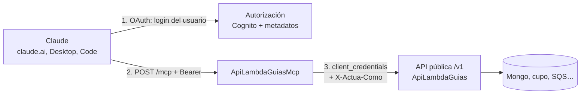

# ADR-006 — Servidor MCP remoto sobre la API pública de guías

**Fecha:** 2026-10-23
**Estado:** **Propuesta.** No hay código del MCP. Se detiene aquí hasta que se validen las decisiones de la sección [Decisiones que necesito de Iker](#decisiones-que-necesito-de-iker).
**HU:** [HU: MCP pedidos claude tanto crear pedidos como revisar pedidos](https://app.clickup.com/t/86e3teac0) (existe, pero **no tiene descripción**: solo el título). Este ADR propone su contenido; no se modificó ClickUp.

---

## Contexto

La [API pública de guías](ApiPublicaGuias.md) permite a integradores crear, consultar y anular guías y ver su cupo. Se quiere que **cualquier IA, principalmente Claude**, haga lo mismo hablando en lenguaje natural ("crea una guía para este pedido", "¿cuánto cupo me queda?", "anula la guía 2400…"). El estándar para eso es el **Model Context Protocol (MCP)**.

Lo que dicen las especificaciones vigentes (verificado el 2026-10-23):

- **Autorización MCP** ([versión 2026-07-28](https://modelcontextprotocol.io/specification/2026-07-28/basic/authorization)): el servidor MCP es un *resource server* OAuth 2.1. Debe publicar **Protected Resource Metadata** (RFC 9728), responder **401 con `WWW-Authenticate`** a quien no trae token, **validar que el token fue emitido para él** (audiencia, RFC 8707) y **no aceptar ni reenviar tokens de otro servicio** (*token passthrough* prohibido). El cliente debe usar **PKCE** y enviar el parámetro `resource`. Para registrar clientes se prefieren los **Client ID Metadata Documents**; el *Dynamic Client Registration* (DCR) quedó **deprecado** pero sigue en uso.
- **Claude como cliente** ([autenticación de conectores](https://claude.com/docs/connectors/building/authentication)): soporta OAuth con DCR o con CIMD, OAuth con credenciales que entrega el administrador al agregar el conector, o una credencial estática en un header (beta, solo organizaciones habilitadas). **No soporta `client_credentials`** (máquina a máquina): siempre hay una persona que inicia sesión. Callback de las apps hospedadas (claude.ai web, Desktop, móvil, Cowork): `https://claude.ai/api/mcp/auth_callback`; Claude Code usa `http://localhost:<puerto>/callback` con puerto variable. Exige `401` real para empezar el login, da **10 s** a los endpoints de descubrimiento y de token, y solo usa el **primer** `authorization_servers` listado. Las peticiones salen de `160.79.104.0/21`.
- **Amazon Cognito** (fuentes: [Zuplo](https://zuplo.com/learn/mcp/compatibility/identity-providers), [AWS community](https://dev.to/aws-builders/building-a-remote-mcp-server-with-oauth-authorization-using-amazon-api-gateway-and-cognito-19ab)): **no** soporta DCR ni CIMD ni el parámetro `resource` (sus access tokens traen `client_id` y `scope`, sin `aud`), y publica metadatos OpenID, no los de OAuth 2.0 RFC 8414. No se encontró un cambio posterior; **hay que confirmarlo contra la documentación actual de Cognito antes de implementar**.
- **SDK C#** oficial [`ModelContextProtocol.AspNetCore`](https://github.com/modelcontextprotocol/csharp-sdk): `AddMcpServer().WithHttpTransport(o => o.Stateless = true).WithTools<…>()` y `app.MapMcp("/mcp")`. En modo *stateless* no hay sesión ni endpoint GET: cada POST es independiente, lo que encaja con Lambda.

Piezas ya decididas que este ADR respeta: la API pública autentica con Cognito `client_credentials` + scopes + API key y un perfil `ApiClientes` ([ADR-002](adr-002-autenticacion.md)); el servicio vive en `ServicioPublicoLogigho/Guias`; no hay Secrets Manager (variables cifradas con AES).

## Decisión propuesta

### 1. Un servidor MCP remoto, delgado, en su propia Lambda

`ServicioPublicoLogigho/Guias/src/ApiLambdaGuiasMcp/` — ASP.NET Core en Lambda (`AddAWSLambdaHosting`, igual que `ApiLambdaGuias`), SDK `ModelContextProtocol.AspNetCore` **2.2.0** (publicada el 2026-08-13; la 2.3.0 es del 2026-10-20 y todavía no cumple las 2 semanas), transporte **Streamable HTTP en modo stateless**, endpoint `POST /mcp`.

Es un **cliente HTTP de la API pública**: **no toca Mongo**, no tiene lógica de negocio ni de cupo. Todo lo que la API valida (permisos por tienda/producto/transportadora, cupo, idempotencia, límites diarios, auditoría) se aplica igual cuando la llamada viene del MCP. Si el MCP tuviera un bug, no puede saltarse esas reglas.

### 2. Herramientas (tools)

| Herramienta | Llama a | Tipo | Notas |
| --- | --- | --- | --- |
| `listar_tiendas` | `GET /v1/tiendas` | lectura | Primero: da el `idTienda` válido |
| `listar_transportadoras` | `GET /v1/transportadoras` | lectura | |
| `listar_productos` | `GET /v1/productos` | lectura | Requiere el endpoint (F1b) |
| `consultar_cupo` | `GET /v1/cupo` | lectura | Disponible por tienda |
| `crear_guia` | `POST /v1/guias` | **escritura, gasta cupo** | Con `vistaPrevia` (ver abajo) |
| `consultar_solicitud` | `GET /v1/solicitudes/{id}` | lectura | Para las que respondieron `202` o `INCIERTA` |
| `obtener_etiqueta` | `GET /v1/guias/{n}/etiqueta` | lectura | Devuelve URL temporal, no el PDF |
| `anular_guia` | `POST /v1/guias/{n}/anulacion` | **destructiva** | Marcada como tal para que el cliente pida confirmación |
| `consultar_pedidos` | `GET /pedidos` | lectura | **Fase 2**: depende de migrar `/pedidos` a `ApiClientes` (hoy usa usuario y contraseña) |

Los lotes (`/v1/lotes`) no se exponen en la primera versión: un asistente conversacional crea guías de a una o pocas; los lotes grandes son para integraciones programáticas.

**Diseño pensado para que Claude las use bien:**

- **Descripciones que dicen cuándo usarla y cuándo no**, no solo qué hace ("Crea UNA guía de envío. Antes llama a `listar_tiendas`; si faltan datos del destinatario, **pregunta al usuario, no los inventes**").
- **Cada parámetro explicado**: unidad (kg, cm, pesos), formato, ejemplo y restricción ("`valorDeclarado`: entero en pesos colombianos, sin puntos ni símbolo; mínimo/máximo según `reglas-negocio.md`"). Los textos salen de la misma fuente que el OpenAPI para que no se desincronicen.
- **Errores accionables**: la API devuelve `codigo`, `traceId` y detalle; el MCP los traduce a una frase que dice qué hacer ("`CUPO_INSUFICIENTE`: disponible $4.000, requerido $14.250; el usuario debe recargar saldo o pedir ampliación a su ejecutivo. No reintentes."). `INCIERTA`/`202` se explican como "no se sabe aún; consulta con `consultar_solicitud`, **no vuelvas a crear**".
- **Idempotencia sin que el modelo la gestione**: el MCP deriva la `Idempotency-Key` de una `referencia` del pedido que da el usuario (o de un hash estable de los datos); si Claude reintenta por un timeout, no se duplica la guía.
- **Anotaciones MCP**: `readOnlyHint` en las lecturas, `destructiveHint` en `anular_guia`, `idempotentHint` en `crear_guia`, `openWorldHint=false`.
- **Respuestas con datos estructurados** (JSON) además del texto, con los costos "con los incrementos de LogiGho" (RC-035), nunca el costo crudo del carrier.
- **`vistaPrevia` en `crear_guia`** (propuesta): valida todo y devuelve el costo estimado y la reserva de cupo **sin crear** la guía. La descripción indica "llama primero con `vistaPrevia=true`, muestra el resumen y pide confirmación". Hace falta que la API lo soporte (un parámetro en F1b). En modo *stateless* el servidor no puede pedir confirmación al usuario por sí mismo (no hay solicitudes servidor→cliente), así que la confirmación la hace el modelo con el usuario.

### 3. Autenticación — la parte difícil

Hay **dos tramos** y no se pueden mezclar:

**(a) Claude → MCP (entrada).** Una persona inicia sesión; el MCP valida un token emitido **para el MCP**.

- El MCP implementa lo que la especificación exige de un *resource server*: `/.well-known/oauth-protected-resource` (con `authorization_servers` y `scopes_supported`), `401` con `WWW-Authenticate: Bearer resource_metadata="…"` y `scope`, `403 insufficient_scope` con el scope requerido, validación de firma, emisor, vencimiento, **audiencia y scope**.
- **Cognito por sí solo no basta** (sin DCR/CIMD/`resource`). Dos caminos:
  - **A — Cliente pre-registrado (propuesto para el piloto).** Un *app client* de Cognito dedicado al conector (con PKCE, callback `https://claude.ai/api/mcp/auth_callback`). El administrador del cliente final lo agrega en Claude como conector personalizado y escribe el *client id* (y secreto si es confidencial) en "configuración avanzada". La **audiencia** se garantiza con un app client y un scope propios (`mcp/…`) en lugar de `aud`, y se documenta como desviación consciente de RFC 8707. Limitación: Claude Code usa un puerto de *localhost* variable y Cognito exige callbacks exactos; hay que fijar el puerto (`--callback-port`) o aceptar que Claude Code quede para la fase B.
  - **B — Fachada de autorización (más adelante).** Una pequeña Lambda (o el propio MCP) que publica `/.well-known/oauth-authorization-server` y `/register` (DCR/CIMD) y delega el login en Cognito, como describe el patrón de la comunidad de AWS. Permite que cualquiera agregue el conector con solo la URL, pero es **código sensible de seguridad** que habría que mantener y auditar.
- **Usuarios.** Un **user pool nuevo** de personas (no el de `client_credentials` `6jmSkfK4B`, que es de máquinas) con MFA, alta por invitación, y un atributo `clienteId` que liga a cada persona con **un** cliente API. Un *pre-token-generation trigger* (V2) lo copia al access token para que el MCP lo lea de un token cuya firma verifica.

**(b) MCP → API pública (salida).** Reenviar el token del usuario a la API está **prohibido** por la especificación (*token passthrough*) y además no serviría: la API espera un token `client_credentials` de un cliente API. Propuesta:

- El MCP tiene **su propio app client M2M** (`mcp-gateway`) con los scopes `guias:*` y `cupo:leer`, y llama a la API con `client_credentials`.
- La API reconoce a ese cliente como **delegado** (campo nuevo en su perfil `ApiClientes`: `PuedeActuarComo = true`) y lee el header **`X-Actua-Como: <clienteId>`**. Solo para ese cliente, la API carga el **perfil del cliente indicado** y evalúa todo (permisos, cupo, límites) contra él. Para cualquier otro cliente el header se ignora y se registra como intento sospechoso.
- Todo queda en `ApiAuditoria` con **tres identidades**: la persona (`sub`), el cliente al que representa y el cliente delegado (`mcp-gateway`).
- Alternativa descartada: guardar el secreto M2M de cada cliente en el MCP (cientos de secretos, sin Secrets Manager).

El `clienteId` que viaja en `X-Actua-Como` sale **exclusivamente del token del usuario ya verificado**, nunca de lo que diga el modelo ni de un argumento de una herramienta.

### 4. Hosting y red

- Lambda `.NET 10` detrás de un **HTTP API (API Gateway v2) con dominio propio** (por ejemplo `mcp.<dominio>`), mapeado en la raíz. Claude y los clientes MCP esperan `/.well-known/*` en la raíz del dominio (o un `resource_metadata` explícito en el `401`); un REST con prefijo de *stage* lo complica. **Es una excepción a la convención "un solo REST por entorno"**, justificada por ese requisito; requiere su visto bueno.
- Modo *stateless* y respuestas cortas: caben en el límite de 29 s del gateway; sin SSE de larga duración ni sesiones.
- WAF regional como la API; el `Host` permitido se fija explícitamente.
- Las llamadas de Claude llegan desde `160.79.104.0/21`: el dominio de autorización de Cognito (Managed Login) debe ser alcanzable desde ahí.
- Mismas reglas de siempre: configuración con variables cifradas AES, logs JSON sin datos personales, `traceId` propagado MCP → API.

### 5. Seguridad específica de un servidor MCP

- **Prompt injection.** Las respuestas contienen texto de terceros (nombres, direcciones, observaciones de pedidos). Se devuelven como **datos** en campos estructurados, ninguna herramienta ejecuta nada en función de ese texto, y las descripciones dicen que son datos no confiables. `anular_guia` exige el número exacto y es `destructiveHint`.
- **Gasto de dinero.** `crear_guia` consume cupo: ya lo limita el cupo de la tienda y el conteo diario. Además se pone un **límite por persona y por minuto** en el MCP.
- **Mínimo privilegio.** Los scopes del token del usuario (`mcp.leer`, `mcp.crear`, `mcp.anular`, `mcp.cupo`) se traducen a los de la API; un usuario de solo lectura no puede crear aunque el modelo lo intente.
- **Sin estado, sin datos en el MCP.** No guarda nada: ni sesiones, ni respuestas.
- **Caducidad y revocación.** Tokens de acceso cortos; bloquear a un cliente en `ApiClientes` (≤ 30 s) corta también el MCP, porque la API rechaza al cliente delegado en su nombre.

### 6. Pruebas y calidad (cuando se implemente)

Pruebas de protocolo con el cliente del propio SDK en memoria; MCP Inspector contra el despliegue; pruebas de autorización (sin token, token de otra audiencia, scope insuficiente, cliente bloqueado, intento de suplantar con `X-Actua-Como`); fotos (*snapshots*) de los esquemas JSON de cada herramienta para que un cambio de descripción sea visible en el *diff*; y **evaluaciones con Claude real** sobre un conjunto de tareas ("crea una guía con estos datos", "no tengo cupo, ¿qué hago?", "anula la última") medidas por éxito de la llamada y ausencia de invenciones.

## Alternativas consideradas

| Opción | Por qué no (o por qué después) |
| --- | --- |
| **Servidor MCP local (stdio)** distribuido a cada usuario | Credenciales en laptops, sin control de versiones ni revocación; Claude web y móvil no lo usan |
| **Solo OpenAPI / función HTTP** sin MCP | Cada IA tendría que aprender la API; no aprovecha conectores de Claude |
| **MCP dentro de la misma Lambda de la API** | Mezcla dos modelos de autenticación en un mismo proceso y acopla despliegues; el MCP debe poder caer sin afectar a los integradores programáticos |
| **Credencial estática en header** (`static_headers`, beta) | Una llave de larga vida compartida por toda la organización, sin identidad de persona y solo para organizaciones habilitadas por Anthropic |
| **Guardar el secreto M2M de cada cliente en el MCP** | Cientos de secretos sin Secrets Manager; una fuga expone a todos |
| **Servicio gestionado de pasarela MCP de AWS (Bedrock AgentCore Gateway u otro)** | **No se evaluó a fondo.** Podría reemplazar la capa de autorización y el alojamiento; vale una investigación corta antes de decidir B (fachada propia) |
| **Fachada de autorización propia desde el día 1** (camino B) | Mucha superficie de seguridad para un piloto; el camino A cubre a los primeros clientes |

## Decisiones que necesito de Iker

1. **¿Quién usará el MCP?** Personal de los integradores, personal interno de LogiGho (soporte/operaciones), o ambos. Cambia el user pool, los roles y el alcance de las herramientas (un usuario interno querría ver varios clientes).
2. **Modelo de salida**: ¿aceptas el *cliente delegado* (`mcp-gateway` + `X-Actua-Como`) con auditoría de tres identidades? Es un cambio pequeño pero **sensible** en la API (un cliente que puede actuar como otros).
3. **Camino de autorización**: A (cliente pre-registrado, el administrador de cada cliente pega un *client id*) para el piloto y B (fachada con DCR/CIMD) después, o directo a B.
4. **Excepción a "un solo REST por entorno"**: un HTTP API con dominio propio para el MCP. ¿Qué dominio?
5. **Pool de usuarios nuevo** con MFA e invitación, ¿o reutilizar uno existente?
6. **`vistaPrevia`** en `POST /v1/guias`: ¿se agrega a F1b? (Sin ella, la confirmación previa a crear queda solo en el texto de la herramienta.)
7. **`consultar_pedidos`**: se pospone hasta migrar `/pedidos` a `ApiClientes`. ¿De acuerdo?
8. **Orden de entrega**: lectura (`listar_*`, `consultar_*`) → `crear_guia` con `vistaPrevia` → `anular_guia`. ¿Se arranca solo con lectura?
9. **Contenido de la HU de ClickUp**: hoy está vacía; ¿la completo con este ADR cuando lo apruebes?

## Consecuencias

- Una sola superficie de negocio (la API pública): el MCP hereda sus garantías y no las puede romper.
- Se agrega un cliente delegado y un user pool de personas: más piezas de identidad que operar.
- El camino A obliga a que cada administrador de cliente configure el conector a mano; es aceptable para un piloto y se elimina con el camino B.
- Dependencia de dos estándares que se mueven (autorización MCP, comportamiento de Claude): los requisitos de este ADR están fechados y deben revisarse antes de implementar.

## Fuentes

- [Especificación de autorización MCP (2026-07-28)](https://modelcontextprotocol.io/specification/2026-07-28/basic/authorization) y [la versión 2025-11-25](https://modelcontextprotocol.io/specification/2025-11-25/basic/authorization)
- [Autenticación de conectores de Claude](https://claude.com/docs/connectors/building/authentication)
- [Conectores personalizados con servidores MCP remotos (soporte de Claude)](https://support.claude.com/en/articles/11503834)
- [SDK C# del MCP](https://github.com/modelcontextprotocol/csharp-sdk)
- [Compatibilidad de proveedores de identidad con MCP (Zuplo)](https://zuplo.com/learn/mcp/compatibility/identity-providers) y [MCP con API Gateway y Cognito (comunidad AWS)](https://dev.to/aws-builders/building-a-remote-mcp-server-with-oauth-authorization-using-amazon-api-gateway-and-cognito-19ab)
