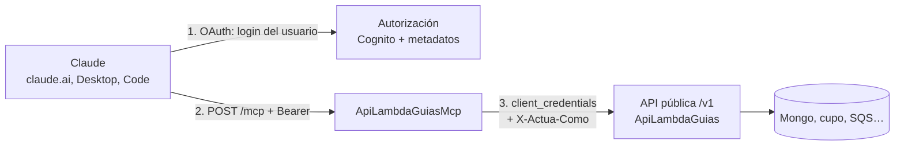

# ADR-006 — Servidor MCP remoto sobre la API pública de guías

**Fecha:** 2026-10-23
**Estado:** **Aceptada con ajustes** el 2026-10-23: Iker respondió las 9 decisiones (ver [Decisiones tomadas](#decisiones-tomadas)). El texto de las secciones de abajo es la propuesta original; **cuando una decisión la modifica, manda la sección [Decisiones tomadas](#decisiones-tomadas)**. Se construye primero un **beta de lectura**.
**HU:** [HU: MCP pedidos claude tanto crear pedidos como revisar pedidos](https://app.clickup.com/t/86e3teac0) (existe, pero **no tiene descripción**: solo el título). Este ADR propone su contenido; no se modificó ClickUp.

---

## Contexto

La [API pública de guías](ApiPublicaGuias.md) permite a integradores crear, consultar y anular guías y ver su cupo. Se quiere que **cualquier IA, principalmente Claude**, haga lo mismo hablando en lenguaje natural ("crea una guía para este pedido", "¿cuánto cupo me queda?", "anula la guía 2400…"). El estándar para eso es el **Model Context Protocol (MCP)**.

Lo que dicen las especificaciones vigentes (verificado el 2026-10-23):

- **Autorización MCP** ([versión 2026-07-28](https://modelcontextprotocol.io/specification/2026-07-28/basic/authorization)): el servidor MCP es un *resource server* OAuth 2.1. Debe publicar **Protected Resource Metadata** (RFC 9728), responder **401 con `WWW-Authenticate`** a quien no trae token, **validar que el token fue emitido para él** (audiencia, RFC 8707) y **no aceptar ni reenviar tokens de otro servicio** (*token passthrough* prohibido). El cliente debe usar **PKCE** y enviar el parámetro `resource`. Para registrar clientes se prefieren los **Client ID Metadata Documents**; el *Dynamic Client Registration* (DCR) quedó **deprecado** pero sigue en uso.
- **Claude como cliente** ([autenticación de conectores](https://claude.com/docs/connectors/building/authentication)): soporta OAuth con DCR o con CIMD, OAuth con credenciales que entrega el administrador al agregar el conector, o una credencial estática en un header (beta, solo organizaciones habilitadas). **No soporta `client_credentials`** (máquina a máquina): siempre hay una persona que inicia sesión. Callback de las apps hospedadas (claude.ai web, Desktop, móvil, Cowork): `https://claude.ai/api/mcp/auth_callback`; Claude Code usa `http://localhost:<puerto>/callback` con puerto variable. Exige `401` real para empezar el login, da **10 s** a los endpoints de descubrimiento y de token, y solo usa el **primer** `authorization_servers` listado. Las peticiones salen de `160.79.104.0/21`.
- **Amazon Cognito** (fuentes: [Zuplo](https://zuplo.com/learn/mcp/compatibility/identity-providers), [AWS community](https://dev.to/aws-builders/building-a-remote-mcp-server-with-oauth-authorization-using-amazon-api-gateway-and-cognito-19ab)): **no** soporta DCR ni CIMD ni el parámetro `resource` (sus access tokens traen `client_id` y `scope`, sin `aud`), y publica metadatos OpenID, no los de OAuth 2.0 RFC 8414. No se encontró un cambio posterior; **hay que confirmarlo contra la documentación actual de Cognito antes de implementar**.
- **SDK C#** oficial [`ModelContextProtocol.AspNetCore`](https://github.com/modelcontextprotocol/csharp-sdk): `AddMcpServer().WithHttpTransport(o => o.Stateless = true).WithTools<…>()` y `app.MapMcp("/mcp")`. En modo *stateless* no hay sesión ni endpoint GET: cada POST es independiente, lo que encaja con Lambda.

Piezas ya decididas que este ADR respeta: la API pública autentica con Cognito `client_credentials` + scopes + API key y un perfil `ApiClientes` ([ADR-002](adr-002-autenticacion.md)); el servicio vive en `ServicioPublicoLogigho/Guias`; no hay Secrets Manager (variables cifradas con AES).

## Decisiones tomadas

Respuestas de Iker del 2026-10-23, en el orden de las 9 preguntas del ADR:

| # | Tema | Decisión | Qué cambia respecto de la propuesta |
| --- | --- | --- | --- |
| 1 | Quién usa el MCP | **Usuarios de la colección de usuarios API** (la que absorbe `ApiUsuariosTiendas` dentro de `ApiClientes`, ADR-002). Para conectarse al MCP, los datos del login **deben coincidir** con un usuario de esa colección | La persona se identifica por su **`sub` de Cognito**, igual que hoy en `/pedidos`; el vínculo persona ↔ cliente sale de la colección, **no** de un atributo de Cognito ni de un trigger |
| 2 | Salida MCP → API | **Cliente delegado** (`mcp-gateway`) con `client_credentials` + header **`X-Actua-Como-Usuario: `**; la API busca ese usuario en la colección, carga SU perfil y evalúa todo contra él | El header lleva el **`sub` verificado** (no el `clienteId`), así el MCP sigue sin tocar Mongo: la búsqueda la hace la API. Solo el cliente delegado puede usarlo |
| 3 | Autorización de la persona | **Camino A** con los **mismos usuarios y contraseñas**: nuevo *app client* en el pool existente (authorization code + PKCE, callback de Claude) y pantalla de login de Cognito. Camino B (fachada DCR/CIMD) para más adelante | Claude no puede llamar a `POST /token` con usuario y contraseña; lo que cambia es **cómo** se hace el login (OAuth), no las credenciales |
| 4 | Dónde se aloja | **Dentro del REST `rl7zt6zak5`**, no un HTTP API aparte | Sin excepción a "un solo REST". El `401` lleva el `resource_metadata` explícito (Claude lo acepta en cualquier URL HTTPS) y la URL que el usuario pega en Claude incluye el *stage*. Los métodos del MCP **no** usan el authorizer del gateway ni API key (el MCP valida el token y devuelve el `401` que Claude necesita) |
| 5 | Pool de usuarios | **Sin pool nuevo**: se reutiliza el de `/pedidos` (`6jmSkfK4B`) | Resuelta por la 1 y la 3 |
| 6 | `vistaPrevia` | **Sí**, parte de F1b | `POST /v1/guias` con `vistaPrevia=true` valida y devuelve costo y reserva **sin** crear ni apartar cupo |
| 7 | `consultar_pedidos` | **Fase 2.** `/pedidos` tiene que migrar a `ApiClientes`, pero no ahora | Fuera del beta |
| 8 | Orden de entrega | **Beta de lectura primero** | Beta 1: estructura + login + delegación + `listar_tiendas` y `listar_transportadoras` (las que la API ya tiene). Después, a medida que la API las tenga: `consultar_cupo`, `listar_productos`, `consultar_solicitud`, `obtener_etiqueta`, `crear_guia` (con `vistaPrevia`), `anular_guia` |
| 9 | HU de ClickUp | **Completarla** con un resumen de este ADR | Hecho el 2026-10-23 |

Objetivo declarado por Iker: *"que funcione un beta del MCP, tampoco completo, pero ir armando la estructura"*.

**Riesgos que traen estas decisiones** (a vigilar):

- Sin MFA: el login del MCP queda con la fortaleza actual del pool. Se puede exigir MFA solo en el *app client* del MCP.
- Dentro del REST con prefijo de *stage*, el `resource` del metadato debe coincidir **exactamente** con la URL que se pega en Claude; si más adelante se pone un dominio propio, hay que volver a registrar el conector.
- Claude Code usa un puerto de *localhost* variable y Cognito exige *callbacks* exactos: queda fuera del beta salvo que se fije el puerto.

## Estado de la implementación (beta 1)

Código en `ServicioPublicoLogigho/Guias/src/ApiLambdaGuiasMcp/` (rama `feature/api-publica-guias`). Qué hay y qué no:

| Pieza | Estado |
| --- | --- |
| Servidor MCP *stateless* (Streamable HTTP) con `ModelContextProtocol.AspNetCore` 2.2.0 | Hecho |
| `401` con `WWW-Authenticate: Bearer resource_metadata="…"` y documento de metadatos (RFC 9728) | Hecho |
| Validación del access token de Cognito (firma RS256, emisor, vencimiento, `token_use=access`, `client_id` = app client del MCP, scope `logigho/mcp:usar`) y `403 insufficient_scope` | Hecho |
| Token del cliente delegado (`client_credentials`, cacheado, una sola renovación a la vez) y cliente HTTP de la API (API key, `X-Actua-Como-Usuario`, reintento solo en GET, tope de 8 s) | Hecho |
| Herramientas `listar_tiendas` y `listar_transportadoras` (solo lectura) | Hecho |
| Terraform del MCP (`crear_mcp`, **apagado por defecto**): función, rutas sin authorizer en `rl7zt6zak5`, *app client* de las personas y scope `mcp:usar`; con pruebas sin cuenta de AWS | Hecho (código, `validate` y `terraform test`; **sin `plan` ni `apply`**) |
| Límite de uso por persona (cuando existan herramientas que gastan cupo) | Pendiente (con `crear_guia`) |
| `consultar_cupo`, `listar_productos`, `consultar_solicitud`, `obtener_etiqueta`, `crear_guia`, `anular_guia` | Pendiente (a medida que la API tenga el endpoint) |

### PreProd: decisiones de Iker (2026-10-23) y cómo quedó el Terraform

| Tema | Decisión | Efecto |
| --- | --- | --- |
| REST público de PreProd | **Crear uno nuevo con Terraform**, regional, espejo de `rl7zt6zak5` | `ApiIntegracionesExternas-PreProd`, con su authorizer, deployment y stage (`crear_rest_api`). No se toca el REST de plataforma `8u5isw5u30` |
| Cognito | **Pools propios de PreProd**: uno M2M para integradores y uno de personas para el MCP | Módulo `guias-identidad`. Ninguna prueba toca identidades de producción. En producción sigue valiendo la decisión 5 (reutilizar `6jmSkfK4B`) |
| MFA de las personas | **Opcional** | `mfa_configuration = OPTIONAL`, solo por aplicación (TOTP); cada persona decide |
| F1b | Espera a `reglas-negocio.md` (Iker responde al chat de reglas) | No se empieza |

El emisor que valida el MCP es el del pool de **personas**; el cliente delegado `mcp-gateway` vive en el pool de **integradores** (es una máquina y
llama a la API con su token). El resource server `logigho` existe en los dos pools con scopes distintos, así que un token de una persona no sirve en la API de
integradores ni al revés.

### Encender el MCP en PreProd (lista para Iker)

Todo es código ya validado con `fmt`, `validate` y `terraform test` (sin cuenta de AWS). **Nadie ha ejecutado `plan` ni `apply`.**

1. **Renueva el SSO de AWS** de la cuenta PreProd y revisa que el estado remoto (`logigho-tfstate-preprod`) responda.
2. **`terraform plan` en `environments/preprod/guias`** (lo ejecutas tú o me lo pides): debe crear los dos pools con sus dominios, el REST, el authorizer, las 13 rutas
   `/v1/*`, el deployment, el stage, el plan de uso, las funciones, la cola y el bucket de trazas. Los prefijos de dominio (`prefijo_dominio_integradores`,
   `prefijo_dominio_personas`) deben ser únicos en la región; si colisionan, cámbialos.
3. **`apply`** si el plan es el esperado. Salida `identidad`: ids de pool y URLs de dominio.
4. **Crea el app client M2M `mcp-gateway`** en el pool de integradores: `client_credentials`, scope `logigho/guias:leer`, con secreto. Su secreto va al variable
   group, **no** a Terraform. Lo mismo para el app client M2M de cada integrador de prueba.
5. **Crea la API key** del plan de uso (`ApiPublicaGuias-preprod-estandar`) y asóciala al plan.
6. **En el variable group del pipeline** (`Lambdas-ServicioPublico-CD`): `Mcp__ApiKey`, `Mcp__SecretoDelegado`, y las variables cifradas de la API (`CADENA_CONEXION`,
   `ID_CLIENTE`, `USER_AUTH`, `TOKEN_AUTH`, `SUCURSAL_GENERICA`, `URL_SERVICIO_INTER`). Hoy el CI empaqueta las tres Lambdas; hay que comprobar que el CD de PreProd
   publique también `ApiLambdaGuiasMcp`.
7. **Enciende el MCP:** en `preprod/guias/main.tf`, `crear_mcp = true` y `mcp_cliente_id_delegado = "<client id de mcp-gateway>"`. Segundo `plan` y `apply`.
8. **Datos en Atlas de PreProd** (yo no escribo en Mongo de PreProd; puedo dejarte los JSON listos): el documento `mcp-gateway` en `ApiClientes` con
   `PuedeActuarComo: true` y `Estado: "ACTIVO"`, y los clientes de prueba con sus `Tiendas` y `Usuarios` (`sub` de Cognito). Alta de las personas en el pool de
   personas (invitación) para obtener su `sub`.
9. **Conecta Claude:** Configuración, Conectores, «Agregar conector personalizado»; URL = salida `mcp_url_conector`; en configuración avanzada, client id =
   `mcp_cliente_id_personas` (sin secreto). Prueba: «¿qué tiendas tengo?».
10. **Pendiente de confirmar:** que Cognito siga sin DCR/CIMD/`resource` (documentación actual) y el WAF (`crear_waf = false` por ahora; el REST es nuevo y nadie más lo usa).

### Configuración (variables de entorno `Mcp__*`, las pone el pipeline desde el variable group)

La Lambda **no arranca** si falta alguna (el mensaje dice cuál, nunca el valor).

| Variable | Qué es | Secreto |
| --- | --- | --- |
| `Mcp__UrlPublica` | URL exacta que se pega en Claude, con *stage* y terminada en `/mcp`; también es el `resource` de los metadatos | No |
| `Mcp__Emisor` | Emisor del pool de Cognito (`https://cognito-idp.us-east-1.amazonaws.com/us-east-1_6jmSkfK4B`) | No |
| `Mcp__ClienteIdMcp` | *App client* del MCP (código + PKCE). Es la amarra de audiencia | No |
| `Mcp__ScopeRequerido` | Por defecto `logigho/mcp:usar` | No |
| `Mcp__ApiUrlBase` | URL de la API pública con *stage* | No |
| `Mcp__ApiKey` | API key del plan de uso de la API | **Sí** |
| `Mcp__TokenEndpointDelegado` | `/oauth2/token` del dominio de Cognito del cliente delegado | No |
| `Mcp__ClienteIdDelegado` / `Mcp__SecretoDelegado` | Credenciales de `mcp-gateway` | **Secreto** |
| `Mcp__ScopeDelegado` | Por defecto `logigho/guias:leer` (en el beta solo lectura) | No |

### Decisiones de implementación

- **Audiencia sin `aud`:** Cognito no lo pone en los access tokens, así que se exige `client_id` = el *app client* del MCP. Un token del mismo pool
  pero de otro *app client* (por ejemplo el de `/pedidos`) se rechaza (hay una prueba que lo demuestra; se comprobó que falla si se quita la regla).
- **El `sub` sale del token validado**, no de argumentos: las herramientas del beta no tienen ningún parámetro, y hay una prueba que manda
  argumentos tramposos (`sub`, `actuaComo`) y comprueba qué llegó a la API.
- **Metadatos servidos dos veces:** API Gateway entrega la ruta *sin* el stage, pero el `401` anuncia la URL pública *con* stage; el esquema del SDK solo
  responde en esa ruta con stage, así que el mismo documento se sirve también en `/.well-known/oauth-protected-resource`.
- **Errores:** la API devuelve `codigo` y `traceId`; el MCP los traduce a una frase en español que dice qué hacer ("No reintentes…", "Puedes reintentar en un
  momento") y lo envía como error de la herramienta. Los códigos de delegación (`ACTUA_COMO_*`, `IP_NO_PERMITIDA`) se muestran como "no está bien
  configurado", sin detalles internos. No se repite el `detail` de la API.
- **Sin secretos en logs:** una prueba fuerza fallos de Cognito y de la API y busca el secreto, la API key, el token del delegado y el de la persona en todos los logs.
- **Entrada del programa:** `ProgramaMcp.Main` (no sentencias de nivel superior) para no chocar con el `Program` de `ApiLambdaGuias` en el proyecto de pruebas.

## Decisión propuesta (texto original)

### 1. Un servidor MCP remoto, delgado, en su propia Lambda

`ServicioPublicoLogigho/Guias/src/ApiLambdaGuiasMcp/` — ASP.NET Core en Lambda (`AddAWSLambdaHosting`, igual que `ApiLambdaGuias`), SDK `ModelContextProtocol.AspNetCore` **2.2.0** (publicada el 2026-08-13; la 2.3.0 es del 2026-10-20 y todavía no cumple las 2 semanas), transporte **Streamable HTTP en modo stateless**, endpoint `POST /mcp`.

Es un **cliente HTTP de la API pública**: **no toca Mongo**, no tiene lógica de negocio ni de cupo. Todo lo que la API valida (permisos por tienda/producto/transportadora, cupo, idempotencia, límites diarios, auditoría) se aplica igual cuando la llamada viene del MCP. Si el MCP tuviera un bug, no puede saltarse esas reglas.

### 2. Herramientas (tools)

| Herramienta | Llama a | Tipo | Notas |
| --- | --- | --- | --- |
| `listar_tiendas` | `GET /v1/tiendas` | lectura | Primero: da el `idTienda` válido |
| `listar_transportadoras` | `GET /v1/transportadoras` | lectura | |
| `listar_productos` | `GET /v1/productos` | lectura | Requiere el endpoint (F1b) |
| `consultar_cupo` | `GET /v1/cupo` | lectura | Disponible por tienda |
| `crear_guia` | `POST /v1/guias` | **escritura, gasta cupo** | Con `vistaPrevia` (ver abajo) |
| `consultar_solicitud` | `GET /v1/solicitudes/{id}` | lectura | Para las que respondieron `202` o `INCIERTA` |
| `obtener_etiqueta` | `GET /v1/guias/{n}/etiqueta` | lectura | Devuelve URL temporal, no el PDF |
| `anular_guia` | `POST /v1/guias/{n}/anulacion` | **destructiva** | Marcada como tal para que el cliente pida confirmación |
| `consultar_pedidos` | `GET /pedidos` | lectura | **Fase 2**: depende de migrar `/pedidos` a `ApiClientes` (hoy usa usuario y contraseña) |

Los lotes (`/v1/lotes`) no se exponen en la primera versión: un asistente conversacional crea guías de a una o pocas; los lotes grandes son para integraciones programáticas.

**Diseño pensado para que Claude las use bien:**

- **Descripciones que dicen cuándo usarla y cuándo no**, no solo qué hace ("Crea UNA guía de envío. Antes llama a `listar_tiendas`; si faltan datos del destinatario, **pregunta al usuario, no los inventes**").
- **Cada parámetro explicado**: unidad (kg, cm, pesos), formato, ejemplo y restricción ("`valorDeclarado`: entero en pesos colombianos, sin puntos ni símbolo; mínimo/máximo según `reglas-negocio.md`"). Los textos salen de la misma fuente que el OpenAPI para que no se desincronicen.
- **Errores accionables**: la API devuelve `codigo`, `traceId` y detalle; el MCP los traduce a una frase que dice qué hacer ("`CUPO_INSUFICIENTE`: disponible $4.000, requerido $14.250; el usuario debe recargar saldo o pedir ampliación a su ejecutivo. No reintentes."). `INCIERTA`/`202` se explican como "no se sabe aún; consulta con `consultar_solicitud`, **no vuelvas a crear**".
- **Idempotencia sin que el modelo la gestione**: el MCP deriva la `Idempotency-Key` de una `referencia` del pedido que da el usuario (o de un hash estable de los datos); si Claude reintenta por un timeout, no se duplica la guía.
- **Anotaciones MCP**: `readOnlyHint` en las lecturas, `destructiveHint` en `anular_guia`, `idempotentHint` en `crear_guia`, `openWorldHint=false`.
- **Respuestas con datos estructurados** (JSON) además del texto, con los costos "con los incrementos de LogiGho" (RC-035), nunca el costo crudo del carrier.
- **`vistaPrevia` en `crear_guia`** (propuesta): valida todo y devuelve el costo estimado y la reserva de cupo **sin crear** la guía. La descripción indica "llama primero con `vistaPrevia=true`, muestra el resumen y pide confirmación". Hace falta que la API lo soporte (un parámetro en F1b). En modo *stateless* el servidor no puede pedir confirmación al usuario por sí mismo (no hay solicitudes servidor→cliente), así que la confirmación la hace el modelo con el usuario.

### 3. Autenticación — la parte difícil

Hay **dos tramos** y no se pueden mezclar:

**(a) Claude → MCP (entrada).** Una persona inicia sesión; el MCP valida un token emitido **para el MCP**.

- El MCP implementa lo que la especificación exige de un *resource server*: `/.well-known/oauth-protected-resource` (con `authorization_servers` y `scopes_supported`), `401` con `WWW-Authenticate: Bearer resource_metadata="…"` y `scope`, `403 insufficient_scope` con el scope requerido, validación de firma, emisor, vencimiento, **audiencia y scope**.
- **Cognito por sí solo no basta** (sin DCR/CIMD/`resource`). Dos caminos:
  - **A — Cliente pre-registrado (propuesto para el piloto).** Un *app client* de Cognito dedicado al conector (con PKCE, callback `https://claude.ai/api/mcp/auth_callback`). El administrador del cliente final lo agrega en Claude como conector personalizado y escribe el *client id* (y secreto si es confidencial) en "configuración avanzada". La **audiencia** se garantiza con un app client y un scope propios (`mcp/…`) en lugar de `aud`, y se documenta como desviación consciente de RFC 8707. Limitación: Claude Code usa un puerto de *localhost* variable y Cognito exige callbacks exactos; hay que fijar el puerto (`--callback-port`) o aceptar que Claude Code quede para la fase B.
  - **B — Fachada de autorización (más adelante).** Una pequeña Lambda (o el propio MCP) que publica `/.well-known/oauth-authorization-server` y `/register` (DCR/CIMD) y delega el login en Cognito, como describe el patrón de la comunidad de AWS. Permite que cualquiera agregue el conector con solo la URL, pero es **código sensible de seguridad** que habría que mantener y auditar.
- **Usuarios.** Un **user pool nuevo** de personas (no el de `client_credentials` `6jmSkfK4B`, que es de máquinas) con MFA, alta por invitación, y un atributo `clienteId` que liga a cada persona con **un** cliente API. Un *pre-token-generation trigger* (V2) lo copia al access token para que el MCP lo lea de un token cuya firma verifica.

**(b) MCP → API pública (salida).** Reenviar el token del usuario a la API está **prohibido** por la especificación (*token passthrough*) y además no serviría: la API espera un token `client_credentials` de un cliente API. Propuesta:

- El MCP tiene **su propio app client M2M** (`mcp-gateway`) con los scopes `guias:*` y `cupo:leer`, y llama a la API con `client_credentials`.
- La API reconoce a ese cliente como **delegado** (campo nuevo en su perfil `ApiClientes`: `PuedeActuarComo = true`) y lee el header **`X-Actua-Como: <clienteId>`**. Solo para ese cliente, la API carga el **perfil del cliente indicado** y evalúa todo (permisos, cupo, límites) contra él. Para cualquier otro cliente el header se ignora y se registra como intento sospechoso.
- Todo queda en `ApiAuditoria` con **tres identidades**: la persona (`sub`), el cliente al que representa y el cliente delegado (`mcp-gateway`).
- Alternativa descartada: guardar el secreto M2M de cada cliente en el MCP (cientos de secretos, sin Secrets Manager).

El `clienteId` que viaja en `X-Actua-Como` sale **exclusivamente del token del usuario ya verificado**, nunca de lo que diga el modelo ni de un argumento de una herramienta.

### 4. Hosting y red

- Lambda `.NET 10` detrás de un **HTTP API (API Gateway v2) con dominio propio** (por ejemplo `mcp.<dominio>`), mapeado en la raíz. Claude y los clientes MCP esperan `/.well-known/*` en la raíz del dominio (o un `resource_metadata` explícito en el `401`); un REST con prefijo de *stage* lo complica. **Es una excepción a la convención "un solo REST por entorno"**, justificada por ese requisito; requiere su visto bueno.
- Modo *stateless* y respuestas cortas: caben en el límite de 29 s del gateway; sin SSE de larga duración ni sesiones.
- WAF regional como la API; el `Host` permitido se fija explícitamente.
- Las llamadas de Claude llegan desde `160.79.104.0/21`: el dominio de autorización de Cognito (Managed Login) debe ser alcanzable desde ahí.
- Mismas reglas de siempre: configuración con variables cifradas AES, logs JSON sin datos personales, `traceId` propagado MCP → API.

### 5. Seguridad específica de un servidor MCP

- **Prompt injection.** Las respuestas contienen texto de terceros (nombres, direcciones, observaciones de pedidos). Se devuelven como **datos** en campos estructurados, ninguna herramienta ejecuta nada en función de ese texto, y las descripciones dicen que son datos no confiables. `anular_guia` exige el número exacto y es `destructiveHint`.
- **Gasto de dinero.** `crear_guia` consume cupo: ya lo limita el cupo de la tienda y el conteo diario. Además se pone un **límite por persona y por minuto** en el MCP.
- **Mínimo privilegio.** Los scopes del token del usuario (`mcp.leer`, `mcp.crear`, `mcp.anular`, `mcp.cupo`) se traducen a los de la API; un usuario de solo lectura no puede crear aunque el modelo lo intente.
- **Sin estado, sin datos en el MCP.** No guarda nada: ni sesiones, ni respuestas.
- **Caducidad y revocación.** Tokens de acceso cortos; bloquear a un cliente en `ApiClientes` (≤ 30 s) corta también el MCP, porque la API rechaza al cliente delegado en su nombre.

### 6. Pruebas y calidad (cuando se implemente)

Pruebas de protocolo con el cliente del propio SDK en memoria; MCP Inspector contra el despliegue; pruebas de autorización (sin token, token de otra audiencia, scope insuficiente, cliente bloqueado, intento de suplantar con `X-Actua-Como`); fotos (*snapshots*) de los esquemas JSON de cada herramienta para que un cambio de descripción sea visible en el *diff*; y **evaluaciones con Claude real** sobre un conjunto de tareas ("crea una guía con estos datos", "no tengo cupo, ¿qué hago?", "anula la última") medidas por éxito de la llamada y ausencia de invenciones.

## Alternativas consideradas

| Opción | Por qué no (o por qué después) |
| --- | --- |
| **Servidor MCP local (stdio)** distribuido a cada usuario | Credenciales en laptops, sin control de versiones ni revocación; Claude web y móvil no lo usan |
| **Solo OpenAPI / función HTTP** sin MCP | Cada IA tendría que aprender la API; no aprovecha conectores de Claude |
| **MCP dentro de la misma Lambda de la API** | Mezcla dos modelos de autenticación en un mismo proceso y acopla despliegues; el MCP debe poder caer sin afectar a los integradores programáticos |
| **Credencial estática en header** (`static_headers`, beta) | Una llave de larga vida compartida por toda la organización, sin identidad de persona y solo para organizaciones habilitadas por Anthropic |
| **Guardar el secreto M2M de cada cliente en el MCP** | Cientos de secretos sin Secrets Manager; una fuga expone a todos |
| **Servicio gestionado de pasarela MCP de AWS (Bedrock AgentCore Gateway u otro)** | **No se evaluó a fondo.** Podría reemplazar la capa de autorización y el alojamiento; vale una investigación corta antes de decidir B (fachada propia) |
| **Fachada de autorización propia desde el día 1** (camino B) | Mucha superficie de seguridad para un piloto; el camino A cubre a los primeros clientes |

## Decisiones que se necesitaban de Iker

Respondidas: ver [Decisiones tomadas](#decisiones-tomadas). La lista original era: usuarios del MCP, modelo delegado, camino de autorización, dominio, pool de usuarios, `vistaPrevia`, `consultar_pedidos`, orden de entrega y contenido de la HU.

## Consecuencias

- Una sola superficie de negocio (la API pública): el MCP hereda sus garantías y no las puede romper.
- Se agrega un cliente delegado y un user pool de personas: más piezas de identidad que operar.
- El camino A obliga a que cada administrador de cliente configure el conector a mano; es aceptable para un piloto y se elimina con el camino B.
- Dependencia de dos estándares que se mueven (autorización MCP, comportamiento de Claude): los requisitos de este ADR están fechados y deben revisarse antes de implementar.

## Fuentes

- [Especificación de autorización MCP (2026-07-28)](https://modelcontextprotocol.io/specification/2026-07-28/basic/authorization) y [la versión 2025-11-25](https://modelcontextprotocol.io/specification/2025-11-25/basic/authorization)
- [Autenticación de conectores de Claude](https://claude.com/docs/connectors/building/authentication)
- [Conectores personalizados con servidores MCP remotos (soporte de Claude)](https://support.claude.com/en/articles/11503834)
- [SDK C# del MCP](https://github.com/modelcontextprotocol/csharp-sdk)
- [Compatibilidad de proveedores de identidad con MCP (Zuplo)](https://zuplo.com/learn/mcp/compatibility/identity-providers) y [MCP con API Gateway y Cognito (comunidad AWS)](https://dev.to/aws-builders/building-a-remote-mcp-server-with-oauth-authorization-using-amazon-api-gateway-and-cognito-19ab)
