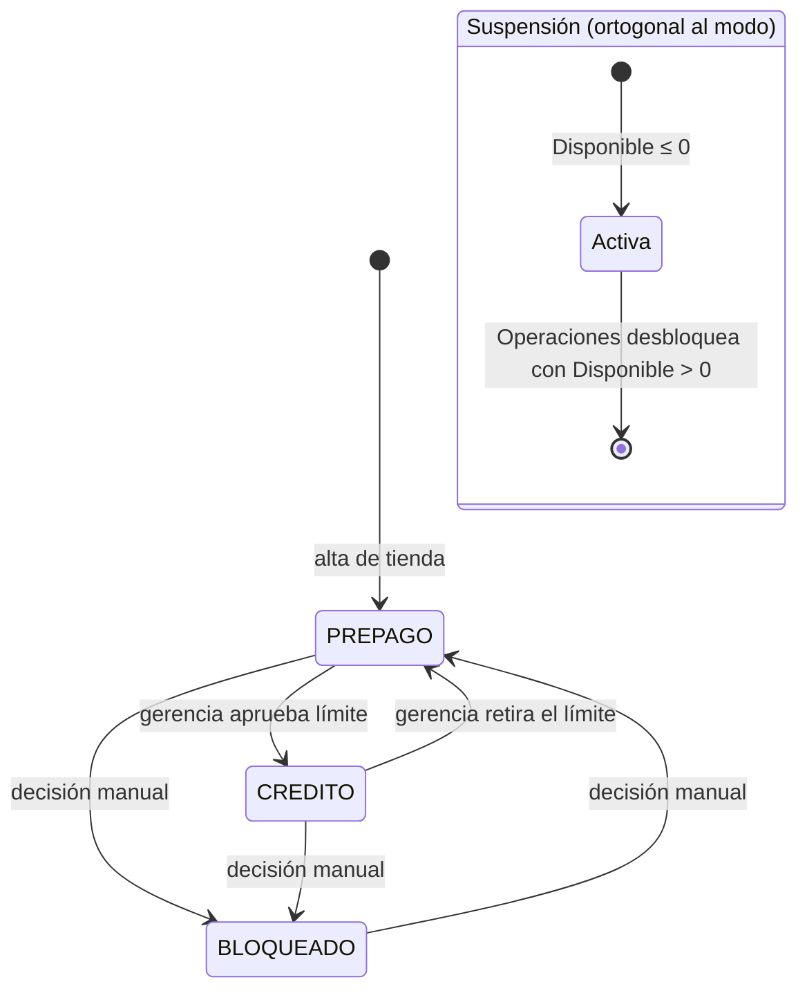

# Cupo — API pública de guías

> **Estado:** diseño aprobado por Iker el 2026-10-22 para el piloto (solo API, solo Interrapidísimo). No hay código desplegado.
> Las decisiones de negocio que dependen de gerencia están en [Pendiente con gerencia](#pendiente-con-gerencia).

---

## 1. Resumen

Hoy nada limita cuántas guías crea una tienda. La wallet (`ResumenSaldoActualLogigho`) solo se mueve cuando `ApiLambdaLiquidacionesLogighoAOT` liquida una guía entregada o devuelta, 2 a 5 días después de crearla. Una tienda con 100 000 de saldo puede crear 300 000 en guías y terminar en negativo; si no paga, pierde LogiGho.

El **cupo** limita lo que una tienda puede crear por la API: antes de crear cada guía se **reserva** su costo de peor caso (calculado con las mismas fórmulas que la liquidación) y la reserva se libera cuando la guía se liquida, se anula o falla. Si no hay `Disponible`, la guía no se crea.

```
Disponible = SaldoConfiable + LimiteCredito − ExposicionExterna − Reservado
```

Principios:

- **No cambia las liquidaciones ni la wallet.** El cupo solo lee; nunca escribe en `ResumenSaldoActualLogigho` ni en `LiquidacionesLogigho`.
- **Un solo cálculo.** La reserva sale de la misma fórmula con la que luego se liquida la guía, no de una tarifa paralela.
- **Seguro ante fallos.** Si algo no se puede calcular, la guía se rechaza; nunca se reserva 0.
- **Piloto controlado.** Pocas tiendas en lista blanca, primero en modo `OBSERVAR`, luego `APLICAR`.
- **Operable.** Finanzas ve el cupo en solo lectura; el integrador consulta su cupo y sus movimientos.

---

## 2. Glosario

| Término | Qué es |
| --- | --- |
| **Cupo / `Disponible`** | Dinero que la tienda todavía puede comprometer en guías nuevas creadas por la API. |
| **`SaldoConfiable`** | Saldo de la wallet **recalculado desde las fuentes** (liquidaciones − retiros + novedades). No se lee de `ResumenSaldoActualLogigho` porque ese snapshot lo escriben varios procesos con fórmulas distintas (ver [Hallazgos](#4-hallazgos-verificados-que-condicionan-el-diseno)). |
| **`LimiteCredito`** | Dinero que LogiGho le **presta** a la tienda por encima de su saldo. Es la pérdida máxima que gerencia acepta con esa tienda. Con saldo 100 000 y límite 50 000, la tienda puede comprometer hasta 150 000. No es el `Apalancamiento` actual (adelantos de retiros de efectivo con interés). |
| **`Reservado`** | Suma de las reservas vivas de guías creadas por la API: guías creadas y todavía no liquidadas, anuladas ni falladas. |
| **`ExposicionExterna`** | Costo de peor caso de las guías abiertas de **otros canales** (Angular, lambdas). Cuentan contra el cupo pero no se bloquean en v1. |
| **Reserva** | Monto que se aparta del `Disponible` al crear una guía. Es el mayor entre la liquidación de entrega y la de devolución. |
| **Liquidación provisional** | Resultado de correr las fórmulas de liquidación sobre una guía **antes** de que se entregue o devuelva. |
| **Ledger** (`ApiMovimientosCupo`) | Libro de movimientos, como el extracto de una cuenta bancaria: cada reserva, ajuste o liberación es una línea que **nunca se edita ni se borra**. Un error se corrige con una línea nueva. Sirve para auditar, detectar descuadres y explicarle el cupo al integrador. |
| **Modo** | Contrato de la tienda con LogiGho: `PREPAGO`, `CREDITO` o `BLOQUEADO`. Lo decide gerencia. |
| **Suspensión** | Estado operativo automático cuando `Disponible ≤ 0`. Se levanta a mano. |
| **Aplicación** | Por tienda: `OBSERVAR` (calcula y registra sin rechazar) o `APLICAR` (rechaza). |

---

## 3. Alcance del piloto

| Incluido | Fuera del piloto |
| --- | --- |
| Creación por la API pública (`POST /v1/guias`, `POST /v1/lotes`) | Contraentrega (COD): se rechaza con `CONTRAENTREGA_NO_DISPONIBLE` |
| Interrapidísimo (motor de liquidación **legacy**) | TCC (único en el motor dinámico), Envía, Servientrega, D2E |
| Consulta de cupo y movimientos para el integrador | Bloqueo de Angular y lambdas (solo cuentan en `ExposicionExterna`) |
| Vista de solo lectura para Finanzas (endpoint interno) | Pantalla Angular del dashboard de cupo |
| Lista blanca de pocas tiendas | Apertura general de la API |

Encaja con las fases de [la API de guías](ApiPublicaGuias.md#fases): F0 documentación, F1 Inter con cupo, F3 resto de transportadoras, F4 dashboard.

---

## 4. Hallazgos verificados que condicionan el diseño

Revisión de código del 2026-10-22. Rutas relativas a `Lambdas_NET_LogiGho/LambdasLogiGho.Aplicacion/`.

### 4.1 La wallet y el saldo

| Hallazgo | Evidencia | Consecuencia |
| --- | --- | --- |
| El saldo es Σ`Liquidacion` − retiros (`Aprobado`/`Pendiente`) + novedades, y se guarda con `$set` + upsert | `Logigho/ApiLambdaLiquidacionesLogighoAOT/Infraestructura/Repositorio/DocumentRepository.cs:302-390` | Misma fórmula para `SaldoConfiable`, pero normalizando el tipo del id. |
| Las liquidaciones se agrupan por `$Idtienda`, pero retiros y novedades se filtran por `IdTienda` **como string** | mismo archivo `:332`, `:340-350` | Registros guardados con `IdTienda` int no entran al cálculo y el saldo puede salir inflado. `SaldoConfiable` consulta ambos tipos. |
| Hay al menos 5 escritores de `ResumenSaldoActualLogigho`: la lambda de liquidaciones, `ApiLambdaLiquidacionApalancamientoAOT`, `ApiLambdaInteresesApalancamiento` y las pantallas Angular `desembolso`, `novedades`, `aprobacion-tarjetas`, `solicitar-recarga-tarjetas`, `aprobacion-recargas-tarjetas`. Las lambdas recalculan completo; Angular hace lectura-modificación-escritura | `ApiLambdaLiquidacionApalancamientoAOT/.../DocumentRepository.cs:126-216`; `ApiLambdaInteresesApalancamiento/Function.cs:147-157`; `Angular SitioLogiGho/.../desembolso.component.ts:195-201`, `novedades.component.ts:157-164`, `aprobacion-tarjetas.component.ts:380-410` | El snapshot no es una fuente confiable de saldo; las escrituras concurrentes se pisan. |
| `Idtienda` es `string` en las lambdas y `int` en `aprobacion-tarjetas` y en `Peticion` | `aprobacion-tarjetas.component.ts:402`; `ApiLambdaLiquidacionesLogighoAOT/.../Peticion.cs:7` | Normalizar siempre a entero (`ApiCupoTiendas._id`). |
| Dos lambdas suman las liquidaciones por **nombre** de tienda, no por id | `ApiLambdaLiquidacionApalancamientoAOT/.../DocumentRepository.cs:192`; `ApiLambdaInteresesApalancamiento/.../Function.cs:128` | No se usan como fuente. |
| `WalletLogigho.ValidaSaldoTienda` existe pero nadie la llama, y busca por nombre de tienda | `LambdasLogiGho.Dominio/Negocio/Wallet/WalletLogigho.cs:11-39` | Se reemplaza por una validación por id contra `Disponible` (RC-029). |
| Ningún flujo de creación de guía revisa saldo | búsqueda en `ApiLambdaCrearGuia`: sin coincidencias | El cupo es el primer control. |
| Los únicos chequeos de saldo son los de retiro, y solo en el frontend | `desembolso.component.ts:129` | Sin limitar retiros por `Disponible`, `PREPAGO` se evade retirando el saldo tras crear guías. |

### 4.2 La liquidación

| Hallazgo | Evidencia |
| --- | --- |
| La guía entra a liquidación solo si tiene `Fecha Entrega` o `Fecha Devolucion`, no está `Anulada` y no tiene ya un documento en `LiquidacionesLogigho` (por `"Numero Guia"`, `Estado ≠ "Referido"`). No hay marca de "liquidada" en `PedidosInter` | `ApiLambdaLiquidacionesLogighoAOT/.../DocumentRepository.cs:136-154` |
| El enrutamiento entre motor dinámico y legacy sale de la colección `ConfiguracionLiquidacionTransportadora` (`MotorLiquidacion = Dinamica` o `Sombra` → dinámico; cualquier otro valor o sin documento → legacy). No hay lista fija en el código | `.../Aplicacion/CasosUso/Liquidacion/LiquidarPedidosDinamicoUseCase.cs:53-72` |
| El motor dinámico solo aplica a TCC; Inter liquida por el **legacy** | Dato de Iker. Confirmar en la colección antes del piloto |
| Una anulada **no se liquida**: anular es gratis | `DocumentRepository.cs:152` |
| Anular solo se permite en estados iniciales (`Creado`, "generada en…", "en alistamiento del cliente") | `Angular SitioLogiGho/.../anular-guias.component.ts:267`; `ApiLambdaAnularGuia` exige `Estado == "Creado"` |
| La devolución **no** es flete de ida más flete de vuelta; no hay `×2` en el código | `.../DepurarLiquidacionUseCase.cs:396-428` |

### 4.3 Inter al crear la guía

| Hallazgo | Evidencia |
| --- | --- |
| Inter responde `valorFlete`, `valorSobreFlete` (seguro que cobra la transportadora) y `valorServicioContraPago` (lo que cobra por recaudar). Se guardan en `Total Flete`, `Total Sobreflete` y `Total Servicio` | `Logigho/ApiLambdaCrearGuia/Aplicacion/CasosUso/Carga/CargaInterUseCase.cs:196-198` |
| XCargo y D2E mapean los mismos tres campos. Envía y Servientrega no los devuelven con esos nombres; TCC usa la cotización | `CargaXCargoUseCase.cs:190-191`; `CargaD2EUseCase.cs:213-214` |
| `Trayecto` queda **vacío** al crear (`CargaInterUseCase.cs:227`) y lo completa `ApiLambdaProcesoAutomaticoInter`: por eventos de tránsito (`Urbano`, `Regional`, `Nacional`) o buscando el valor de `TotalFlete` en la colección `TarifasInter` | `Interrapidisimo/ApiLambdaProcesoAutomaticoInter/.../CargaInterNegocioUseCase.cs:177-197` |

### 4.4 Plataforma

| Hallazgo | Consecuencia |
| --- | --- |
| La lambda de liquidaciones no tiene ruta HTTP: `FunctionHandler` ignora `Path` y `HttpMethod` y siempre corre el job batch (900 s, 2048 MB, 9 colecciones completas por ejecución) (`Function.cs:77`) | La calculadora es una función nueva (ver [§7.5](#75-donde-vive-la-calculadora)). |
| Las calculadoras del motor dinámico son estáticas y puras; `LiquidarAsync` mezcla cálculo con escrituras (`LiquidarPedidosDinamicoUseCase.cs:167,182,217`) | Se extrae un método puro sin cambiar el comportamiento. |
| El legacy (`DepurarLiquidacionUseCase`) no es reutilizable tal cual: llama servicios externos y escribe liquidaciones de marketing y referido | La calculadora de Inter replica sus fórmulas en una función pura. |
| Producción usa DocumentDB (instancia única, ya cargada); no hay transacciones, change streams ni `$lookup`. Los índices se crean desde el código con prefijos `ux_`/`ix_` | RC-032. |
| No hay índice declarado sobre `PedidosInter.Idtienda` | Se crea `ix_PedidosInter_Idtienda_Estado` antes de activar `ExposicionExterna`. |

---

## 5. Modos y estados

### 5.1 Modo (contrato; lo decide gerencia)

| Modo | `LimiteCredito` | Qué significa | Quién lo asigna |
| --- | --- | --- | --- |
| `PREPAGO` | 0 | La tienda solo puede comprometer su propio saldo. Es el valor por defecto de toda tienda. | Automático al dar de alta |
| `CREDITO` | X > 0 | LogiGho presta hasta X sobre el saldo. Sin vigencia ni renovación: queda como esté configurado hasta que gerencia lo cambie. | Gerencia, una firma, motivo obligatorio |
| `BLOQUEADO` | — | No puede crear guías por la API, aunque tenga saldo. | Gerencia u Operaciones, con motivo |

### 5.2 Suspensión (automática; operativa)

| Campo | Regla |
| --- | --- |
| Se activa cuando | `Disponible ≤ 0` tras una reserva, un ajuste o un recálculo; o `Base ≤ 0` (saldo negativo sin crédito). Utilización 100 % |
| Efecto | Se rechazan reservas nuevas con `CUPO_SUSPENDIDO`. Las guías ya creadas siguen su curso |
| Se levanta | **Solo a mano**, por Operaciones, con motivo, y únicamente si `Disponible > 0` |
| Registro | Línea `Suspension` / `Desbloqueo` en el ledger y en `ApiAuditoria` |

La suspensión es **por tienda**. `ApiClientes.Estado = SUSPENDIDO_CUPO` solo se usa cuando **todas** las tiendas permitidas del cliente están suspendidas (informativo; pendiente de alinear con [Colecciones](colecciones.md)).

### 5.3 Aplicación (por tienda)

| Valor | Comportamiento |
| --- | --- |
| `OBSERVAR` | Calcula, reserva y registra en el ledger **sin rechazar**. Si la reserva habría sido rechazada, la línea queda con `HabriaRechazado = true` y se emite una métrica. No suspende. Sirve para medir antes de bloquear a nadie. |
| `APLICAR` | Rechaza con `CUPO_INSUFICIENTE`/`CUPO_SUSPENDIDO`. |

Una tienda fuera de la lista blanca del piloto no puede crear por la API.



---

## 6. Modelo de datos

Colecciones nuevas con prefijo `Api`. Las demás están en [Colecciones](colecciones.md).

### 6.1 `ApiCupoTiendas`

Un documento por tienda. `_id` es el `IdTienda` **entero** normalizado.

```json
{
  "_id": 1234,
  "Tienda": "Tienda Ejemplo",
  "Modo": "PREPAGO",
  "LimiteCredito": 0,
  "Aplicacion": "OBSERVAR",
  "Suspension": { "Activa": false, "Motivo": null, "Desde": null, "Por": null },
  "Parametros": {
    "DescontarRecaudoNoPagado": false,
    "MargenEstimacionPct": 25,
    "GuiasPorDiaTienda": 200,
    "TopeLote": 50,
    "VentanaExposicionDias": 90
  },
  "Saldo": {
    "Confiable": 100000,
    "Liquidaciones": 130000,
    "Retiros": 40000,
    "Novedades": 10000,
    "RecaudoNoPagado": 0,
    "Corte": "6718f2a1c3e4b5d6e7f80912",
    "CalculadoEn": "2026-10-22T17:40:00Z"
  },
  "ExposicionExterna": 0,
  "Reservado": 0,
  "Base": 100000,
  "Disponible": 100000,
  "Alertas": { "Nivel80": false, "Nivel100": false },
  "Version": 1,
  "CreadoEn": "2026-10-22T17:00:00Z",
  "ActualizadoEn": "2026-10-22T17:40:00Z"
}
```

- `Base = Saldo.Confiable + LimiteCredito − ExposicionExterna`.
- `Disponible = Base − Reservado`. Se **materializa** para poder usar una guarda simple (`Disponible ≥ monto`) sin `$expr`.
- Todos los montos son pesos enteros (`long`). La reserva se redondea **hacia arriba** al peso; el saldo se redondea como la wallet (`AwayFromZero`).
- Índices: `_id` (único por definición); `{ Aplicacion: 1, "Suspension.Activa": 1 }`.

### 6.2 `ApiMovimientosCupo` (ledger)

Solo inserciones. Nunca `update` ni `delete`.

```json
{
  "_id": "sol_01HZX...:Reserva:1",
  "IdTienda": 1234,
  "ClienteId": "cli_abc",
  "SolicitudId": "sol_01HZX...",
  "NumeroGuia": null,
  "Tipo": "Reserva",
  "Monto": 14250,
  "Origen": "ESTIMADO",
  "Desglose": { "Flete": 11250, "Seguro": 1500, "ServicioContraPago": 0, "Otros": 1500 },
  "ReservadoDespues": 14250,
  "DisponibleDespues": 85750,
  "HabriaRechazado": false,
  "Actor": { "Tipo": "SISTEMA", "Id": "ApiLambdaGuias" },
  "Motivo": null,
  "TraceId": "1-67...",
  "Fecha": "2026-10-22T17:41:03Z"
}
```

| `Tipo` | Efecto sobre `Reservado` | Cuándo |
| --- | --- | --- |
| `Reserva` | `+monto` | Al aceptar la solicitud |
| `AjusteReserva` | `±delta` | Con los valores reales del carrier, o por re-cálculo |
| `Liberacion` | `−monto` | Creación fallida o guía anulada |
| `Consumo` | `−monto` | La guía se liquidó. Guarda además `LiquidacionReal` para medir el error de la estimación |
| `AjusteLimite`, `CambioModo`, `Suspension`, `Desbloqueo`, `Recalculo` | 0 | Cambios de configuración y de base. Llevan `Actor`, `Motivo`, antes y después |
| `Correccion` | `±delta` | La auditoría encontró un descuadre |

- **`_id` determinista** `{SolicitudId}:{Tipo}:{Secuencia}`: la idempotencia sale gratis (clave duplicada = ya aplicado). Los movimientos manuales usan un GUID.
- Índices: `{ IdTienda: 1, Fecha: -1 }`; `{ NumeroGuia: 1 }`; `{ ClienteId: 1, Fecha: -1 }`.
- `Σ(Reserva + AjusteReserva + Correccion) − Σ(Liberacion + Consumo)` de una tienda **debe** ser igual a `ApiCupoTiendas.Reservado`.

> **Diferencia con [Colecciones](colecciones.md):** ahí el índice único del ledger es `{SolicitudId, Tipo}`. No alcanza: una solicitud puede tener varios ajustes. Aquí la unicidad la da el `_id` determinista con `Secuencia`. Actualizar `colecciones.md` al aprobar este documento.

### 6.3 `ApiContadoresUso`

Conteos de guías por día. Se usa una sola colección con dos tipos de documento:

| `_id` | Cuenta | Límite |
| --- | --- | --- |
| `C:{ClienteId}:{yyyyMMdd}` | Guías por cliente y día | `ApiClientes.Limites` |
| `T:{IdTienda}:{yyyyMMdd}` | Guías por tienda y día | `ApiCupoTiendas.Parametros.GuiasPorDiaTienda` |

TTL de 90 días. El conteo se incrementa con `findOneAndUpdate({_id, Guias: {$lt: limite}}, {$inc: {Guias: 1}}, upsert)`. Si el documento ya existe y alcanzó el límite, el upsert falla por clave duplicada: eso **es** "límite alcanzado". Si la creación falla definitivamente, el contador se decrementa.

> **Diferencia con [Colecciones](colecciones.md):** ahí el índice es `{ClienteId, Fecha}`. Se propone el `_id` compuesto para cubrir también tienda.

### 6.4 Relación con `ApiSolicitudesGuia`

`ApiSolicitudesGuia` (ya diseñada) lleva la máquina de estados `RECIBIDA → RESERVADA → CREANDO → CREADA | FALLIDA | INCIERTA → ANULADA` y los montos estimados y reales. Para el cupo agrega: `Reserva` (monto vigente), `Provisional` (resultado de la calculadora con su origen `ESTIMADO`/`REAL` y versión de fórmulas) y `ReservaViva` (booleano que el reconciliador baja al liberar o consumir).

---

## 7. Liquidación provisional (calculadora)

### 7.1 Idea

La reserva es **la liquidación de la guía calculada antes de tiempo**: el mismo resultado que luego escribirá `ApiLambdaLiquidacionesLogighoAOT` en `LiquidacionesLogigho.Liquidacion`. Se calculan los dos escenarios y se reserva el más costoso:

```
Reserva = max( −Liquidacion(entrega), −Liquidacion(devolucion) )
```

### 7.2 Fórmulas del legacy (Interrapidísimo, prepago)

`DepurarLiquidacionUseCase.cs` (rutas bajo `Logigho/ApiLambdaLiquidacionesLogighoAOT/Aplicacion/CasosUso/Liquidacion/`). Para una guía sin contrapago (`TotalRecaudo = 0`):

| Paso | Fórmula | Línea |
| --- | --- | --- |
| Cobro de la transportadora | `TotalTransportadora = −(TotalFlete + TotalServicio + TotalSobreflete)` | `:131` |
| Seguro de la tienda | `TotalSobreflete = ValorDeclarado × %Seguro / 100` (si `Seguro = SI`; con recaudo 0 la base es el valor declarado) | `:121-123`, `:138` |
| Servicio de recaudo de la tienda | `TotalServicio = TotalRecaudo × %Recaudo / 100` → **0 si no hay recaudo** | `:133` |
| Flete de la tienda | Peso > 1: `TotalFlete × (1 + %KiloAdicional/100)`. Si no, la columna por `Trayecto` (`FleteUrbano`, `FleteRegional`, `FleteNacionalMetropolitano`, `FleteNacionalMunicipal`, `FleteReexpedido`; cualquier otro valor usa `FleteNacionalMetropolitano`) | `:162-196` |
| Se cobra el mayor | `Flete = max(TotalFlete, Flete)` | `:199` |
| Total de la tienda | `TotalFleteTienda = Flete + TotalServicio + TotalSobreflete` | `:203` |
| **Entrega** | `FleteEntregado = Flete × %FleteEntregado/100`; `FleteFinal = −(TotalFleteTienda − FleteEntregado)`; **piso:** si `TotalTransportadora < FleteFinal` ⇒ `FleteFinal = TotalTransportadora − 200` | `:210-217` |
| Otros (entrega) | `−(PicyPac + OtroVenta + Confirmacion + Adelanto + OtroEntregado + Marketing)`; `Adelanto = (TotalRecaudo + FleteFinal) × %Adelanto/100` | `:222-239`, `:271` |
| `Liquidacion` (entrega) | `TotalRecaudo + FleteFinal + TotalOtros` | `:367` |
| **Devolución** | `FleteDevolucion = Flete × %FleteDevolucion/100`; `FleteFinal = −(TotalFleteTienda − FleteDevolucion)`; sin piso de 200 | `:400-417` |
| Otros (devolución) | `−(PicyPac + OtroVenta + OtroDevolucion)` | `:416` |
| `Liquidacion` (devolución) | `FleteFinal + TotalOtros` | `:419` |
| Impuesto Gobierno | `−TotalRecaudo × 0.004`: solo entregas con recaudo, **0 en v1** | `:379-392` |

Los porcentajes y montos salen de `CostosTransporteTienda` (por nombre de tienda, transportadora y `EstadoGuia`, con reintentos y fila "Generico Interrapidisimo …"; `:102-157`) y de `AdministracionCostos` (`:204-239`).

> **Nota de nombres.** En el legacy, `TotalSobreflete` es el **seguro** y `TotalServicio` es el **servicio de recaudo**. Para el integrador se exponen como `seguro` y `servicioContraPago`.

### 7.3 Qué se sabe al crear y qué no

| Dato | Antes de llamar a Inter | Con la respuesta de Inter |
| --- | --- | --- |
| Tienda, peso, valor declarado, `Seguro`, recaudo, tarifas, porcentajes, `AdministracionCostos` | Sí | Sí |
| `TotalFlete`, `TotalServicio`, `TotalSobreflete` del carrier | No | **Sí**: `valorFlete`, `valorServicioContraPago`, `valorSobreFlete` |
| `Trayecto` | No (vacío) | Se puede derivar buscando `valorFlete` en `TarifasInter`, igual que hace `ApiLambdaProcesoAutomaticoInter` (`CargaInterNegocioUseCase.cs:193-197`) |

Por eso la reserva tiene **dos tiempos**:

1. **Estimación** (antes de crear en Inter): `TotalFlete` desconocido. Se usa `max(cotización de Inter si existe, flete máximo configurado de la tienda)` × `(1 + MargenEstimacionPct/100)` como sustituto de `TotalFlete`, `Trayecto` desconocido ⇒ **el mayor** de las columnas de flete configuradas, y el piso `carrier + 200` no se evalúa.
2. **Ajuste** (con la respuesta de Inter): se recalcula con los valores reales y se reemplaza la reserva (`AjusteReserva` por la diferencia). El margen deja de aplicar.

Regla de recaudo: si `TotalRecaudo = 0`, `servicioContraPago = 0` en lo que se le cobra a la tienda y se le muestra al integrador. Si Inter devuelve un `valorServicioContraPago > 0` con recaudo 0, se ignora para la tienda, se guarda en el costo del carrier y se emite una alarma (LogiGho estaría pagando un cobro que no recupera).

### 7.4 Ejemplo calculado (valores ilustrativos, no son tarifas reales)

Tienda: `FleteUrbano` 6 000, `FleteRegional` 7 500, `FleteNacionalMetropolitano` 9 000, `%Seguro` 1,5 con valor declarado 100 000 y `Seguro = SI` (seguro de tienda 1 500), `%FleteEntregado` 0, `%FleteDevolucion` 0, `OtroDevolucion` 1 500 fijo, el resto de costos en 0. Prepago.

**Estimación** (margen 25 %, sin valores reales):

```
TotalFlete_est = 9 000 × 1,25                       = 11 250
TotalFleteTienda = 11 250 + 0 + 1 500               = 12 750
Entrega     = −12 750
Devolución  = −12 750 − 1 500                       = −14 250
Reserva     = 14 250
```

**Respuesta de Inter**: `valorFlete 5 530`, `valorSobreFlete 2 577`, `valorServicioContraPago 0`.

```
Flete = max(5 530, 9 000)                            = 9 000
TotalFleteTienda = 9 000 + 0 + 1 500                 = 10 500
TotalTransportadora = −(5 530 + 0 + 2 577)           = −8 107
Entrega: FleteFinal = −10 500; ¿−8 107 < −10 500? no ⇒ sin piso      ⇒ −10 500
Devolución: −10 500 − 1 500                                           ⇒ −12 000
Reserva exacta = 12 000   (ajuste −2 250 respecto de la estimación)
```

**Caso excepcional**: Inter cobra `valorFlete 14 000`.

```
Flete = max(14 000, 9 000) = 14 000;  TotalFleteTienda = 15 500
TotalTransportadora = −(14 000 + 0 + 2 577) = −16 577
Entrega: FleteFinal = −15 500; −16 577 < −15 500 ⇒ piso: −16 577 − 200 = −16 777
Devolución: −15 500 − 1 500 = −17 000
Reserva exacta = 17 000   (ajuste +2 750 respecto de la estimación)
```

### 7.5 Dónde vive la calculadora

**Decisión:** una sola implementación de las fórmulas, en el repo de Lambdas, como clase pura en un proyecto compartido. La usan:

- el job de liquidación (`LiquidarAsync` la llama sin cambiar su comportamiento), y
- una **función Lambda nueva de cálculo**, invocada con `Lambda.Invoke` desde `ApiLambdaGuias` (sin API Gateway público; permiso IAM).

`Servicios_Guias` / `ApiLambdaGuias` **no copia fórmulas**. La función de cálculo es dueña de las tarifas y de su acceso a datos, con caché en memoria y TTL (el job actual carga 9 colecciones completas; no sirve por guía).

| Alternativa | Por qué no |
| --- | --- |
| Copiar las fórmulas en cada proyecto | Se desincronizan: el cupo reservaría un valor distinto al que se liquida |
| Ruta HTTP en la lambda de liquidaciones | Obliga a crear un API Gateway y mezcla un job de 900 s con una consulta por guía |
| Reutilizar el cotizador (`LogighoPricingService`) | Devuelve un solo número y usa otro modelo de tarifas (`CostosTransporteTienda` vs `TarifasTransportadoraTienda`). Sirve como **contraverificación** para Inter, no como base |

**Costo y mitigación:** es una dependencia en línea. Si la función no responde, la API rechaza con `503 CUPO_NO_DISPONIBLE` y **no** reserva 0 (RC-014). Como el código de `Guias/` vive en el mismo repo de Lambdas, si la latencia del `Invoke` molesta se puede pasar a referencia de proyecto sin cambiar las fórmulas.

**Contrato:**

```json
// Request
{
  "idTienda": 1234,
  "tienda": "Tienda Ejemplo",
  "transportadora": "INTERRAPIDISIMO",
  "peso": 1.5,
  "trayecto": null,
  "valorDeclarado": 100000,
  "seguro": "SI",
  "aplicaContraPago": "NO",
  "totalRecaudo": 0,
  "valoresCarrier": null
}

// Response
{
  "motor": "LEGACY",
  "origen": "ESTIMADO",
  "entrega":    { "liquidacion": -12750, "desglose": { "flete": 11250, "seguro": 1500, "servicioContraPago": 0, "otros": 0 } },
  "devolucion": { "liquidacion": -14250, "desglose": { "flete": 11250, "seguro": 1500, "servicioContraPago": 0, "otros": 1500 } },
  "reserva": 14250,
  "version": "legacy-2026.10",
  "advertencias": []
}
```

`valoresCarrier` = `{ "totalFlete": 5530, "totalServicio": 0, "totalSobreflete": 2577 }` cambia `origen` a `REAL`.

### 7.6 Pruebas y calibración

1. **Pruebas doradas:** correr la función pura sobre guías de Inter ya liquidadas (con sus `Total*`, `Trayecto` y fechas reales) y comparar contra `LiquidacionesLogigho.Liquidacion`. La diferencia esperada es 0.
2. **Contraverificación** con `LogighoPricingService.CalcularTarifaInterEnMemoriaAsync`, que usa el mismo modelo de tarifas.
3. **Margen:** durante `OBSERVAR` se mide `LiquidacionReal − Provisional` por transportadora; el margen se calibra con el percentil 95.
4. **Regresión del motor dinámico** al extraer el método puro (TCC): mismas salidas que hoy.

La carpeta de pruebas de `ApiLambdaLiquidacionesLogighoAOT.Tests` en este checkout solo contiene `bin/` y `obj/`; no se pudo comprobar la cobertura actual.

### 7.7 Qué pasa con otras transportadoras

| Transportadora | Motor | Estado |
| --- | --- | --- |
| Interrapidísimo | Legacy | **Piloto.** Función pura que replica el legacy |
| TCC | Dinámico | Después. Reutiliza `Calcular(...)` extraído del motor |
| Envía, Servientrega, D2E | Legacy (verificar) | Después. No devuelven los tres valores al crear: la reserva queda en estimación con margen hasta que lleguen los `Total*` |
| XCargo | Legacy (verificar) | Fuera de la API |

No se migra Inter al motor dinámico para el piloto: cambiaría las liquidaciones actuales (17 diferencias entre motores: mínimos de servicio y recaudo, máximo contra el carrier, tabla de peso, trayecto sin resolver, base del seguro en prepago, doble fecha, entre otras).

---

## 8. Flujos

### 8.1 Crear una guía (con reserva)

```mermaid
sequenceDiagram
    autonumber
    participant I as Integrador
    participant A as ApiLambdaGuias
    participant C as Calculadora (Lambda)
    participant D as DocumentDB
    participant Q as SQS
    participant W as Worker
    participant T as Inter

    I->>A: POST /v1/guias (Idempotency-Key)
    A->>D: ¿cliente activo? ¿tienda en lista blanca? conteos
    A->>C: liquidación provisional (ESTIMADO)
    C-->>A: reserva estimada
    A->>D: findOneAndUpdate cupo (Disponible ≥ monto) $inc
    alt sin cupo en APLICAR
        A-->>I: 422 CUPO_INSUFICIENTE
    else con cupo
        A->>D: línea Reserva en el ledger; solicitud RESERVADA
        A->>Q: mensaje por guía
        Q->>W: procesa
        W->>T: crea la guía
        T-->>W: valorFlete, valorSobreFlete, valorServicioContraPago
        W->>C: liquidación provisional (REAL)
        C-->>W: reserva exacta
        W->>D: $inc por la diferencia; AjusteReserva; solicitud CREADA
        W-->>I: costos con incrementos de LogiGho
    end
```

Detalle del paso de reserva:

```
findOneAndUpdate(
  { _id: idTienda, Modo: { $ne: "BLOQUEADO" }, "Suspension.Activa": false, Disponible: { $gte: monto } },
  { $inc: { Disponible: -monto, Reservado: +monto } },
  { returnDocument: "after" })
```

- **Orden:** 1) `$inc` con guarda; 2) insertar la línea `Reserva`; 3) pasar la solicitud a `RESERVADA`. Si falla entre 1 y 2, `Reservado` queda **mayor** que Σ ledger (lado conservador) y la auditoría lo corrige.
- **En `OBSERVAR`** la guarda de `Disponible` y la de suspensión no se aplican; solo se registra `HabriaRechazado`.
- **Lotes:** una sola reserva por la **suma** de las estimaciones del lote (todo o nada), más una línea de ledger por guía. Si no alcanza, se rechaza el lote completo (`422 CUPO_INSUFICIENTE`).
- **Después de un ajuste** que deje `Disponible < 0` (la guía ya existe en el carrier): la tienda queda suspendida y el negativo queda acotado al error de la estimación.

### 8.2 Falla o incertidumbre al crear en el carrier

| Resultado | Cupo |
| --- | --- |
| Rechazo formal del carrier (`FALLIDA`) | `Liberacion` por el monto reservado; conteo decrementado |
| Timeout o 5xx ambiguo (`INCIERTA`) | La reserva **se mantiene** hasta que el reconciliador resuelva (ver [ADR-003](adr-003-idempotencia.md)) |
| Resuelta como creada | Pasa a `CREADA` con ajuste real |
| Resuelta como no creada | `Liberacion` |

### 8.3 Anulación

`POST /v1/guias/{numero}/anulacion` solo procede si la guía está en estados iniciales (`Creado`, "generada en…", "en alistamiento del cliente"). Una guía despachada **no se puede anular**: su reserva sigue hasta que se liquide. Al anular: `Liberacion` por el monto vigente. La anulación es gratis (decisión de Iker; no hay modelo de negocio sobre anulaciones).

### 8.4 Liberación al liquidar (reconciliador)

El reconciliador vive en `ApiLambdaGuiasWorker` y corre cada 5 minutos para las tiendas con reservas vivas o en lista blanca. **El orden es parte de la regla:**

1. Leer el documento de cupo y su `Version`.
2. **Primero** calcular el conjunto *L* de guías con reserva viva que ya tienen liquidación (`"Numero Guia"` en `LiquidacionesLogigho`, `Estado ≠ "Referido"`) o estado `Anulada`.
3. **Después** calcular `SaldoConfiable` (liquidaciones, retiros y novedades, buscando el `IdTienda` como entero y como string), de forma **incremental** (§8.8).
4. Calcular `ExposicionExterna` (§8.6), con la consulta acotada de §8.8.
5. `Base' = SaldoConfiable + LimiteCredito − ExposicionExterna` y `liberado = Σ reserva(L)`.
6. Una **sola** escritura con guarda de versión:
   `$inc { Disponible: (Base' − Base) + liberado, Reservado: −liberado, Version: 1 }`, `$set { Base, Saldo, ExposicionExterna, ... }`.
7. Insertar líneas `Consumo` (con la liquidación real) y `Recalculo`.

**Por qué ese orden:** si el saldo se leyera antes que *L*, una guía liquidada entre ambas lecturas se liberaría sin que su costo esté todavía en el saldo y el `Disponible` quedaría inflado (lado peligroso). Con *L* primero, lo peor que pasa es que una guía quede contada dos veces hasta el próximo ciclo (lado conservador).

Como las reservas y los ajustes solo usan `$inc`, que es conmutativo, el reconciliador no necesita bloquear: aplica el delta aunque entren reservas mientras calcula. Solo la guarda de `Version` evita dos reconciliadores simultáneos sobre la misma tienda.

### 8.5 Retiros y novedades

- **Retiro:** el monto debe ser `≤ Disponible` (RC-029). Es lo que impide crear guías y luego retirar todo el saldo. Un retiro `Pendiente` o `Aprobado` ya resta de `SaldoConfiable`. La validación vive en el flujo de `desembolso`; es un cambio de Angular y su backend, fuera del piloto API-only (ver [Pendiente con gerencia](#pendiente-con-gerencia)). Mientras tanto Finanzas revisa los retiros de las tiendas del piloto.
- **Novedad negativa** (por ejemplo, re-pesaje: la transportadora cobra más de lo reservado): se registra en la wallet como hoy (`NovedadesLogigho`). `SaldoConfiable` la recoge en el siguiente recálculo. No se ajusta el ledger.

### 8.6 Exposición de otros canales

Las guías que crean Angular y las lambdas no reservan, pero sí gastan saldo cuando se liquidan. El reconciliador las cuenta:

- Guías de la tienda en `PedidosInter` **sin** documento en `LiquidacionesLogigho`, no `Anulada`, creadas dentro de `VentanaExposicionDias` (90 por defecto) y que **no** estén en `ApiSolicitudesGuia`.
- Cada una se valora con la calculadora en modo `REAL` (ya tienen `Total Flete`, `Total Servicio`, `Total Sobreflete`).
- Solo para tiendas de la lista blanca, con una consulta por índice y acotada. **Nunca** se escanea `PedidosInter` completo: el presupuesto de carga está en §8.8.

En v1 esta exposición **reduce** el `Disponible` de la API pero **no** bloquea Angular ni las lambdas.

### 8.7 Auditoría diaria

Para cada tienda: recalcular `Reservado` desde el ledger y compararlo con el documento. Si difiere: línea `Correccion`, ajuste del documento y alarma. También se recalcula `Disponible = Base − Reservado`. Corre de noche, fuera del horario de operación.

> **Precisión de la implementación (F1a-f).** La suma del libro que se compara con `Reservado` es
> `Σ(Reserva + AjusteReserva) − Σ(Liberacion + Consumo)`. Las líneas `Correccion` **no suman**: documentan el ajuste hecho para volver a
> ese valor. Si sumaran, una corrección nunca podría cuadrar con su propio libro (RC-031 se lee con esta salvedad).

### 8.8 Presupuesto de carga sobre DocumentDB

Producción es una sola instancia `t4g.medium` ya cargada y no crece por ahora. El recálculo periódico debe ser liviano: **toda consulta va por índice, con proyección mínima, `maxTimeMS` y sin `$lookup`**. Si una consulta excede su tiempo, el reconciliador conserva el último valor, marca el dato como atrasado y alarma; **nunca** reintenta con un escaneo.

| Dato | Consulta | Índice requerido | Frecuencia |
| --- | --- | --- | --- |
| Reservas vivas de la tienda | `ApiSolicitudesGuia` `{ IdTienda, ReservaViva: true }` | `{ IdTienda: 1, ReservaViva: 1 }` (colección propia, pequeña) | 5 min |
| ¿Cuáles ya se liquidaron? | `LiquidacionesLogigho` `{ "Numero Guia": { $in: [lote de ≤ 200] } }` | `{ "Numero Guia": 1 }` | 5 min |
| `SaldoConfiable` — liquidaciones | **Incremental:** guardar un corte (`Saldo.Corte`, el último `_id` ya sumado) y sumar solo `{ Idtienda ∈ {n, "n"}, _id > corte }` | `{ Idtienda: 1 }` (el `_id` ya está indexado) | 5 min |
| `SaldoConfiable` — retiros y novedades | `{ IdTienda ∈ {n, "n"} }` (por tienda, volumen pequeño; los retiros cambian de estado, por eso no son incrementales) | `TransaccionesWalletLogigho { IdTienda: 1, EstadoTransaccion: 1 }`; `NovedadesLogigho { IdTienda: 1 }` | 5 min |
| `ExposicionExterna` | `PedidosInter` `{ Idtienda ∈ {n, "n"}, Estado ∈ abiertos, "Fecha de creación" ≥ ventana }`, con proyección de los campos de la calculadora | `ix_PedidosInter_Idtienda_Estado` (con la fecha de creación como tercer campo si el plan de ejecución lo pide) | 15 min |
| Cuáles de esas ya tienen fechas de entrega o devolución y pueden estar liquidadas | Mismo `Numero Guia $in` de arriba, solo para las que tienen fecha | `{ "Numero Guia": 1 }` | 15 min |

Reglas de carga:

- **Solo tiendas de la lista blanca** o con reservas vivas. Con 1 a 3 tiendas en el piloto el costo es despreciable; el número de tiendas activas es el que escala el costo.
- **Recálculo incremental de liquidaciones** (suma desde el corte) cada 5 minutos y **recálculo completo** por tienda una vez al día de noche. El completo detecta liquidaciones editadas o borradas después del corte y deja una línea `Recalculo` si corrige algo.
- **Lotes y pausa:** las tiendas se procesan en serie con una pausa corta entre una y otra, con tope de tiempo por ciclo.
- **Datos atrasados:** si `Saldo.CalculadoEn` supera 15 minutos o `ExposicionExterna` supera 60, se alarma. Una tienda en `APLICAR` cuyo saldo lleva más de 60 minutos sin recalcular pasa a rechazar con `CUPO_NO_DISPONIBLE` (no se confía en un saldo viejo).
- **Índices antes de activar:** se verifican con `explain` en preprod (Atlas) y se crean en prod (DocumentDB) en horario valle, desde el código con la convención `ix_*`/`ux_*`, ver [Colecciones](colecciones.md). Hoy **no** se confirmó cuáles existen (solo se sabe que no hay uno sobre `PedidosInter.Idtienda`).
- **Alternativa si la carga molesta:** reemplazar el cálculo de `ExposicionExterna` por un contador mantenido en el momento de crear la guía por los otros canales (RC-036). Queda para cuando esos canales se enganchen.

---

## 9. Reglas de cupo (RC)

"Aplica a" indica el alcance: **API v1** rige en el piloto; **Sistema** son reglas para todos los canales que se aplicarán cuando Angular y las lambdas se enganchen.

| ID | Regla | Aplica a | Estado |
| --- | --- | --- | --- |
| RC-001 | El cupo en dinero es **por tienda** (`IdTienda` entero normalizado). Los conteos son por cliente y por tienda. | API v1 | Aprobada |
| RC-002 | `Disponible = SaldoConfiable + LimiteCredito − ExposicionExterna − Reservado`. | API v1 | Aprobada |
| RC-003 | `SaldoConfiable` se recalcula desde `LiquidacionesLogigho`, `TransaccionesWalletLogigho` (`Pendiente`/`Aprobado`) y `NovedadesLogigho`, buscando `IdTienda` como entero y como string. Nunca se lee de `ResumenSaldoActualLogigho`. | API v1 | Aprobada |
| RC-004 | `DescontarRecaudoNoPagado` está **apagado** por defecto: el recaudo COD ya liquidado cuenta como saldo y LogiGho financia ese monto hasta que el carrier paga. El parámetro queda disponible por tienda. | API v1 | Aprobada; confirmar con gerencia |
| RC-005 | Una tienda sin documento en `ApiCupoTiendas` o fuera de la lista blanca no puede crear guías por la API. | API v1 | Aprobada |
| RC-006 | Modo por defecto `PREPAGO` con `LimiteCredito = 0`. | API v1 | Aprobada |
| RC-007 | Crear o cambiar `CREDITO`/`LimiteCredito` solo lo hace gerencia, **una firma**, con motivo obligatorio. Sin vigencia ni renovación. Queda en el ledger (`AjusteLimite`) y en `ApiAuditoria` con antes y después. | API v1 | Aprobada |
| RC-008 | `BLOQUEADO` impide crear por la API aunque haya saldo. | API v1 | Aprobada |
| RC-009 | `Disponible ≤ 0` (o `Base ≤ 0`) suspende la tienda automáticamente. Solo se levanta a mano, por Operaciones, con motivo y con `Disponible > 0`. | API v1 | Aprobada |
| RC-010 | Alertas al 80 % y al 100 % de utilización (`1 − Disponible/Base`; con `Base ≤ 0` es 100 %). | API v1 | Aprobada |
| RC-011 | Una tienda con saldo negativo y sin crédito no crea por la API. Un plazo de gracia lo decide gerencia después. | API v1 | Aprobada |
| RC-012 | La reserva es el mayor costo entre la liquidación de entrega y la de devolución, calculada con las **mismas fórmulas** que la liquidación real. | Sistema | Aprobada |
| RC-013 | Se reserva **antes** de encolar y de llamar al carrier, con guarda atómica (`findOneAndUpdate` con `Disponible ≥ monto`). | Sistema | Aprobada |
| RC-014 | Fail-closed: sin tarifa, trayecto o configuración resolvible ⇒ `422 CUPO_TARIFA_NO_RESUELTA`. Si la calculadora no responde ⇒ `503 CUPO_NO_DISPONIBLE`. Nunca se reserva 0. | Sistema | Aprobada |
| RC-015 | Con `Trayecto` desconocido se usa el mayor de los fletes configurados de la tienda. | API v1 | Aprobada |
| RC-016 | El margen de estimación solo aplica mientras no hay valores reales del carrier. | API v1 | Aprobada; calibrar en `OBSERVAR` |
| RC-017 | Con los valores reales del carrier se recalcula y se ajusta la reserva (`AjusteReserva`). Si el ajuste deja `Disponible < 0` la guía ya existe: se suspende la tienda, no se anula la guía. | API v1 | Aprobada |
| RC-018 | Con `TotalRecaudo = 0`, `servicioContraPago = 0` para la tienda. En v1 todo recaudo `> 0` se rechaza con `CONTRAENTREGA_NO_DISPONIBLE`. | API v1 | Aprobada |
| RC-019 | La reserva se redondea hacia arriba al peso entero. | API v1 | Propuesta |
| RC-020 | Idempotencia: una misma solicitud nunca reserva dos veces (`_id` determinista del ledger). | Sistema | Aprobada |
| RC-021 | Un lote reserva la suma de sus guías en una sola operación, todo o nada. | API v1 | Propuesta |
| RC-022 | Creación fallida definitivamente ⇒ `Liberacion`. | Sistema | Aprobada |
| RC-023 | Una solicitud `INCIERTA` conserva su reserva hasta que el reconciliador la resuelva. | Sistema | Aprobada |
| RC-024 | Solo se anulan guías en estados iniciales; anular libera la reserva. Una guía despachada no se anula y su reserva sigue hasta liquidarse. Anular es gratis. | Sistema | Aprobada |
| RC-025 | La liberación por liquidación y la actualización de `SaldoConfiable` van en la misma escritura. Primero se determina el conjunto liquidado, después se calcula el saldo. | Sistema | Aprobada |
| RC-026 | Lo que la reserva cubre de más que la liquidación real (por ejemplo, la entrega no cobra `OtroDevolucion`) se libera al liquidar; queda en la línea `Consumo`. | Sistema | Aprobada |
| RC-027 | Cobros posteriores del carrier (re-pesaje) se registran como novedad negativa en la wallet. El ledger no se ajusta. | Sistema | Aprobada |
| RC-028 | Las guías de otros canales cuentan en `ExposicionExterna` sin bloquearse en v1. | API v1 | Aprobada |
| RC-029 | Un retiro no puede superar el `Disponible`. Reemplaza a `WalletLogigho.ValidaSaldoTienda` (por nombre, sin uso). | Sistema | Aprobada; implementación en `desembolso` pendiente |
| RC-030 | El cupo nunca escribe en `ResumenSaldoActualLogigho` ni en `LiquidacionesLogigho`. | Sistema | Aprobada |
| RC-031 | El ledger es de solo inserción. `Σ` de sus líneas vivas debe igualar `Reservado`; la auditoría diaria lo comprueba y corrige con `Correccion`. | Sistema | Aprobada |
| RC-032 | Solo operaciones compatibles con DocumentDB: `findOneAndUpdate` con filtros simples y `$inc`, índices únicos, TTL. Sin transacciones, `$expr`, `$lookup` ni change streams. | Sistema | Aprobada |
| RC-033 | Conteos: guías por día por cliente y por tienda, y tope por lote, con contador atómico `$inc` con guarda. | API v1 | Aprobada; valores por confirmar |
| RC-034 | Cada tienda corre en `OBSERVAR` o `APLICAR`. El piloto empieza en `OBSERVAR` con lista blanca. | API v1 | Aprobada |
| RC-035 | Al integrador se le muestran los valores **con los incrementos de LogiGho**, nunca el costo crudo del carrier ni el margen ni las fórmulas internas. | API v1 | Aprobada |
| RC-036 | Toda guía creada por cualquier canal debe llevar una liquidación provisional y una reserva cuando el canal se enganche al cupo. | Sistema | Futuro |
| RC-037 | Todo cambio de modo, límite, suspensión o parámetros queda en `ApiAuditoria` y en el ledger. | API v1 | Aprobada |
| RC-038 | Finanzas ve el cupo en solo lectura (endpoint interno); la pantalla Angular llega después. | API v1 | Aprobada |
| RC-039 | `LimiteCredito` y `Apalancamiento` son conceptos distintos y no se mezclan. | Sistema | Aprobada |
| RC-040 | El recálculo periódico es liviano: toda consulta va por índice, con proyección mínima y `maxTimeMS`; nunca se escanea `PedidosInter` completo ni se usa `$lookup`. Si una consulta se pasa de tiempo se conserva el último valor y se alarma. | Sistema | Aprobada (DocumentDB prod sin crecer) |
| RC-041 | El saldo se recalcula de forma incremental (corte por `_id`) cada 5 minutos y completo una vez al día de noche. Un saldo con más de 60 minutos sin recalcular hace que `APLICAR` rechace con `CUPO_NO_DISPONIBLE`. | API v1 | Propuesta |

---

## 10. Endpoints

Complementan [Endpoints](endpoints.md).

### 10.1 Integrador

| Método | Ruta | Scope | Qué devuelve |
| --- | --- | --- | --- |
| `GET` | `/v1/cupo` | `cupo:leer` | Estado del cupo por tienda permitida al cliente |
| `GET` | `/v1/cupo/movimientos` | `cupo:leer` | Movimientos paginados por cursor (`desde`, `hasta`, `tipo`, `numeroGuia`, `cursor`, `limite`) |
| `GET` | `/v1/guias/{numero}/costos` | `guias:leer` | Desglose de costos de una guía |

```json
// GET /v1/cupo
{
  "tiendas": [{
    "idTienda": 1234,
    "nombre": "Tienda Ejemplo",
    "modo": "PREPAGO",
    "estado": "ACTIVA",
    "disponible": 4000,
    "reservado": 96000,
    "saldoBase": 100000,
    "limiteCredito": 0,
    "otrasGuiasAbiertas": 0,
    "utilizacionPct": 96,
    "conteo": { "guiasHoy": 8, "limiteDia": 200 },
    "actualizadoEn": "2026-10-22T17:45:00Z"
  }]
}

// POST /v1/guias → respuesta (fragmento)
"costos": {
  "flete": 9000,
  "seguro": 1500,
  "servicioContraPago": 0,
  "otros": 0,
  "totalEntrega": 10500,
  "totalDevolucion": 12000,
  "cupoReservado": 12000,
  "moneda": "COP"
}
```

`movimientos` muestra solo `Reserva`, `AjusteReserva`, `Liberacion`, `Consumo`, `Suspension` y `Desbloqueo`, con monto, desglose, `numeroGuia`, `disponibleDespues` y fecha. No expone `Actor`, el margen ni el detalle de `ExposicionExterna` (solo el agregado `otrasGuiasAbiertas`).

### 10.2 Administración y Finanzas

Autenticación con el pool interno de administradores; todo cambio queda en `ApiAuditoria`.

| Método | Ruta | Quién | Qué hace |
| --- | --- | --- | --- |
| `GET` | `/admin/v1/cupos/{idTienda}` | Finanzas, Operaciones, gerencia | Documento de cupo, `Base`, `Disponible`, exposición y últimos movimientos. Solo lectura |
| `GET` | `/admin/v1/cupos` | Finanzas | Lista con filtros (modo, suspendidas, utilización) |
| `PUT` | `/admin/v1/cupos/{idTienda}/credito` | Gerencia | Cambia `Modo`/`LimiteCredito` (una firma, motivo obligatorio) |
| `POST` | `/admin/v1/cupos/{idTienda}/suspension` · `/desbloqueo` | Operaciones | Suspende o levanta (motivo; el desbloqueo exige `Disponible > 0`) |
| `PUT` | `/admin/v1/cupos/{idTienda}/aplicacion` | Operaciones, gerencia | `OBSERVAR` ↔ `APLICAR` |
| `PUT` | `/admin/v1/cupos/{idTienda}/parametros` | Gerencia | Límites de conteo, margen, ventana |
| `GET` | `/admin/v1/cupos/{idTienda}/movimientos` | Finanzas | Ledger completo con `Actor` |

`/admin/v1/clientes-api/{id}/cupos` de [Endpoints](endpoints.md) queda para los límites de conteo del **cliente**; los de dinero viven en `/admin/v1/cupos`.

### 10.3 Errores

| Código | HTTP | Cuándo |
| --- | --- | --- |
| `CUPO_INSUFICIENTE` | 422 | `Disponible` menor que la reserva requerida. Detalle: `disponible` y `requerido` |
| `CUPO_SUSPENDIDO` | 403 | Tienda suspendida por cupo |
| `TIENDA_BLOQUEADA` | 403 | Modo `BLOQUEADO` |
| `CUPO_TARIFA_NO_RESUELTA` | 422 | Sin tarifa, trayecto o configuración para calcular el costo |
| `CUPO_NO_DISPONIBLE` | 503 | La calculadora o el servicio de cupo no responde. Reintentable |
| `LIMITE_DIARIO_ALCANZADO` | 429 | Conteo por cliente o tienda superado |
| `LOTE_EXCEDE_TOPE` | 422 | El lote supera `TopeLote` |
| `CONTRAENTREGA_NO_DISPONIBLE` | 422 | Recaudo mayor que 0 en v1 |

---

## 11. Ejemplos numéricos

Tienda de ejemplo en `PREPAGO`, saldo 100 000, guía de las de §7.4: reserva estimada **14 250**, exacta **12 000**, liquidación de entrega **10 500**, de devolución **12 000**.

| # | Situación | Resultado |
| --- | --- | --- |
| 1 | Se crean 8 guías de a una; cada una pasa de 14 250 a 12 000 al confirmar Inter | `Reservado` 96 000, `Disponible` 4 000. La 9.ª pide 14 250 y recibe `CUPO_INSUFICIENTE` (disponible 4 000, requerido 14 250). La empresa no queda expuesta por encima del saldo |
| 2 | 20 solicitudes **simultáneas** con `Disponible` 100 000 | Cada una reserva 14 250 de forma atómica: se aceptan **7** (99 750) y 13 se rechazan. Al confirmar Inter cada reserva baja a 12 000 y el integrador puede reintentar; en total caben 8 |
| 3 | Las 8 guías se devuelven | Cada una liquida −12 000; saldo final 100 000 − 96 000 = **4 000 ≥ 0** |
| 4 | Una de las 8 se entrega | Liquida −10 500: saldo 89 500; `Reservado` 7 × 12 000 = 84 000; `Disponible` = 89 500 − 84 000 = **5 500** (los 1 500 de diferencia se liberan) |
| 5 | Inter cobra más de lo previsto (`valorFlete` 14 000) en una guía | La reserva exacta es 17 000 (+2 750 sobre lo estimado). Si `Disponible` es 2 000, queda en −750 y la tienda se suspende; el exceso está acotado a esa diferencia |
| 6 | La tienda tiene 3 guías abiertas creadas en Angular (valoradas en 12 000 c/u) | `ExposicionExterna` 36 000, `Disponible` 64 000: caben 5 guías por la API (60 000) |
| 7 | Con 8 guías abiertas la tienda pide un retiro de 50 000 | `Disponible` 4 000: el retiro máximo es **4 000**. Si no se limitara, la tienda retiraría su saldo y las guías quedarían sin respaldo |
| 8 | Modo `CREDITO` con `LimiteCredito` 50 000 | `Base` 150 000: caben 12 guías (144 000; `Disponible` 6 000). Si las 12 se devuelven, saldo −44 000: deuda **≤ 50 000**, exactamente lo que gerencia aprobó |
| 9 | 40 000 de los 100 000 son recaudo COD entregado y aún no pagado por el carrier | Con `DescontarRecaudoNoPagado` apagado (decisión actual): 8 guías; si el carrier nunca paga, LogiGho asume los 40 000. Con el parámetro encendido: saldo confiable 60 000 y caben 5 guías (60 000) |
| 10 | El carrier re-pesa y cobra 3 000 de más | Novedad −3 000 en la wallet: saldo 97 000, `Disponible` baja 3 000 en el siguiente recálculo (≤ 5 min) |
| 11 | Se anula una guía recién creada | `Liberacion` de 12 000: `Disponible` sube 12 000 |
| 12 | Tienda con saldo −30 000 y sin crédito | `Base` −30 000: `CUPO_SUSPENDIDO`/`CUPO_INSUFICIENTE` hasta que recargue; después Operaciones levanta la suspensión |
| 13 | Tienda en `OBSERVAR` con `Disponible` 4 000 pide 14 250 | Se crea la guía; el ledger guarda `HabriaRechazado = true`. Con ese conteo se decide cuándo pasar a `APLICAR` |

**El margen tiene un costo:** con `Disponible` 12 500 una guía que realmente cuesta 12 000 se rechaza porque la estimación pide 14 250. Para reducirlo, la estimación debería usar la cotización exacta de Inter antes de crear la guía; se calibra con los datos de `OBSERVAR`.

---

## 12. Casos de borde

| Caso | Tratamiento |
| --- | --- |
| La calculadora no responde o excede el tiempo | `503 CUPO_NO_DISPONIBLE`; no se reserva |
| Tienda sin tarifa en `CostosTransporteTienda` | El legacy cae a la fila "Generico Interrapidisimo …". Si tampoco existe, `CUPO_TARIFA_NO_RESUELTA` |
| Dos solicitudes con la misma `Idempotency-Key` | Solo la primera reserva (`_id` determinista del ledger) |
| El Worker falla después de crear en Inter y antes de ajustar | La guía queda `CREADA` con la reserva estimada (mayor o igual al riesgo); el reconciliador ajusta con los valores guardados |
| Crash entre el `$inc` y la línea del ledger | `Reservado` queda mayor que Σ ledger (conservador); la auditoría diaria lo corrige y alarma |
| Dos reconciliadores sobre la misma tienda | La guarda `Version` hace fallar uno; reintenta en el siguiente ciclo |
| Guía liquidada entre dos lecturas del reconciliador | El orden "conjunto liquidado primero, saldo después" evita liberar antes de que el saldo la refleje |
| Guía con doble fecha (entrega y devolución) | El legacy ejecuta ambos bloques y gana la devolución; la reserva (máximo) la cubre |
| Guía que nunca se liquida (carrier no reporta) | La reserva sigue viva; alarma si una reserva supera `VentanaExposicionDias` |
| `IdTienda` guardado como entero o como string | `SaldoConfiable` consulta ambos; `_id` de cupo siempre entero |
| `Disponible` fuera de rango por una tienda con datos viejos | La auditoría recalcula; la suspensión es automática |
| Tienda con varios clientes API | Comparten el cupo de la tienda; los conteos son por cliente y por tienda. Una cuota de dinero por cliente dentro de la tienda queda para después |
| Cambio de modo con reservas vivas | Las reservas no cambian; solo cambia `LimiteCredito`, y por tanto `Base` y `Disponible` |
| Tienda `BLOQUEADO` con guías ya creadas | Siguen su curso; solo se rechazan creaciones nuevas |
| Recaudo > 0 enviado por el integrador | `CONTRAENTREGA_NO_DISPONIBLE` |

---

## 13. Observabilidad y alarmas

| Métrica | Alarma |
| --- | --- |
| Reservas por minuto y rechazos por `CUPO_INSUFICIENTE`, por tienda | Pico anormal de rechazos |
| Tiendas con utilización ≥ 80 % y ≥ 100 % | Notificación a Operaciones y a Finanzas |
| Tiendas suspendidas y tiempo suspendidas | Suspensión > 24 h |
| Edad del último recálculo por tienda y de `ExposicionExterna` | Saldo > 15 min; exposición > 60 min |
| Duración de las consultas del reconciliador y consultas que superan `maxTimeMS` | Cualquier consulta que exceda su tiempo; tendencia de CPU de la instancia durante el ciclo |
| Descuadre `Reservado` vs Σ ledger | Cualquiera ⇒ alarma crítica |
| Latencia y errores de la calculadora | `CUPO_NO_DISPONIBLE` sostenido |
| `LiquidacionReal − Provisional` por transportadora (histograma) | Deriva respecto del margen |
| `HabriaRechazado = true` en `OBSERVAR` | Reporte semanal para decidir `APLICAR` |
| `valorServicioContraPago > 0` con recaudo 0 | Alarma: LogiGho paga un cobro que no recupera |

Se integra con [Observabilidad](observabilidad.md); los logs no incluyen datos personales.

---

## 14. Plan de despliegue del piloto

| Paso | Contenido | Salida |
| --- | --- | --- |
| 0 | Extraer el método puro del motor dinámico; escribir la función pura legacy de Inter; pruebas doradas contra liquidaciones reales de Inter; confirmar en `ConfiguracionLiquidacionTransportadora` qué carrier está en qué motor | Diferencia 0 contra el histórico |
| 1 | Crear `ApiCupoTiendas`, `ApiMovimientosCupo` e índices en preprod (Atlas) y prod (DocumentDB, en horario valle); verificar con `explain` los índices de §8.8 sobre las colecciones existentes (`PedidosInter`, `LiquidacionesLogigho`, `TransaccionesWalletLogigho`, `NovedadesLogigho`) | Colecciones e índices listos |
| 2 | Calculadora desplegada en preprod; `ApiLambdaGuias` reserva y el Worker ajusta | Flujo end-to-end con Inter |
| 3 | Piloto en `OBSERVAR` con 1 a 3 tiendas de la lista blanca | Reporte de `HabriaRechazado`, error de estimación, margen calibrado |
| 4 | Paso a `APLICAR` de las tiendas del piloto; endpoint interno para Finanzas | Cupo en vigor |
| 5 | Más tiendas; TCC con el motor dinámico; resto de transportadoras | Ampliación |
| 6 | Dashboard Angular de cupo; enganchar Angular y lambdas a la reserva (RC-036) y limitar retiros (RC-029) | Cupo en todos los canales |

---

## 15. Trabajo derivado

### Dentro del alcance del cupo

- Normalizar `IdTienda` (entero/string) en el cálculo de `SaldoConfiable`.
- Índices de §8.8 (`ix_PedidosInter_Idtienda_Estado`, `LiquidacionesLogigho` por `Idtienda` y por `"Numero Guia"`, retiros y novedades por `IdTienda`) antes de activar el reconciliador. Si ya existen, se confirma con `explain`.
- Reemplazar `WalletLogigho.ValidaSaldoTienda` (por nombre, sin uso) por una validación por id contra `Disponible` en retiros.
- Pruebas doradas de la calculadora.

### Se registran aparte (no son del cupo)

| Hallazgo | Evidencia |
| --- | --- |
| `Sombra` **escribe** liquidaciones igual que `Dinamica`, aunque el ADR dice que calcula sin persistir. **Documentación y código no coinciden** | `LiquidarPedidosDinamicoUseCase.cs`; [ADR-001 strangler fig](../../../lambdas/ApiLambdaLiquidacionesLogighoAOT/adr/ADR-001-strangler-fig-motor-dinamico.md) |
| Al menos 5 escritores de `ResumenSaldoActualLogigho` con fórmulas distintas | §4.1 |
| `ApiLambdaLiquidacionApalancamientoAOT` e `InteresesApalancamiento` suman por nombre de tienda | §4.1 |
| `cd-prod.yml` documenta un rollback con el campo `UltimaActualizacion`, pero el código escribe `FechaActualizacion` | `cd-prod.yml:8` |
| Carpeta de pruebas de `ApiLambdaLiquidacionesLogighoAOT.Tests` sin fuentes | checkout local |
| Dos modelos de tarifas: `CostosTransporteTienda` (legacy y cotizador) y `TarifasTransportadoraTienda` (dinámico) | §7.5 |
| `Servicio_Sincronizacion` / `ProcesoAutomaticoInter`: no se verificó si completa `Trayecto` siempre | §7.3 |

### Documentos que hay que alinear al aprobar este

- [Colecciones](colecciones.md): índice del ledger y de `ApiContadoresUso`.
- [Endpoints](endpoints.md): agregar `GET /v1/cupo/movimientos`, `GET /v1/guias/{numero}/costos`, rutas `/admin/v1/cupos` y los errores de §10.3.
- [API pública de guías](ApiPublicaGuias.md): este documento ya figura como "en construcción".

---

## 16. Decisiones tomadas

| Tema | Decisión |
| --- | --- |
| Unidad del cupo | La tienda |
| Estimación del costo | La liquidación provisional con las mismas fórmulas que la liquidación real; peor caso entre entrega y devolución |
| Calculadora | Una sola implementación en el repo de Lambdas; función nueva invocada con `Lambda.Invoke` |
| Transportadora del piloto | Interrapidísimo (motor legacy). TCC (dinámico) después |
| Guías de otros canales | Cuentan en `ExposicionExterna`, no se bloquean en v1; solo la API en el piloto |
| Retiros | Limitados por `Disponible` (implementación en `desembolso` por coordinar) |
| Crédito | Solo gerencia, una firma, sin vigencia ni renovación |
| Suspensión | Automática; desbloqueo manual |
| Recaudo COD no pagado | Cuenta como saldo; LogiGho lo financia |
| Plazo de pago del carrier | No se modela: siempre se valida que el cupo alcance |
| Anulación | Gratis; solo en estados iniciales |
| Re-pesaje | Novedad negativa en la wallet |
| Negativos actuales | No crean por la API |
| Finanzas | Endpoint interno de solo lectura; pantalla Angular después |
| Integrador | Consulta `GET /v1/cupo`, sus movimientos y el costo de cada guía, con los valores de LogiGho |

## Pendiente con gerencia

1. **Recaudo COD no pagado.** Ejemplo: el lunes LogiGho acredita 40 000 de recaudo a la tienda, pero el carrier le paga a LogiGho 15 días después. Si la tienda usa esos 40 000 para crear guías y el carrier nunca paga, la pérdida es de LogiGho. Hoy se asume ese riesgo (RC-004). ¿Se confirma, y hasta qué monto total?
2. **Tope de crédito.** Máximo por tienda y máximo global entre todas las tiendas con `CREDITO` (por ejemplo, "la suma de los créditos no puede pasar de $N millones").
3. **Negativos al abrir a más clientes.** Hoy una tienda con saldo negativo no crea por la API. Si hay una tienda en −30 000, ¿se le da un plazo de gracia o se mantiene el bloqueo hasta que recargue?
4. **Extender el cupo a Angular y a las lambdas.** Criterio y fecha para que esos canales también reserven (RC-036).
5. **Retiros.** Confirmar el cambio en `desembolso` para que un retiro no supere el `Disponible` (RC-029) y cuándo hacerlo.

### Pendiente técnico antes de empezar

- Confirmar en `ConfiguracionLiquidacionTransportadora` qué carriers están en cada motor.
- Confirmar si `ApiLambdaProcesoAutomaticoInter` completa siempre `Trayecto`; si no, la liquidación real puede usar la columna de flete `Nacional/Metropolitano`.
- Confirmar el tipo real de `IdTienda`/`Idtienda` en `LiquidacionesLogigho`, `TransaccionesWalletLogigho` y `NovedadesLogigho` consultando Mongo.
- Valores iniciales de `GuiasPorDiaTienda`, `TopeLote` y `MargenEstimacionPct` (aquí 200, 50 y 25 %; propuestos, a calibrar en `OBSERVAR`).
- Confirmar la regla de recaudo 0: "no se debería cobrar el servicio de contrapago a las transportadoras" se interpreta como `servicioContraPago = 0` para la tienda.

---

## Documentos relacionados

- [API pública de creación de guías](ApiPublicaGuias.md) · [Endpoints](endpoints.md) · [Colecciones](colecciones.md) · [Observabilidad](observabilidad.md)
- [ADR-003 Idempotencia](adr-003-idempotencia.md) (máquina de estados con `RESERVADA`)
- [ApiLambdaLiquidacionesLogighoAOT](../../../lambdas/ApiLambdaLiquidacionesLogighoAOT/ApiLambdaLiquidacionesLogighoAOT.md) · [Motor legacy](../../../lambdas/ApiLambdaLiquidacionesLogighoAOT/legacy.md) · [Motor dinámico](../../../lambdas/ApiLambdaLiquidacionesLogighoAOT/motor-dinamico/overview.md)
