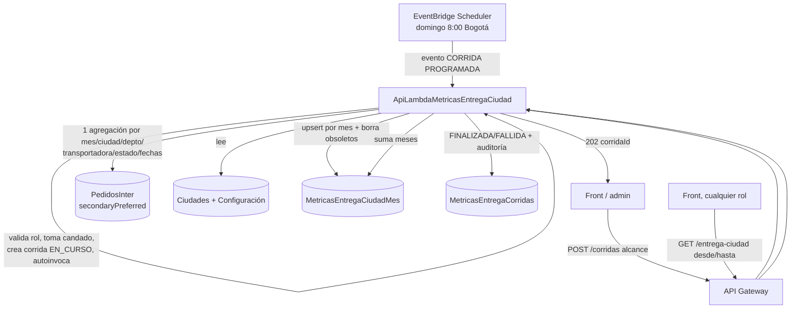

# Métricas — Arquitectura

Una sola función Lambda **`ApiLambdaMetricasEntregaCiudad`** (.NET 10, no AOT, Clean Architecture) con **dos puertas** que distingue por el evento que recibe:

- **Evento de corrida** `{ "tipo": "CORRIDA", ... }` (lo manda el EventBridge Scheduler o la autoinvocación asíncrona de una corrida manual): ejecuta el cálculo y escribe el resumen. `DetectorEventoCorrida` reconoce la propiedad `tipo` **sin distinguir mayúsculas**: el Scheduler manda `tipo` y la autoinvocación serializa `Tipo`.
- **Evento de API Gateway** (trae `httpMethod`): enruta a los casos de uso de lectura y administración.

## Capas (Clean Architecture)

| Capa | Qué contiene | Toca Mongo/AWS |
|---|---|---|
| `Dominio` | Reglas puras: `ClasificadorEstado`, `NormalizadorTransportadora`, `ResolutorCiudad`, `CalculadoraPorcentaje`, `CalculadoraAlcance`, `AcumuladorResumen`, `PoliticaCandado`, `ValidadorConfiguracion`, `ExtractorMes`, `CatalogoCiudades`, `NormalizadorTexto` | No |
| `Aplicacion` | Casos de uso (`EjecutarCorrida`, `ConsultarResumen`, `LanzarCorridaManual`, `GuardarConfiguracion`…), `EnrutadorApi`, `DetectorEventoCorrida`, DTOs, puertos (`IVerificadorToken`…), `AutorizacionUsuario` | No (puertos) |
| `Infraestructura` | Repositorios Mongo, `InvocadorCorridaLambda`, `VerificadorJwtCognito`, `EncripcionAES`, `RelojBogota` | Sí |

**209 tests** en verde (2026-10-30). El dominio y los casos de uso están cubiertos por tests; la infraestructura de Mongo se prueba contra Atlas, no con tests unitarios. El verificador de JWT sí tiene tests unitarios (genera sus propias claves RSA y un JWKS falso; sin red).

## Flujo de una corrida

### Pasos

1. **Candado** (RN-08): `findOneAndUpdate` atómico sobre el documento de candado. Si hay una corrida `EN_CURSO` de menos de 20 min, la nueva se rechaza (manual → 409; programada → `OMITIDA`); una de más de 20 min se considera caída y se libera. La corrida **manual toma el candado al lanzarse** y su autoinvocación lo **vuelve a tomar con el mismo `CorridaId`**: el filtro del repositorio acepta esa re-toma (idempotente); con el candado de otra corrida se omite.
2. **Leer** configuración (`_id="entrega-ciudad"`) y catálogo `Ciudades` a memoria.
3. **Una agregación** sobre `PedidosInter` (`secondaryPreferred`, `allowDiskUse`, `maxTimeMS`): `$match` por rango de `FechaCarga` + `$group` por mes, ciudad, departamento, transportadora, estado y presencia de fechas. Solo operadores ya probados en DocumentDB (`$match`, `$group`, `$substr`, `$cond`, `$ne`, `$ifNull`).
4. **Calcular en memoria:** normalizar transportadora y ciudad, clasificar cada grupo, acumular por `(mes, mun8, transportadora)` y armar la auditoría.
5. **Escribir** el resumen: `bulkWrite` con upsert por `_id = "<mes>|<mun8>|<transportadora>"` con el `CorridaId`; luego borrar los documentos de los meses del alcance con `CorridaId` distinto (combinaciones que desaparecieron). Sin transacciones (DocumentDB).
6. **Cerrar** la corrida (`FINALIZADA` con métricas o `FALLIDA` con error) y liberar el candado.

## Colecciones (base `LogighoDB`)

| Colección | Rol | Escribe |
|---|---|---|
| `PedidosInter` | Fuente de verdad (se **lee**, nunca se escribe) | — |
| `Ciudades` | Catálogo DANE para resolver `mun8` (se lee) | — |
| `Users` | Roles por `sub` para autorizar (se lee) | — |
| `MetricasEntregaCiudadMes` | Resumen: un doc por `(mes, mun8, transportadora)` | La corrida |
| `MetricasEntregaCorridas` | Auditoría de cada corrida | La corrida |
| `MetricasEntregaConfiguracion` | Config editable (`_id="entrega-ciudad"`) + candado (`_id="candado-entrega-ciudad"`) | PUT config / corrida |

## Variables de entorno (solo nombres)

| Variable | Para qué |
|---|---|
| `CADENA_CONEXION` | Cadena Mongo **cifrada AES** (se descifra con `Seguridad.Encripcion`); secreto en Azure Library |
| `DATABASE_NAME` | Base de datos (`LogighoDB`) |
| `COLECCION_PEDIDOS` | Colección que se agrega en cada corrida (`PedidosInter`) |
| `COLECCION_USUARIOS` | Colección de roles por `sub` (`Users`) |
| `NOMBRE_FUNCION` | Nombre con el que la función se **autoinvoca** en la corrida manual; sin ella falla al construirse |
| `MAX_TIME_AGREGACION_SEG` | `maxTimeMS` de la agregación (por defecto 600) |
| `COGNITO_REGION`, `COGNITO_USER_POOL_ID`, `COGNITO_CLIENT_IDS` | Verificación de la firma del JWT. **Si falta cualquiera, la lambda rechaza todos los tokens** (falla cerrado) |

Se cargan por Azure Library de forma **aditiva** (el CD nunca pisa un valor ya puesto en la función); los valores nunca van en el repo ni en el YAML. Terraform pone solo `DATABASE_NAME`, `COLECCION_PEDIDOS` y `NOMBRE_FUNCION` al crear la función.

## Tamaño y tiempos (producción, 2026-10-30)

Función con 1024 MB y timeout de 900 s, dentro de la VPC de prod. La primera corrida `TODO` sobre 926 476 guías duró **1 min 53 s** y escribió 25 023 documentos.
