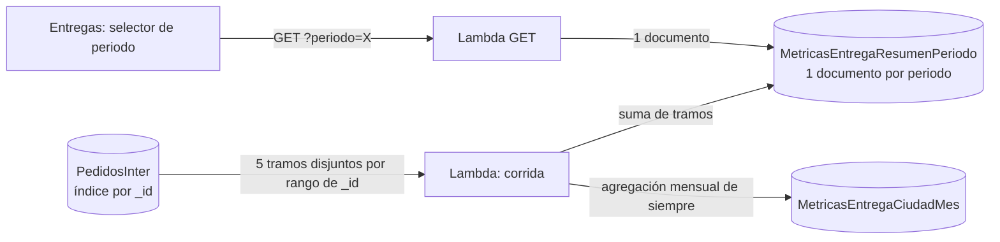

# Métricas — Periodos de tiempo y rendimiento (spec 006)

Gerencia pidió ver la efectividad por ciudad **por periodos** y que la vista cargue rápido con ~1 100 ciudades × 4 transportadoras y 926 k guías. Esta página resume el diseño. Estado al 2026-10-30: **implementado en las ramas `feature/metricas-entrega`, pendiente de despliegue y de las mediciones antes/después**.

## Periodos

Cinco periodos fijos, contados **hacia atrás desde el día de la corrida** (hora de Bogotá) por la **fecha del ObjectId `_id`** de la guía en `PedidosInter` (el día en que se sincronizó), no por `FechaCarga` (decisión de Iker, 2026-10-30).

| Periodo | Id | Rango |
|---|---|---|
| Histórico | `HISTORICO` | todo |
| Últimos 6 meses | `MESES_6` | hoy − 6 meses hasta hoy (meses móviles) |
| Últimos 3 meses | `MESES_3` | hoy − 3 meses hasta hoy |
| Último mes | `DIAS_30` | 30 días móviles, hoy incluido |
| Última semana | `DIAS_7` | 7 días móviles, hoy incluido |

!!! warning "Datos inmaduros en los periodos cortos"
    Las guías de los últimos días todavía no tienen estado final (entregada o devuelta). En 7 y 30 días el porcentaje puede cambiar y habrá ciudades con muestra insuficiente. La vista lo avisa y el mínimo de guías por defecto baja a 5 (semana) y 15 (mes); el resto usa el general (30). Se acepta por decisión de Iker.

## Cómo se calcula

- Cada guía se lee **una sola vez**: los 5 tramos (7 días, de 7 a 30 días, de 30 días a 3 meses, de 3 a 6 meses, más viejo) no se cruzan, y cada periodo es la suma de los tramos más nuevos hasta el suyo.
- Los tramos se consultan antes de escribir: si uno falla, la corrida queda `FALLIDA` y no toca nada.
- La colección mensual y la auditoría siguen por `FechaCarga` (están validadas contra la base). El histórico por periodos puede diferir levemente porque incluye guías sin `FechaCarga` válida.
- El `$match` por `_id` no necesita índice nuevo. Un índice de `FechaCarga` (M-124) ya no hace falta.

## API

`GET /metricas/entrega-ciudad?periodo=<id>` (por defecto `HISTORICO`; inválido, 400 `PERIODO_INVALIDO`). Lee **un** documento. Responde compacto (camelCase, sin nulls, solo `entregas` y `devoluciones` por celda; el front calcula finales y porcentaje) con `ETag` y `Cache-Control: private, max-age=60`; con `If-None-Match` igual responde **304** sin leer el documento. `desde`/`hasta` se conserva por compatibilidad. Antes de la primera corrida posterior al despliegue, el histórico sale de los meses y los demás periodos responden `sinDatos`.

## Ajuste visual por periodo

El `AjusteVisual` de la [spec 005](ajuste-visual.md) pasa a ser el **ajuste general**; cada periodo puede tener el suyo en `AjustePorPeriodo` (con sus excepciones por ciudad). En la pestaña **Ajuste** del panel de administración:

- Se elige el periodo; un periodo con ajuste propio se marca con ●. Editar un periodo que usaba el general le crea su propio ajuste.
- **Aplicar a todos los periodos**: el ajuste del periodo editado pasa a ser el general y se **borran** los ajustes propios de los demás (pide confirmación).
- **Restablecer este periodo**: vuelve a usar el general.
- **Mínimo de guías** por periodo. El botón anterior "Restablecer" se llama ahora **Descartar cambios** (recarga lo guardado).

El backend solo guarda y entrega los parámetros; **el cálculo del ajuste sigue siendo del front** y la base guarda siempre el real.

## Rendimiento

| Qué | Antes | Ahora |
|---|---|---|
| Lectura por GET | todos los documentos mensuales del rango (≈ 25 000 en histórico), sumados en cada petición | **1 documento** ya armado por la corrida |
| Payload | PascalCase, con `Finales`, `Porcentaje` y nulls por celda | compacto, sin campos derivables |
| Repetición | cada visita pedía todo | `ETag` + 304, caché del navegador 60 s y caché en memoria por periodo 5 min; los demás periodos se precargan |
| Compresión | ninguna | gzip del gateway (ver abajo) |

**Payload medido con datos reales de prod** (1 189 ciudades, 2 270 celdas): antes **281 KB**; después **212 KB** (compacto) y **23,5 KB con gzip**. **Tiempo del GET antes/después:** pendiente; se toma con `tools/medir-get-entregas.ps1` en PreProd y prod y la tabla se completa al desplegar.

### Compresión (estándar)

Ninguna lambda comprime respuestas; el estándar es el **gzip nativo de API Gateway REST** (`minimum_compression_size`), una propiedad del API, no de las rutas. En PreProd la fija Terraform (`environments/preprod/datos`, 1024 bytes). En producción el REST `7elgyten88` no es de Terraform: se activa por consola (API → Configuración → Codificación de contenido → 1024 bytes → volver a desplegar el stage). El navegador ya envía `Accept-Encoding: gzip` y descomprime solo.

## Operación

- **El Scheduler del domingo 8:00 refresca todos los periodos** (y los meses). Sigue `DISABLED` en prod hasta que gerencia revise.
- **Desde el panel (pestaña Corridas)** se puede lanzar una corrida de **un solo periodo** a elección, de una en una: consulta solo sus tramos y escribe solo su documento (la semana tarda ≈ 2 s; el histórico, ≈ 1 min). Los demás periodos quedan como estaban.
- Costo medido en prod (solo lectura, 2026-10-30): los 5 tramos tardan 2,2 / 3,2 / 7,8 / 16,7 y 28,3 s (≈ 53 s); sumados a la mensual (1 min 53 s) la corrida del domingo queda en ≈ 3 min (estimación; se confirma con la primera corrida real).
- **Verificado en prod:** la fecha del ObjectId coincide con el día de carga de la guía (1 500 guías, hora de Bogotá, mismo día en todas).

Spec completa: `specs/006_periodos/spec.md`. Contrato y datos: `docs/architecture/contratos/` y `datos/` (metricas-entrega-ciudad).
