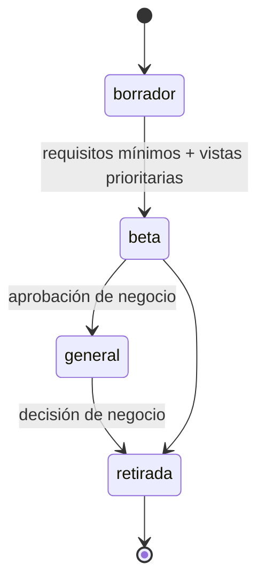

---

## Autor: Iker Acevedo

Fecha creacion: 2026-10-17
Estado: propuesta (pendiente de aprobación)
Tipo: estándar obligatorio

# Crear una experiencia

Una experiencia nueva es trabajo de **diseño y presentación**. No toca lógica, rutas, permisos ni backend.

## 1. Definición

```ts
// core/experiencias/experiencias.models.ts
export type EstadoExperiencia = 'borrador' | 'beta' | 'general' | 'retirada';

export interface ExperienciaDef {
  /** kebab-case, estable: se guarda en la BD. */
  id: string;
  nombre: string;
  descripcion: string;
  estado: EstadoExperiencia;
  /** Shell de la experiencia (carga diferida). */
  shell: CargadorComponente;
  /** Acomoda el menú. Recibe solo módulos permitidos; nunca agrega. Función pura. */
  organizarMenu: (modulos: readonly ModuloPermitido[]) => ElementoMenu[];
}
```

```ts
// experiencias/clasica/clasica.experiencia.ts
export const EXPERIENCIA_CLASICA: ExperienciaDef = {
  id: 'clasica',
  nombre: 'Clásica',
  descripcion: 'La experiencia original de LogiGho',
  estado: 'general',
  shell: () => import('./shell/shell-clasica.component').then(m => m.ShellClasicaComponent),
  organizarMenu: organizarMenuClasica, // la lógica actual de buildNavItems(), como función pura
};
```

```ts
// core/experiencias/experiencias.registro.ts
export const EXPERIENCIAS = [EXPERIENCIA_CLASICA /*, EXPERIENCIA_B, EXPERIENCIA_C */] as const;
export type ExperienciaId = (typeof EXPERIENCIAS)[number]['id'];
```

Esta es la única aplicación del patrón Strategy en el frontend: cada experiencia es una estrategia que decide
**cómo se presenta** la plataforma (shell y organización del menú) sobre los mismos datos.

## 2. Requisitos mínimos de toda experiencia

Antes de pasar a `beta`, el shell de una experiencia debe tener:

| Requisito | Por qué |
|---|---|
| Menú con **todos** los módulos permitidos (puede agruparlos u ordenarlos a su manera) | Ningún usuario pierde acceso a una funcionalidad al cambiar de experiencia |
| Buscador del menú | Ya existe en `clasica`; es una función esperada |
| Selector de experiencia | El usuario siempre puede volver a otra |
| Atención al cliente (WhatsApp) | Canal de soporte actual |
| Notificaciones, perfil y cerrar sesión | Funciones globales del header actual |
| `<router-outlet>` | Donde se montan las vistas |
| Funcionar en celular y escritorio | Hay usuarios en ambos |
| Accesibilidad AA: contraste, teclado, foco visible | Calidad mínima de la plataforma |
| Tokens completos (todos los semánticos definidos) | Las vistas en respaldo se ven integradas |

Todas las acciones del shell salen de `PlataformaFacade`; el shell no hace HTTP ni decide permisos.

## 3. Pasos

1. Crear `experiencias/<id>/` con `shell/`, `navegacion/`, `estilos/_tokens.scss` y `ui/`.
2. Definir los tokens de la experiencia (ver [Tokens y estilos](tokens-y-estilos.md)).
3. Construir el UI kit mínimo: botón, campo, selector, tarjeta, tabla, modal, pestañas, insignia de estado.
4. Construir el shell cumpliendo los requisitos de la sección 2.
5. Escribir `organizarMenu` con sus pruebas.
6. Registrar la experiencia en `experiencias.registro.ts` con `estado: 'borrador'`.
7. Crear versiones de las vistas prioritarias (ver [cobertura](migracion-vistas.md#cobertura)).
8. Avanzar en el ciclo de vida.

## 4. Ciclo de vida



| Estado | Quién la ve en el selector | Uso |
|---|---|---|
| `borrador` | Solo rol Desarrollador | Construcción y pruebas internas |
| `beta` | Usuarios habilitados para pruebas | Validación con usuarios reales |
| `general` | Todos | Producción |
| `retirada` | Nadie | Quien la tenía pasa a `clasica` al iniciar sesión |

Para retirar una experiencia: pasarla a `retirada` en un despliegue y eliminar su código en un despliegue posterior.
Su id no se reutiliza.

## 5. Qué no puede hacer una experiencia

- Cambiar, agregar o quitar rutas.
- Ocultar módulos permitidos o mostrar módulos no permitidos.
- Llamar al API o leer `sessionStorage` / `localStorage`.
- Importar código de otra experiencia (si dos experiencias necesitan lo mismo, es un componente neutro en `components/`).
- Cargar estilos o scripts remotos (CDN, base de datos).

## Historial de cambios

| Fecha | Autor | Cambio |
|---|---|---|
| 2026-10-17 | Iker Acevedo | Creación de la propuesta |
