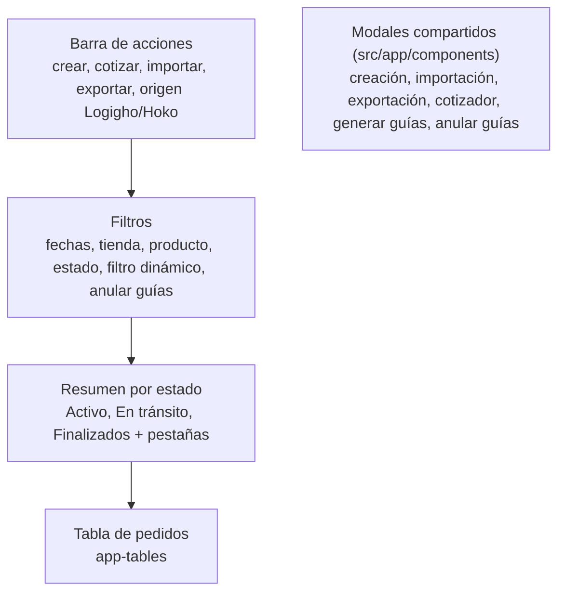

---

## Autor: Iker Acevedo

Fecha creacion: 2026-10-17
Estado: propuesta (pendiente de aprobación)
Tipo: ejemplo de migración (vista piloto)

# Ejemplo: migrar `tienda/pedidos`

`tienda/pedidos` es la vista piloto. Este documento muestra qué hay hoy, a dónde se mueve cada parte y en qué
orden, sin cambiar el comportamiento ni el backend.

## 1. Cómo está hoy (2026-10-17)

| Archivo | Tamaño | Contenido |
|---|---|---|
| `pedidos.component.ts` | 1.555 líneas | HTTP, descompresión, reglas, filtros, conteos, exportación CSV, permisos por rol, estado de modales |
| `pedidos.component.html` | 23 KB | Toda la vista |
| `pedidos.component.scss` | 22 KB | 82 colores hexadecimales |
| `data-processor.worker.ts` | 3 KB | Descomprime Zstd y oculta campos de costos según el rol |
| `estado.enum.ts` | — | `Activo`, `enTransito`, `finalizados` |

La vista tiene cuatro bloques visuales y usa modales que ya son componentes compartidos:



## 2. A dónde va cada parte

| Hoy en `pedidos.component.ts` | Destino |
|---|---|
| `fetchTableData`, `fetchTableDataTienda`, `fetchTableDataCarga`, `buildUrl`, `processWithWorker` y el worker | `repository/` |
| `generateColumns`, `generateRows`, `extractProducts`, `extractTransport`, `extractEstados`, `extractTiendas`, `matchEstado`, formato de moneda de `processData` | `helpers/pedidos.reglas.ts` |
| `getCountByStatus`, `getCountByCategory`, `getPercentageByCategory`, `getCountByStatuses`, `getPercentage` | `helpers/` + `computed` en el store (hoy se recalculan en cada detección de cambios) |
| `applyFilters`, `filterGeneric`, `filterRowsDate`, `onDateRangeChange`, `handleFilter`, `filterStatus`, `selectTab`, `selectStatus` | Acción en el facade, cálculo en `helpers/`, estado en el store |
| `exportToCSV`, `exportToCSV_New` | `facade.exportar()` + armado del CSV en `helpers/` (se unifican en una sola versión) |
| `canAnularGuias`, `showLogighoButton`, `showHokoButton`, `rolesAsignados` | `facade.permisos()`, calculado en un solo archivo (`helpers/pedidos.permisos.ts`) mientras el backend no los entregue |
| `showButtons` / `hideButtons` (origen Interrapidísimo / Hoko) | `facade.cambiarOrigen(origen)` |
| `open*Modal`, `close*Modal`, `toggle*Dropdown`, `onDocumentClick`, `isToday` | La versión visual (estado solo visual) |

## 3. Estructura final

```
views/tienda/pedidos/
├── pedidos.page.ts
├── pedidos.experiencias.ts
├── models/pedidos.models.ts               # Pedido, FiltrosPedidos, ResumenEstados, PermisosPedidos, OrigenPedidos
├── repository/
│   ├── pedidos.repository.ts
│   └── data-processor.worker.ts
├── state/
│   ├── pedidos.store.ts
│   ├── pedidos.facade.ts
│   └── pedidos.facade.spec.ts
├── helpers/
│   ├── pedidos.reglas.ts
│   ├── pedidos.reglas.spec.ts
│   └── pedidos.permisos.ts
└── experiencias/
    ├── clasica/                           # Lo de hoy, movido sin cambios visuales
    │   ├── pedidos-clasica.component.*
    │   └── partes/                        # barra de acciones, filtros, resumen por estado
    └── <experiencia-b>/                   # Cuando exista su diseño
```

## 4. El facade de pedidos

```ts
@Injectable()
export class PedidosFacade {
  private readonly repository = inject(PedidosRepository);
  private readonly store = inject(PedidosStore);

  readonly cargando = this.store.cargando;
  readonly error = this.store.error;
  readonly origen = this.store.origen;              // 'Interrapidisimo' | 'Hoko'
  readonly columnas = this.store.columnas;
  readonly filas = this.store.filasVisibles;        // computed: filas + filtros + estado seleccionado
  readonly resumen = this.store.resumenPorEstado;   // computed: conteos y porcentajes
  readonly opciones = this.store.opcionesFiltro;    // tiendas, productos, estados, transportadoras
  readonly filtros = this.store.filtros;
  readonly permisos = this.store.permisos;          // { anularGuias, verCostos, origenLogigho, origenHoko }

  async iniciar(): Promise<void> {
    this.store.setPermisos(permisosPedidos());
    await this.cambiarOrigen('Interrapidisimo');
  }

  async cambiarOrigen(origen: OrigenPedidos): Promise<void> {
    this.store.setCargando(true);
    try {
      const [pedidos, tiendas] = await Promise.all([
        this.repository.consultarPedidos(origen),
        this.repository.consultarTiendas(origen),
      ]);
      this.store.setDatos(origen, pedidos, tiendas);
    } catch {
      this.store.setError('No se pudieron obtener los pedidos.');
    } finally {
      this.store.setCargando(false);
    }
  }

  aplicarFiltros(cambio: Partial<FiltrosPedidos>): void {
    this.store.setFiltros(cambio);
  }

  seleccionarEstado(estado: EstadoPedido | null): void {
    this.store.setEstadoSeleccionado(estado);
  }

  exportar(): void {
    descargarArchivo(armarCsvPedidos(this.filas(), this.columnas()), 'pedidos.csv');
  }
}
```

Todas las experiencias usan exactamente este facade. Lo único que cambia entre ellas es el HTML, el SCSS y el UI kit:

=== "Clásica"

    ```html
    <!-- experiencias/clasica/pedidos-clasica.component.html (fragmento) -->
    <c-card class="mb-4">
      <c-card-body>
        <app-pedidos-clasica-resumen
          [resumen]="pedidos.resumen()"
          (estadoSeleccionado)="pedidos.seleccionarEstado($event)" />
        <app-tables [columns]="pedidos.columnas()" [rows]="pedidos.filas()" />
      </c-card-body>
    </c-card>
    ```

=== "Otra experiencia (ilustrativo)"

    ```html
    <!-- experiencias/<experiencia-b>/pedidos-<experiencia-b>.component.html (fragmento) -->
    <section class="pedidos">
      <app-b-indicadores [items]="pedidos.resumen()" (seleccion)="pedidos.seleccionarEstado($event)" />
      <app-b-panel-filtros [opciones]="pedidos.opciones()" (cambio)="pedidos.aplicarFiltros($event)" />
      <app-b-tabla [columnas]="pedidos.columnas()" [filas]="pedidos.filas()" />
    </section>
    ```

## 5. Migración en PRs pequeños

Ninguno de estos PRs cambia lo que ve el usuario.

| PR | Qué hace | Riesgo | Cómo se valida |
|---|---|---|---|
| 1 | `helpers/pedidos.reglas.ts` con pruebas; el componente las llama | Bajo | Pruebas + la vista se ve igual |
| 2 | `repository/` y mover el worker | Bajo | Mismas peticiones en la pestaña Network |
| 3 | `store` + `facade` + `pedidos.permisos.ts`; el componente usa solo el facade | Medio | Pruebas del facade + recorrido de filtros, estados, exportar y anular |
| 4 | `pedidos.page.ts` + `pedidos.experiencias.ts`; mover el componente a `experiencias/clasica/` | Bajo | Pantallazos idénticos |
| 5 | Tokens en `experiencias/clasica/` | Bajo | Pantallazos idénticos |

Cuando exista el diseño de otra experiencia, su versión de pedidos es un PR más que solo agrega una carpeta y una
línea en `pedidos.experiencias.ts`.

## 6. Seguridad en esta vista

| Hoy (observado en código) | Objetivo |
|---|---|
| La tienda consultada sale de `sessionStorage` y viaja como parámetro `Tienda` | El backend obtiene las tiendas del usuario a partir del token, como `APILambdaConsultarPedidos` con `UsuarioTienda` |
| Los costos (`TotalFlete`, `TotalServicio`, `TotalSobreflete`) llegan al navegador y el worker los oculta según el rol | El backend no envía campos que el usuario no puede ver |
| Permisos decididos con nombres de rol en el componente | Primero un solo archivo (`pedidos.permisos.ts`); después, permisos entregados por el backend |

Este cambio de backend se trabaja en la línea de seguridad y **solo toca `pedidos.repository.ts`**.

## Historial de cambios

| Fecha | Autor | Cambio |
|---|---|---|
| 2026-10-17 | Iker Acevedo | Creación de la propuesta |
