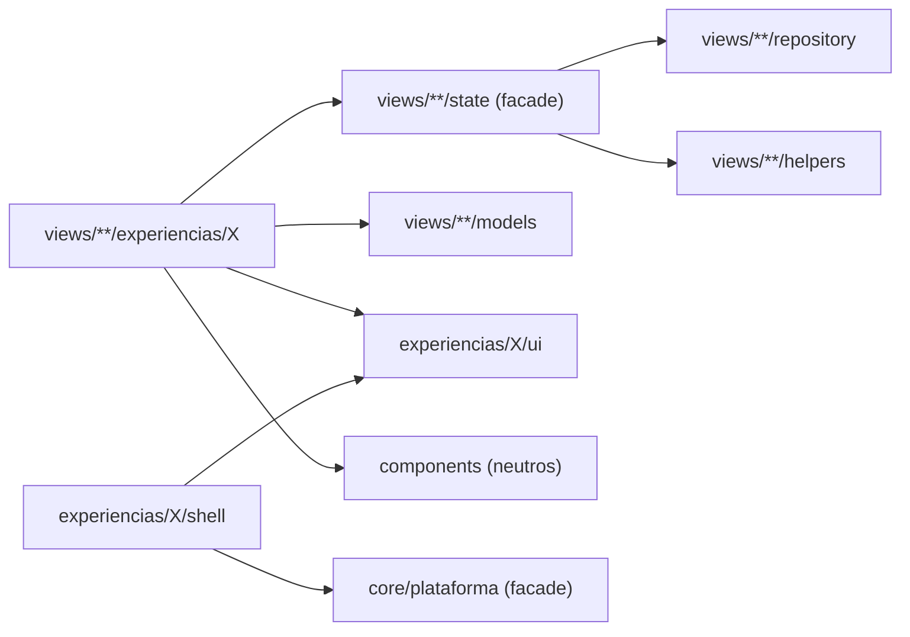

---

## Autor: Iker Acevedo

Fecha creacion: 2026-10-17
Estado: propuesta (pendiente de aprobación)
Tipo: estándar obligatorio

# Estructura del proyecto

## Árbol general

```
src/app/
├── core/
│   ├── experiencias/                     # Motor del sistema (se construye una vez)
│   │   ├── experiencias.models.ts        # ExperienciaDef, VersionesVista, tipos
│   │   ├── experiencias.registro.ts      # Lista de todas las experiencias
│   │   ├── experiencia-activa.store.ts   # Experiencia del usuario + respaldo
│   │   ├── version-activa.ts             # Resuelve qué versión de una vista se monta
│   │   └── shell-host.component.ts       # Monta el shell de la experiencia activa
│   ├── plataforma/                       # Cerebro del shell (compartido por todas las experiencias)
│   │   ├── plataforma.facade.ts          # Usuario, menú permitido, alertas, cerrar sesión
│   │   ├── plataforma.store.ts
│   │   └── plataforma.repository.ts
│   └── application/ ...                  # Servicios existentes (se mantienen)
│
├── experiencias/                         # Todo lo exclusivo de cada experiencia
│   ├── clasica/
│   │   ├── clasica.experiencia.ts        # Definición: id, nombre, estado, shell, organizador de menú
│   │   ├── shell/                        # Hoy: default-layout, header, sidebar, footer
│   │   ├── navegacion/organizar-menu.ts  # Cómo acomoda el menú (función pura)
│   │   ├── estilos/_tokens.scss          # Valores de los tokens para esta experiencia
│   │   └── ui/                           # UI kit: botón, tarjeta, tabla, modal... de esta experiencia
│   └── <otra-experiencia>/               # Misma estructura
│
├── components/                           # Componentes compartidos existentes (neutros, usan tokens)
│
└── views/<dominio>/<vista>/
    ├── <vista>.page.ts                   # Host de la ruta: crea el cerebro y monta la versión
    ├── <vista>.experiencias.ts           # Qué experiencias tienen versión de esta vista
    ├── models/<vista>.models.ts
    ├── repository/<vista>.repository.ts  # Único archivo que llama al API
    ├── state/
    │   ├── <vista>.store.ts              # Estado en signals
    │   └── <vista>.facade.ts             # Única puerta para las versiones visuales
    ├── helpers/<vista>.reglas.ts         # Funciones puras + .spec.ts
    └── experiencias/
        ├── clasica/                      # Obligatoria
        │   ├── <vista>-clasica.component.ts
        │   ├── <vista>-clasica.component.html
        │   ├── <vista>-clasica.component.scss
        │   └── partes/                   # Subcomponentes propios de esta versión (opcional)
        └── <otra-experiencia>/
```

Los nombres `repository/`, `state/`, `models/` y `helpers/` ya se usan en el proyecto (`gestion-cuentas`,
`ingreso-devoluciones`); se mantienen.

## Responsabilidades

| Carpeta | Hace | No puede |
|---|---|---|
| `core/experiencias/` | Registrar experiencias, resolver la activa, montar shell y versiones | Conocer vistas concretas |
| `core/plataforma/` | Datos del usuario, menú permitido, alertas globales | Tener HTML o estilos |
| `experiencias/<id>/` | Shell, organizador de menú, tokens y UI kit de esa experiencia | Lógica de negocio, HTTP, importar otra experiencia |
| `views/**/repository/` | HTTP y conversión de respuestas a modelos | Estado, mensajes, HTML |
| `views/**/state/` | Estado (store) y acciones/lecturas (facade); permisos de la vista | DOM, saber qué experiencia está activa |
| `views/**/helpers/` | Reglas puras | Importar Angular, `sessionStorage`, HTTP |
| `views/**/experiencias/<id>/` | Pintar la vista en esa experiencia; estado solo visual | Ver [Crear una vista, sección 6](crear-vista.md#6-prohibiciones-en-una-version-visual) |

## Quién puede importar a quién



| Desde | Puede importar | Nunca importa |
|---|---|---|
| `views/**/experiencias/X/` | facade y models de su vista, `experiencias/X/ui`, `components/` | `repository/`, `store`, `HttpClient`, otra experiencia |
| `views/**/state`, `repository`, `helpers`, `models` | Entre ellos y `core/` | Nada de `experiencias/` |
| `experiencias/X/` | `core/plataforma`, `core/experiencias`, su propio `ui/` | Otra experiencia, `views/` |
| `core/` | `core/` | `views/`; `experiencias/` solo desde `experiencias.registro.ts` con `import()` diferido |

Estas reglas se hacen cumplir con ESLint (`no-restricted-imports` por carpeta). Un PR que las rompa no pasa CI.

## Nombres

| Elemento | Formato | Ejemplo |
|---|---|---|
| Id de experiencia | kebab-case, nombre de negocio estable | `clasica` |
| Clave de vista | `<dominio>.<vista>` | `tienda.pedidos` |
| Versión de vista | `<Vista><Experiencia>Component` en `<vista>-<experiencia>.component.ts` | `PedidosClasicaComponent` |
| Selector | `app-<vista>-<experiencia>` | `app-pedidos-clasica` |
| Página | `<Vista>Page` en `<vista>.page.ts` | `PedidosPage` |
| Shell | `Shell<Experiencia>Component` | `ShellClasicaComponent` |
| Componente del UI kit | `app-<experiencia>-<pieza>` | `app-clasica-boton` |

Los ids de experiencia y las claves de vista se guardan en la base de datos: **no se renombran**.

## Historial de cambios

| Fecha | Autor | Cambio |
|---|---|---|
| 2026-10-17 | Iker Acevedo | Creación de la propuesta |
