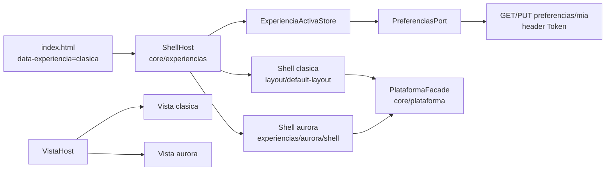

---

## Autor: Iker Acevedo

Fecha creacion: 2026-11-24
Estado: implementado en la rama `feature/sistema-experiencias` del front (pendiente de PR a `preprod`)
Tipo: guía de implementación

# Motor de experiencias y experiencia «Aurora»

Esta página describe **lo que quedó construido** en el front (`Angular_SitioLogiGho`). El estándar original está en
[Sistema de Experiencias](index.md); donde la implementación se apartó de esa propuesta, manda esta página (sección
«Diferencias con la propuesta»).

## Qué existe

| Experiencia | Id | Estado | Qué es |
|---|---|---|---|
| Clásica | `clasica` | general | La plataforma actual (La Red, noche y día). No cambia |
| Aurora | `aurora` | borrador | Paleta verde lima, negro y blanco, Montserrat, header claro, riel de 7 iconos con panel, pedidos con etapas, tabla de filas altas |

El usuario cambia de experiencia con el selector **Experiencia** del header. El cambio no recarga la página y
conserva la URL. El selector solo aparece si el servidor le ofrece más de una experiencia.

## Cómo funciona



1. `index.html` pone `data-experiencia="clasica"` antes del primer pintado.
2. `ShellHostComponent` (ruta raíz autenticada) pide la preferencia al servidor. **Gana el servidor.** Si la API
   falla, tarda más de 5 s, responde 401 o devuelve un id que el front no conoce, se usa `clasica` sin mensajes y
   sin cerrar la sesión.
3. Nadie ve un shell distinto de `clasica` hasta que el servidor lo confirma (carga neutra de hasta 3 s para quien
   tenía otra experiencia guardada en el navegador).
4. El host monta el shell de la experiencia (carga diferida) y pone `data-experiencia` en `<html>`. Quien usa
   `clasica` no descarga el código de `aurora`.
5. Una vista con versiones usa `VistaHostComponent` con `data.versiones` en su ruta. Sin versión para la
   experiencia activa se pinta la de `clasica`.
6. Al cerrar sesión se reinicia el estado (menú, saldo, experiencia).

En `localStorage` solo se guarda el id de la experiencia (`lg-experiencia`).

## Dónde está cada cosa

```
src/app/core/experiencias/        motor: registro, store, puerto y adaptadores, ShellHost, VistaHost, selector, aviso
src/app/core/plataforma/          datos del shell: PlataformaFacade, menú, acceso, alerta de tiendas, saldo de billetera
src/app/experiencias/clasica/     definición (apunta a layout/default-layout)
src/app/experiencias/aurora/
├── aurora.experiencia.ts         definición (modoBase: 'dia')
├── shell/                        cabecera, riel, panel
├── navegacion/                   riel-aurora.config.ts (los 7 grupos) y organizar-menu-aurora.ts (función pura)
└── estilos/                      _tokens.scss (único archivo con hex), _global.scss, _vistas*.scss, README.md
src/app/views/<dominio>/<vista>/experiencias/aurora/   versión aurora de una vista
src/scss/_experiencias.scss       @use de los estilos de cada experiencia
scripts/verificar-arquitectura.mjs  reglas de dependencias (npm run test:arquitectura)
```

Vistas con versión `aurora` hoy: `tienda/pedidos`, `dropshipping/productos`, `dropshipping/proveedores`. Las demás
se recolorean con los tokens.

## Reglas obligatorias

1. **Una experiencia solo pinta.** Shells y versiones de vista no hacen HTTP, no leen `localStorage` ni
   `sessionStorage` y no deciden permisos. Los datos llegan por `PlataformaFacade` y `ExperienciaActivaStore`.
2. **Permisos:** una experiencia nunca muestra un módulo, enlace, acción, columna o dato que el usuario no tenga
   permitido o que la vista clásica le oculte. El riel se arma solo con el menú ya filtrado por roles.
3. **Dependencias en un solo sentido:** `core` no importa de `experiencias/<id>` (salvo el registro); una
   experiencia no importa de otra ni de `layout/`. Lo verifica `npm run test:arquitectura`.
4. **Estilos:** los colores fijos viven solo en `experiencias/<id>/estilos/_tokens.scss`; todo selector global de
   una experiencia empieza por `:root[data-experiencia='<id>']`; sin `::ng-deep` nuevo; `!important` solo
   documentado en el README de estilos.
5. **`clasica` no cambia.** `data-experiencia='clasica'` no tiene reglas CSS.
6. **Pruebas:** toda función de reglas es pura y lleva pruebas de tabla; cada defecto corregido deja su prueba.

## Tokens

Los tokens semánticos son los `--lg-*` de `src/scss/lared/_tokens.scss`. Una experiencia los redefine con sus
valores; así recolorea todas las vistas sin tocarlas.

Paleta de Aurora (decisión de Iker, 2026-11-24): verde lima `#44cc17`, negro y blanco.

| Uso | Color |
|---|---|
| Acción principal, activos y seleccionados | Fondo lima, texto e iconos blancos (negrita, ≥ 13 px) |
| Acción secundaria fuerte, grupo activo del riel, cabecera de panel | Fondo negro, texto e iconos blancos |
| Acción terciaria | Blanca con borde |
| Texto verde sobre blanco | Verde oscuro `#246b0d` |
| Iconos de filtros y de pasos | Lima |
| Peligro y avisos | Rojo y ámbar |

El negro solo se combina con blanco. El blanco sobre lima queda por debajo del contraste AA (2,1:1): es una
decisión de producto registrada; se cambia en `_tokens.scss`.

## El riel de Aurora

Siete grupos fijos, definidos en `experiencias/aurora/navegacion/riel-aurora.config.ts`:

| # | Grupo | Contenido |
|---|---|---|
| 1 | Dashboard | Enlace a `/app/tienda/dashboard` |
| 2 | Productos | Portafolio, Proveedores, Productos, Catálogo Compartido |
| 3 | Operación | Pedidos, Flujo de guías, Relación de despacho, Novedades, Información de guías, Inventario, Bodegas |
| 4 | Analítica | El módulo padre de analítica |
| 5 | Exportación de datos | Enlace a `/app/export-data` |
| 6 | Billetera | Saldo disponible (suma del saldo actual de las tiendas asignadas) y «Balance y Movimientos» |
| 7 | Otros | Buscador (Ctrl/⌘+B) y el resto de módulos por módulo padre |

Un grupo sin módulos permitidos no se pinta. Las pruebas exigen que el conjunto de módulos alcanzables desde el
riel sea exactamente el del menú del usuario. En pantallas de hasta 768 px el riel es una barra inferior y el panel
sale como hoja.

## Cómo agregar una versión de vista

1. Crea `views/<dominio>/<vista>/experiencias/aurora/` con un componente delgado que extienda el clásico
   (`extends`) y tenga plantilla y SCSS propios. No copies lógica.
2. En el archivo de rutas, la ruta usa `VistaHostComponent` con
   `data: { versiones: { clasica: () => import(...), aurora: () => import(...) } }`.
3. Pruebas: la ruta con `clasica` resuelve al componente de hoy; la versión aurora pinta los mismos datos y
   muestra las mismas acciones por rol que la clásica.
4. Estilos solo con tokens.

## Cómo agregar una experiencia

1. Carpeta `experiencias/<id>/` con `<id>.experiencia.ts`, `shell/`, `estilos/_tokens.scss`.
2. Una línea en `core/experiencias/experiencias.registro.ts`.
3. Un `@use` en `src/scss/_experiencias.scss`.
4. Registrarla en el servidor con `POST /experiencias` en estado `borrador` (ver [API de experiencias](../../api/experiencias.md)).

Si hace falta tocar el motor, el motor está mal: se corrige el motor.

## Cómo probar en local

`ng serve` usa PreProd. Para ver Aurora sin registrarla en el servidor, activa temporalmente
`preferenciasLocales: true` en `src/environments/environment.preprod.ts` (en producción, además
`experienciasInternas: true` en `environment.ts`). **No se sube:** una prueba falla si esas banderas quedan activas.

## Diferencias con la propuesta

| Propuesta (2026-10-17) | Implementado |
|---|---|
| Lista nueva de tokens semánticos | Se usan los `--lg-*` del rediseño La Red |
| Error al leer la preferencia: «se queda como está» | Error, timeout o 401 → `clasica` |
| Aplicar la experiencia guardada antes de la respuesta del servidor | Se espera la confirmación del servidor (hasta 3 s) |
| `tienda/pedidos` con repository + store + facade | La versión aurora hereda del componente clásico (pendiente M-396) |
| ESLint y Stylelint en CI | Pendiente (M-395); existe `npm run test:arquitectura` |
| Selector como botón flotante | Selector en el header |

## Pendientes

- Vistas con colores fijos propios que Aurora no recolorea (métricas del muro, perfil de tienda, publicaciones).
- Reglas de arquitectura y de estilos en el pipeline de CI.
- Modo oscuro de Aurora.
- Panel de administración de experiencias en el front.

## Historial de cambios

| Fecha | Autor | Cambio |
|---|---|---|
| 2026-11-24 | Iker Acevedo | Creación: motor y experiencia Aurora implementados en `feature/sistema-experiencias` |
