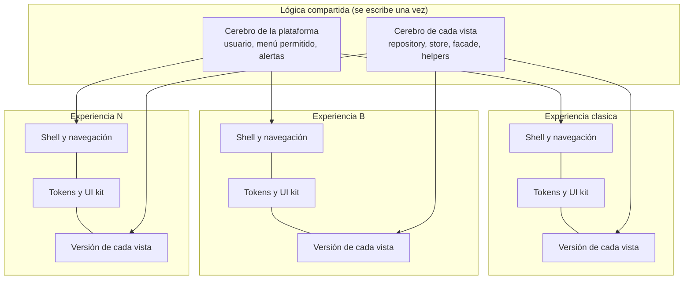

---

## Autor: Iker Acevedo

Fecha creacion: 2026-10-17
Estado: propuesta (pendiente de aprobación)
Tipo: estándar de arquitectura frontend

# Sistema de Experiencias

!!! warning "Estado: propuesta"
    Este estándar todavía no está aprobado ni implementado. Cuando se apruebe, el estado de este documento y del
    [ADR-001](adr/ADR-001-sistema-experiencias.md) cambia a **Aceptada** y pasa a ser obligatorio para todo el
    equipo frontend.

## Qué es

LogiGho va a tener **varias experiencias**. Una experiencia es un frontend visual completo: cómo se organiza la
barra de navegación, dónde quedan los botones, cómo se ven las tablas y tarjetas, qué colores y tipografía usa.
Para el usuario es como usar otra aplicación.

Todas las experiencias comparten **la misma lógica, las mismas rutas, los mismos permisos y el mismo backend**.
Lo único que cambia es lo visual.

> **Regla de oro:** la lógica se escribe una vez; cada experiencia solo pinta.

El usuario elige su experiencia y toda la plataforma cambia. Hoy existe una sola, `clasica` (la plataforma
actual). Se espera tener al menos tres y agregar más con el tiempo.

## Por qué este nombre

**Experiencia** describe lo que de verdad cambia: la experiencia de usuario completa (UX y UI), no solo los
colores. Se descartaron "tema" (en el equipo y en las librerías significa solo colores), "interfaz" (choca con
`interface` de TypeScript) y "skin" (sugiere un cambio superficial).

## Cómo está organizado

Cada experiencia aporta cuatro cosas:

| Pieza | Qué es | Dónde vive |
|---|---|---|
| **Shell** | El marco: barra de navegación, header, botones globales, footer | `src/app/experiencias/<id>/shell/` |
| **Organizador de menú** | Cómo acomoda los módulos que el usuario tiene permitidos | `src/app/experiencias/<id>/navegacion/` |
| **Tokens y UI kit** | Colores, tipografía, espacios y componentes base (botón, tarjeta, tabla) | `src/app/experiencias/<id>/estilos/` y `ui/` |
| **Versiones de vistas** | Cómo se ve cada vista en esta experiencia | `src/app/views/<dominio>/<vista>/experiencias/<id>/` |

## Qué ve el usuario

1. Inicia sesión. La plataforma carga la experiencia que tiene guardada (o `clasica` si nunca eligió).
2. Desde el selector de experiencia, elige otra.
3. La plataforma cambia de shell, menú, estilos y vistas, sin recargar el navegador y sin cambiar de URL.
4. Si una vista todavía no tiene versión para esa experiencia, se muestra la versión `clasica` con los colores de
   la experiencia elegida. A esto se le llama **respaldo**.
5. Su elección se guarda en el servidor: la encuentra igual en cualquier dispositivo.

Las reglas completas están en [Reglas de cambio entre experiencias](reglas-de-cambio.md).

## Glosario

| Término | Significado |
|---|---|
| **Experiencia** | Frontend visual completo. Id en kebab-case: `clasica`, `<nombre-de-negocio>` |
| **Shell** | Marco visual de una experiencia (navegación, header, footer, botones globales) |
| **Cerebro** | Lógica compartida: `repository`, `store`, `facade`, `helpers` |
| **Facade** | Única puerta que usan las versiones visuales para leer datos y ejecutar acciones |
| **Versión de vista** | Carpeta `experiencias/<id>/` dentro de una vista |
| **Respaldo** | Usar la versión `clasica` cuando la vista no tiene versión para la experiencia activa |
| **Clave de vista** | Identificador estable de la vista: `<dominio>.<vista>` (ej.: `tienda.pedidos`) |
| **Token** | Variable CSS con significado (`--lg-color-primario`), definida por cada experiencia |
| **Cobertura** | Qué vistas tienen versión propia en cada experiencia |

## Documentos

| Documento | Para qué |
|---|---|
| [ADR-001](adr/ADR-001-sistema-experiencias.md) | Por qué se eligió esta arquitectura |
| [Estructura del proyecto](estructura-proyecto.md) | Carpetas, responsabilidades y quién puede importar a quién |
| [Crear una vista](crear-vista.md) | Estándar obligatorio para toda vista nueva |
| [Crear una experiencia](crear-experiencia.md) | Cómo nace, se publica y se retira una experiencia |
| [Reglas de cambio entre experiencias](reglas-de-cambio.md) | Selección, respaldo, persistencia y ciclo de vida |
| [Tokens y estilos](tokens-y-estilos.md) | Cómo se escriben los estilos |
| [Seguridad por diseño](seguridad-por-diseno.md) | Reglas de seguridad obligatorias para todo lo nuevo |
| [Buenas prácticas: sí y no](buenas-practicas.md) | Lista corta para revisar PRs |
| [Migración de vistas existentes](migracion-vistas.md) | Cómo llevar vistas viejas al sistema, poco a poco |
| [Ejemplo: tienda/pedidos](ejemplo-tienda-pedidos.md) | La vista piloto, paso a paso |
| [Plan de implementación](plan-implementacion.md) | Fases para construir la base |
| [Plantilla de vista](../../plantillas/PLANTILLA-VISTA-EXPERIENCIAS.md) | Ficha de documentación de cada vista |

## Historial de cambios

| Fecha | Autor | Cambio |
|---|---|---|
| 2026-10-17 | Iker Acevedo | Creación de la propuesta |
