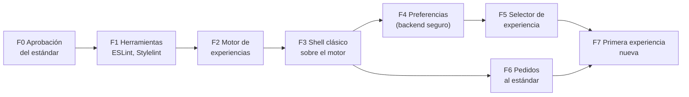

---

## Autor: Iker Acevedo

Fecha creacion: 2026-10-17
Estado: propuesta (pendiente de aprobación)
Tipo: plan de implementación

# Plan de implementación

Plan para construir la **base** del Sistema de Experiencias y migrar la primera vista. No se migra todo de una vez:
cada fase deja la plataforma funcionando igual que antes y se puede detener sin dejar nada a medias.

## Criterios

- **Sin cambio visual** hasta que exista una segunda experiencia y el usuario la elija.
- **Seguro desde el inicio:** todo lo nuevo cumple [Seguridad por diseño](seguridad-por-diseno.md).
- **Reutilizar lo que existe:** paleta `--logigho-*`, patrón Repository + Store, módulo Terraform
  `datos-reportes-analytics`, authorizers Cognito.
- **No construir lo que todavía no se necesita** (ver el final).
- Todo pasa por PreProd. Producción solo con instrucción explícita de Iker.

## Relación con la línea de seguridad

La corrección de la seguridad existente (rutas sin autorización, CRUD genérico, roles IAM) se trabaja en **otra
línea de trabajo**. Este plan solo exige que lo **nuevo** nazca seguro. Cuando la línea de seguridad cambie un
endpoint que usa una vista migrada, el cambio toca solo el `repository` de esa vista.

## Fases

### F0. Aprobación del estándar

| Tarea | Responsable |
|---|---|
| Revisar y aprobar esta sección de documentación | Iker |
| Resolver las decisiones pendientes (al final de este documento) | Iker |
| Cambiar el estado de los documentos y del ADR a **Aceptada** | Equipo |

### F1. Herramientas que hacen cumplir las reglas

| Tarea | Detalle |
|---|---|
| ESLint con `angular-eslint` | Reglas de dependencias por carpeta (`no-restricted-imports`), según [Estructura del proyecto](estructura-proyecto.md#quien-puede-importar-a-quien) |
| Stylelint | `color-no-hex`, `declaration-no-important`; activo solo en `experiencias/**`, `views/**/experiencias/**` y archivos nuevos |
| Alias de TypeScript | `@core/*` para importar el motor sin rutas relativas largas |
| CI del frontend | Lint y pruebas en el pipeline existente (`azure-pipelines-ci.yml`) |

**Listo cuando:** el pipeline corre lint y pruebas, y el código actual pasa (las reglas nuevas solo aplican a carpetas nuevas).

### F2. Motor de experiencias

| Archivo | Contenido |
|---|---|
| `core/experiencias/experiencias.models.ts` | `ExperienciaDef`, `VersionesVista`, `EstadoExperiencia`, `CargadorComponente` |
| `core/experiencias/experiencias.registro.ts` | `EXPERIENCIAS` (por ahora solo `clasica`) y el tipo `ExperienciaId` |
| `core/experiencias/experiencia-activa.store.ts` | Experiencia activa, respaldo y reglas R4, R6 y R7. Versión temporal con `localStorage` (solo el id) |
| `core/experiencias/version-activa.ts` | `versionActiva(registro)` con respaldo a `clasica` |
| `core/experiencias/shell-host.component.ts` | Monta el shell de la experiencia activa y pone `data-experiencia` en `<html>` |
| `core/experiencias/tokens-semanticos.ts` + prueba | Lista oficial de tokens y validación por experiencia |
| `experiencias/clasica/estilos/_tokens.scss` | Tokens con los valores visuales actuales |

Incluye una **prueba de concepto** temprana: un `<router-outlet>` dentro de un shell montado de forma dinámica,
y el cambio de shell manteniendo la URL. Si la prueba falla, se ajusta el diseño antes de seguir.

**Listo cuando:** el motor tiene pruebas y la plataforma se ve igual.

### F3. Shell clásico sobre el motor

| Tarea | Detalle |
|---|---|
| Extraer el cerebro del layout | Lo que hoy hace `default-layout.component.ts` (usuario, módulos, alerta de tiendas inactivas, validación de rutas) pasa a `core/plataforma/` (facade, store, repository) |
| Organizador de menú | `buildNavItems()` pasa a `experiencias/clasica/navegacion/organizar-menu.ts`, función pura con pruebas |
| Mover el shell | `layout/default-layout` pasa a `experiencias/clasica/shell/` y solo usa `PlataformaFacade` |
| Ruta | El layout de la ruta raíz pasa a ser `ShellHostComponent` |

**Listo cuando:** pantallazos idénticos del shell en escritorio y celular; menú, buscador, alertas y accesos funcionan igual.

### F4. Preferencias del usuario (backend seguro)

| Elemento | Definición |
|---|---|
| Lambda | `ApiLambdaPreferenciasUsuario`, misma estructura que `ApiLambdaPublicarReporteAnalytics` (casos de uso, DI, pruebas) |
| Rutas | `GET /preferencias/mia` y `PUT /preferencias/mia` en el API REST, con authorizer Cognito (prod `7elgyten88`, authorizer `tvqga4`) |
| Identidad | `sub` del token validado |
| Colección | `PreferenciasUsuario`: `{ sub, experiencia, tema, version, actualizadoEn }`, índice único en `sub` |
| Disponibilidad (R7) | La Lambda conoce los ids permitidos y su estado por configuración (`clasica:general`, `<id>:beta`...) y rechaza ids desconocidos o no disponibles para el usuario |
| Validación | Campos cerrados, `experiencia` y `tema` en kebab-case con largo máximo, concurrencia por `version` |
| Infraestructura | Terraform: módulo basado en `datos-reportes-analytics`; rol IAM propio con acceso solo a `PreferenciasUsuario`; VPC en prod; logs sin tokens |
| Pruebas | Casos de uso con repositorio falso + pruebas de seguridad (B9) |

El store de la F2 cambia de `localStorage` al API sin que ninguna vista se entere.

**Listo cuando:** en PreProd un usuario guarda su experiencia y la encuentra en otro navegador; las pruebas de
seguridad pasan.

### F5. Selector de experiencia

| Tarea | Detalle |
|---|---|
| Botón flotante | El botón de WhatsApp de `clasica` pasa a ser un menú hacia arriba: "Experiencia", "Tema" (si aplica) y "Atención al cliente" |
| Comportamiento | Según [Reglas de cambio](reglas-de-cambio.md): confirmación si hay cambios sin guardar, guardar en el servidor, cambiar el shell sin recargar |
| Accesibilidad | Teclado, `Esc`, foco visible, `aria-expanded` |
| Visibilidad | La opción "Experiencia" aparece solo si el usuario tiene más de una disponible |

### F6. `tienda/pedidos` al estándar

PRs 1 a 5 del [ejemplo](ejemplo-tienda-pedidos.md#5-migracion-en-prs-pequenos). Puede avanzar en paralelo con F4 y F5.

### F7. Primera experiencia nueva

| Tarea | Detalle |
|---|---|
| Diseño | Negocio entrega el diseño completo: shell, navegación, UI kit y vista de pedidos |
| Construcción | Según [Crear una experiencia](crear-experiencia.md), con estado `borrador` |
| Versión de pedidos | `views/tienda/pedidos/experiencias/<id>/` |
| Publicación | `borrador` → `beta` → `general` |

Después de F7, cada experiencia y cada vista nueva siguen el mismo camino, y las vistas viejas se migran según la
[tabla de cobertura](migracion-vistas.md#cobertura).

## Qué no se hace (por ahora)

| Idea | Por qué no | Se retoma cuando |
|---|---|---|
| Elegir experiencia distinta por vista | Rompe la coherencia y multiplica combinaciones (R1) | Negocio lo pida con un caso concreto |
| Colores libres elegidos por el usuario | Exige validación de contraste y soporte | Las experiencias estén en uso |
| Catálogo de experiencias editable en BD | El registro en código se versiona y se revisa; el servidor solo valida ids | Haya que activar experiencias sin desplegar |
| Micro-frontends | Complejidad desproporcionada | Equipos separados por experiencia |
| Migrar todas las vistas | Riesgo alto; el respaldo lo hace innecesario | Nunca de una vez: vista por vista |
| RBAC y corrección de endpoints existentes | Es la línea de seguridad, en otra sesión | — |

## Decisiones pendientes

| Decisión | Opciones |
|---|---|
| URL base para rutas REST nuevas en PreProd | El frontend de PreProd usa la API HTTP `g3iz6qk3f0`. Agregar una URL base adicional solo para rutas REST nuevas, o migrar primero el frontend de PreProd al REST `8u5isw5u30` |
| Usuarios habilitados para `beta` | Por rol, por lista de usuarios o por tienda |
| Colores `#3d4fd6` y `#121b60` | Agregarlos a la paleta o unificarlos |
| Tema oscuro en `clasica` | Desde el inicio o después |
| Nombres de las nuevas experiencias | Los define negocio; el id no se cambia después |

## Historial de cambios

| Fecha | Autor | Cambio |
|---|---|---|
| 2026-10-17 | Iker Acevedo | Creación del plan |
